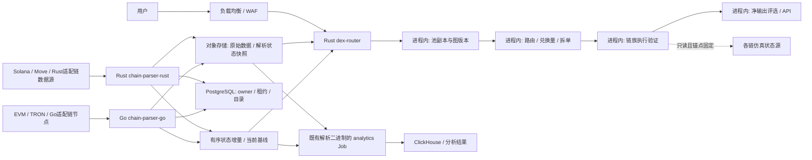
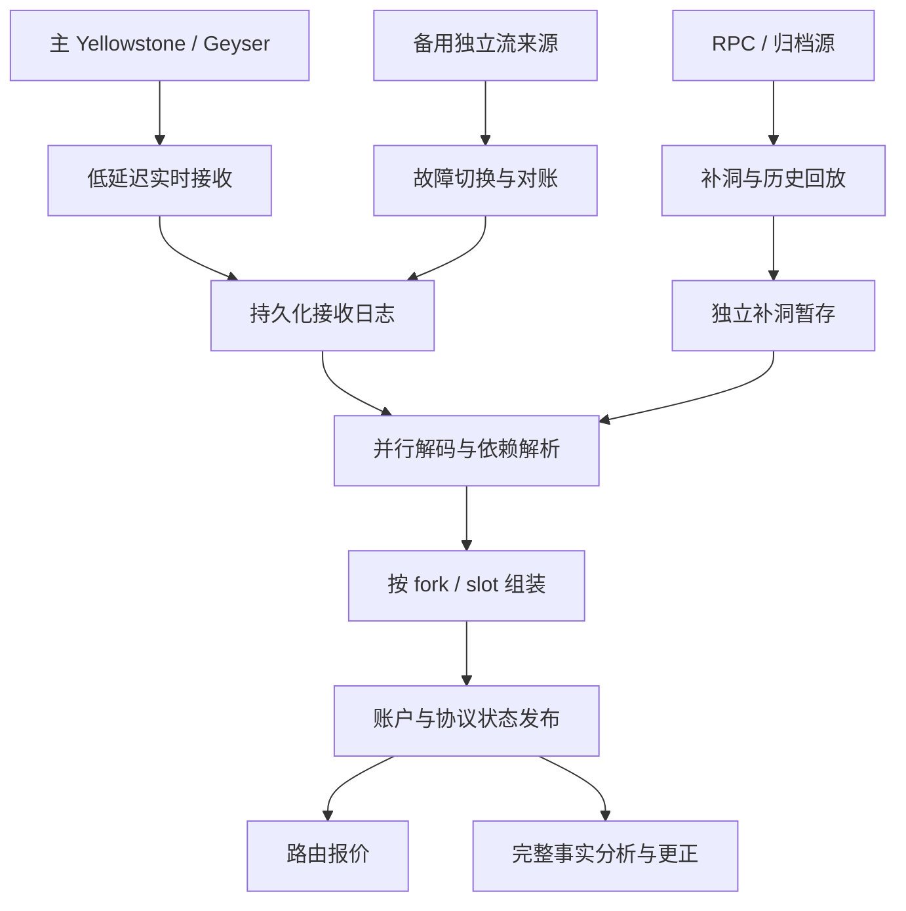
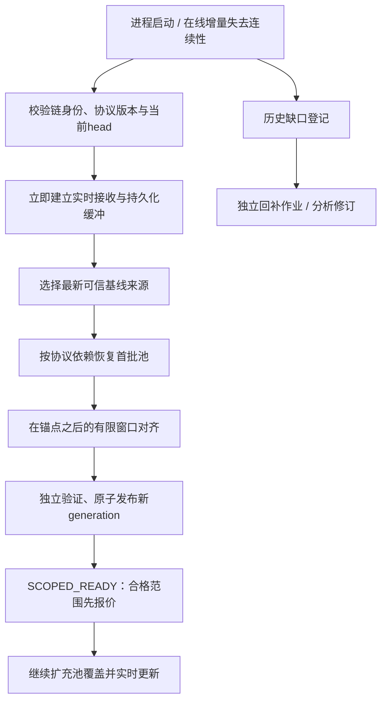

# Xone 多链 DEX 路由与区块分析系统：最终设计文档

> **版本：2.3（配置文件与完整日志规范审校版）｜日期：2026-10-25｜状态：设计与实施基线，尚未开发、部署或完成容量实测。**
>
> **目标：** 在多链上构建可追溯、可处理重组、报价可验证的DEX路由与区块分析系统。
>
> **固定服务边界：** 恰好三个核心服务类型：Go区块解析 `chain-parser-go`、Rust区块解析 `chain-parser-rust`、Rust兑换量计算 `dex-router`。`dex-router` 内部包含图的构建/更新/查询、协议报价数学、路由、拆单、执行验证和API。增加链通过两个解析服务内的适配器实现，不按链再新增核心服务；分析通过现有解析二进制的隔离作业模式运行。
>
> **强制启动规则：** 所有链默认 `HEAD_FIRST`，优先从最新可信基线恢复在线报价。历史游标、缺失旧块和分析回补不作为在线readiness前置；按合格协议/池范围先恢复，禁止混用旧状态制造假ready。
>
> 本文件集中包含架构、语言、链支持、Solana流式追块、启动恢复、高可用、性能、分析扩展及26个实施工作包。后续设计变更在本文件维护，避免多份设计互相覆盖。

## 阅读导航

- [1. 设计结论与约束](#1-设计结论与约束)
- [2. 业务范围、假设与质量目标](#2-业务范围假设与质量目标)
- [3. 支持链清单与能力等级](#3-支持链清单与能力等级)
- [4. 架构与服务规划](#4-架构与服务规划)
- [5. 语言与技术选型](#5-语言与技术选型)
- [6. 链族抽象与协议适配](#6-链族抽象与协议适配)
- [7. 区块采集、顺序日志与重组](#7-区块采集顺序日志与重组)
- [8. Solana实时流与持续追块](#8-solana实时流与持续追块)
- [9. HEAD_FIRST最新状态启动与历史独立补齐](#9-head_first最新状态启动与历史独立补齐)
- [10. 状态一致性、快照与缓存](#10-状态一致性快照与缓存)
- [11. 跨语言协议与数据模型](#11-跨语言协议与数据模型)
- [12. DEX数学模型与精确报价](#12-dex数学模型与精确报价)
- [13. 候选路由、拆单与成本优化](#13-候选路由拆单与成本优化)
- [14. 执行计划与独立交易仿真](#14-执行计划与独立交易仿真)
- [15. API与报价产品语义](#15-api与报价产品语义)
- [16. 区块分析扩展与历史修订](#16-区块分析扩展与历史修订)
- [17. 存储、消息与数据保留](#17-存储消息与数据保留)
- [18. 高可用、接管与灾备](#18-高可用接管与灾备)
- [19. 性能、资源调度与容量](#19-性能资源调度与容量)
- [20. 部署、环境与发布](#20-部署环境与发布)
- [21. 安全与资金边界](#21-安全与资金边界)
- [22. 监控、告警与运行手册](#22-监控告警与运行手册)
- [23. 测试、基准与上线验收](#23-测试基准与上线验收)
- [24. 实施阶段、迁移与排期](#24-实施阶段迁移与排期)
- [25. 仓库结构与研发规范](#25-仓库结构与研发规范)
- [26. 配置、接口与运行示例](#26-配置接口与运行示例)
- [27. 决策记录、风险与待确认项](#27-决策记录风险与待确认项)
- [28. 实施工作包与交付验收](#28-实施工作包与交付验收)
- [29. 一手资料与证据边界](#29-一手资料与证据边界)

## 1. 设计结论与约束

### 1.1 必须先确定的选择

| 主题 | 推荐选择 | 原因及边界 |
|---|---|---|
| 核心服务数量 | 固定3种：Go解析、Rust解析、Rust兑换量计算 | 副本/链分片/隔离Job可以增加实例，不增加核心服务类型 |
| 两个区块解析服务 | `chain-parser-go`（Go）与`chain-parser-rust`（Rust） | EVM/TRON/部分Cosmos放Go适配器；Solana/Sui/Aptos放Rust适配器，逐链验收 |
| `dex-router` | Rust | 将精确数学、候选搜索、求解与仿真放在同一计算核心 |
| 分析扩展 | 既有解析二进制的独立消费组/Job角色 | 使用隔离实例与资源；不作为第四种常驻核心服务 |
| API | 合并在 `dex-router` | 不为网关单独引入第三个业务服务 |
| 在线恢复依据 | 当前合格基线+基线后有限连续增量 | HEAD_FIRST；旧交易事实日志后台补齐，不以全历史重放阻塞报价 |
| 历史恢复依据 | Kafka canonical journal + 对象归档 | 历史事实与缺口可追溯，不冒充外部系统 exactly-once |
| 解析器状态库 | Go解析器Pebble；Rust解析器RocksDB | 两个解析器各自本地状态与WAL，非共享集群，主备各自独立副本 |
| 计算服务持久化 | dex-router默认内存池副本与图，本地KV可选 | 首版不强制第三份落盘；重启按HEAD_FIRST从当前基线恢复 |
| 状态分发 | 保留Kafka | 顺序、回放、解耦和多副本分发；不自研替代消息中间件 |
| 元数据/配置 | 保留PostgreSQL控制面 | 链配置、协议版本、owner/租约及审计；不逐账户更新同步写PG |
| 明细分析 | ClickHouse按规模启用，非报价首版必选 | 历史明细/聚合查询需要时部署，不参与报价ready |
| 图的唯一归属 | Rust `dex-router` 进程内的方向性多重图 | 两个解析服务不维护交易路由图，不提供选路/兑换量接口 |
| 状态一致性 | 区块提交屏障 + 不可变快照 | 所有报价显式绑定链、区块哈希与状态版本 |
| 正确性验证 | 原始合约/真实 calldata 差分与仿真 | 不用“同一错误公式执行两次”充当独立验证 |
| 性能原则 | 有界并发、预算、增量与局部更新 | 不用无限 goroutine/task 提高表面吞吐 |
| 启动原则 | HEAD_FIRST，每链/协议/池范围独立就绪 | 在线新鲜状态与历史完整性解耦，历史回补无在线写权限 |
| 运维原则 | 单地域多可用区起步 | 多地域先灾备，不能在分叉/版本未对齐时盲目跨地域接管 |
| 配置原则 | 所有运维/业务配置由版本化配置文件在启动时加载 | 统一ConfigProvider接口；首版文件源，未来配置中心复用同一schema，禁止隐式环境变量覆盖 |
| 日志原则 | 三服务统一结构化JSON、关联ID与状态版本 | 分级、脱敏、限流、轮转、集中检索与故障策略，日志不替代事实日志/审计证据 |

### 1.2 可压缩与不可压缩的边界

API、图、报价、求解和仿真固定在Rust `dex-router` 内，分别设置调度预算。Go/Rust两个解析服务各自将本链族采集与状态聚合放在同一二进制内，网络采集、历史回补和实时提交使用不同队列和资源预算。

不能因压缩服务而取消：区块版本、重组恢复、执行验证、消息幂等、背压、状态屏障和资金权限边界。

开发环境可以一条命令启动三种二进制。仅测试EVM时可不启动未用的Rust解析实例，但架构仍定义三种服务；不得把Solana解析合入`dex-router`，也不得为压进程数重新引入Go/Rust FFI混合进程。后续若调整服务边界必须形成新ADR并经明确批准，不能作为本文实施选项自行切换。

### 1.3 现有系统的复用和重写范围

复用候选：协议地址与 ABI、池发现规则、历史样本、区块读取和协议事件解析经验。复用前必须做许可证与正确性审查。

重写重点：全局状态版本、区块提交屏障、统一报价内核、金额安全类型、候选策略、拆单状态模型、仿真闭环和恢复协议。

已审查旧版本：`spicy/solana_pool_data` 的 `origin/dev`，提交 `ed818e29c65478b808ead9db7b7e311124317b30`。已复现多 V2 池手续费系数、Uint64 截断及余数报价不一致等问题。研究证据另见 `../research/dex-routing-20261024/analysis.md`；下列基线结论已在本文件明确，不依赖外部报告才能理解设计。旧代码不直接视为协议数学的可信基准。

### 1.4 本轮能力审查结论与上线判据

| 目标 | 当前设计判定 | 实现后必须提交的证据 |
|---|---|---|
| 多链DEX | 可通过两个解析服务适配器和一个Rust计算器承载 | chain+protocol+version能力矩阵及逐链数据/数学/执行验收，不能仅证明RPC可连 |
| 最佳兑换量 | 在明确状态、候选范围、成本和计算预算内寻找经验证最好方案 | 小图oracle、同状态协议差分、共享池/守恒、Gas后净输出与基线gap；不无条件宣称全市场全局最优 |
| 高可用 | 架构提供独立主备、Kafka、当前基线、状态/图视图与fencing | 进程/盘/节点/可用区/旧主故障演练，实测合格报价RTO与事实RPO |
| 卓越性能 | 现有预算、热路径、缓存和隔离提供实现基础，尚无实测证明 | 固定数据/硬件/负载的P50/P95/P99、净输出质量、峰值追块与故障后剩余容量，不通过减少校验或丢来源伪造更快 |
| 配置文件启动加载 | 本版补齐强制配置契约和配置中心扩展口 | 三服务同schema语义、配置前置校验、缺项/未知字段失败、版本/来源可追溯，业务参数不写死 |
| 完整日志 | 本版补齐统一事件模型和故障处理规则 | 跨Go/Rust/Kafka追踪、版本关联、敏感值扫描、队列/磁盘/采集器故障及检索演练 |

设计满足的是可实施的能力覆盖与验收约束，不代表系统已经运行、达到SLO或解决任意hook/未来区块的最优性。首发可以缩减链和协议数量，但不能缩减状态一致性、金额正确性、配置校验、日志故障可观测与独立执行验证。

### 1.5 旧系统已知错误与新系统验收基线

旧版已复现：多V2池批量费率系数反向（特定样本输出29而正确为9871）、大整数Uint64截断后除零、拆单余数仅改输入不重算输出。另有负流动性路径筛选、跨跳数平移成本和边际贪心适用条件等边界。新系统采用统一协议数学、明确整数舍入、输入守恒、快照版本和独立执行验证作为上线前置，不直接继承旧计算结果为正确答案。


## 2. 业务范围、假设与质量目标

### 2.1 首版业务

- EVM 多链区块/日志采集、池发现、池状态更新。
- ExactIn 报价先上线；ExactOut 通过独立测试门槛后开放。
- 按区块状态生成候选路径，支持有限的跨池和跨路径拆单。
- 返回输入、输出、费用、Gas、有效性、状态版本与执行计划。
- 对最终交易进行指定区块的完整仿真。
- 基础池/代币价格、Swap/流动性事件和历史回放分析。
- 同一链内部报价；不把桥接、CEX 余额或另一条链状态混入原子兑换结果。

### 2.2 扩展业务

- Solana AMM/CLMM、token extensions、程序升级与不同交易预算。
- 新 DEX、新 fee 模型、新 hook、稳定池与加权池。
- K 线、流动性、成交量、价差、钱包行为、资金流、事件规则等分析。
- 外部聚合器/RFQ 来源竞争；需要明确时效与执行限制。
- 可选交易执行服务；报价系统自身默认不保管私钥。
- 对 Sui 等对象模型、UTXO 链的采集分析，可通过链族适配器扩展；不承诺原 EVM AMM 模型自动通用。

### 2.3 初期架构假设

1. 先以一条EVM链跑通闭环，Solana数据源/快照/追块从P0并行研究。建议第一批覆盖Ethereum、Base、BSC、Solana、Arbitrum、OP Mainnet、Polygon PoS、Avalanche C-Chain共8条；第二批Sui、Aptos、HyperEVM、Unichain、Monad、TRON共6条，逐协议/能力验收，不等于现在已支持。
2. 使用自建节点与商业 RPC 的混合供应，不默认任一 RPC 无限制、无遗漏、无分叉。
3. 单个链有一个规范化提交顺序；采集和解码可并发，状态提交保持确定性。
4. 第一期不自研完整 EVM/共识节点，复用已有节点与执行组件。
5. 团队能维护 Go 和 Rust；如果 Rust 人员不足，减少首版协议范围，不悄悄引入第三套在线数学实现。
6. 初期采用一个主运行地域、跨可用区部署；跨地域恢复采用可测量的 RPO/RTO。

### 2.4 报价正确性与最优性声明

必须区分：

- **正确性：** 对固定状态及执行计划，输出与真实合约执行一致。
- **候选内最优：** 在给定候选、约束及模型下取得最好结果或可量化界。
- **实际成交：** 未来区块和排序后的到账，不由当前块报价完全决定。

首版产品承诺“在支持的协议与约束内返回经过验证的可执行报价”，不能宣传无条件全市场全局最优。

### 2.5 SLO 草案与测量前提

以下为启动压测和成本评审的目标，不是已验证性能。必须按链、池数、ticks、请求分布及机器配置重新校准。

| 维度 | 初始设计目标 | 测量规则 |
|---|---|---|
| 对外合格报价可用性 | 月度 99.9% 起步 | 只返回状态过旧/降级不可执行结果不算成功 |
| 快速报价 | 服务端 P95 ≤ 200 ms，P99 ≤ 500 ms | 命中本地状态，限定协议与搜索预算，不含客户端公网 |
| 仿真验证报价 | P95 ≤ 1.5 s 起步 | 需同时报告 RPC 命中率、状态读取量与仿真预算 |
| 状态年龄 | 分链设定块数及毫秒双阈值 | 不统一把所有链设成 3 秒；RPC 观测头也要记录 |
| 单池确定性数学 | 支持合约下原子单位一致 | 特殊 token/hook 使用独立约束和实际收款余额 |
| 输入/中间币守恒 | 100% 合格计划满足 | 包括余数、包装币、协议费和退款 |
| Go/Rust解析活跃实例切换 | 目标 ≤ 60 s | 包括旧主 fencing、新主恢复、head 追赶；实测决定 |
| Rust dex-router计算副本重启 | 不影响合格请求路由 | 优先健康副本当前基线；无副本时按HEAD_FIRST从源恢复 |
| 长停机首批报价恢复 | 不随旧历史缺口无界线性增长 | 分链测first-qualified-snapshot与first-verified-quote，完整历史另验收 |
| 可用区故障 | 保留合格报价能力 | 前提是 Kafka/数据库/RPC 及计算仍具足够余量 |
| 区域灾难恢复 | 例：RTO ≤ 60 min，RPO ≤ 5 min | 取决于异步归档和跨区复制；不能写成无条件 RPO=0 |

为 fast、verified 两类接口分别设置 SLO 和限流。不能用大量不经仿真的快速响应掩盖 verified 报价的失败。


## 3. 支持链清单与能力等级

| 等级 | 名称 | 条件 |
|---|---|---|
| D0 | 连接 | 能连接RPC/流并校验身份 |
| D1 | 数据 | 声明范围内有完整、可恢复、可回放事实 |
| D2 | 状态 | 版本化池/账户状态和fork/确认性成立 |
| Q1 | 本地报价 | 指定协议的精确数学及完整输入/输出成立 |
| Q2 | 可执行验证 | 真实交易、收款、费用、限制通过仿真 |
| P | 生产 | HA、SLO、恢复、运营与协议升级门槛通过 |

上线表以 `chain + protocol + program/contract version + level` 为粒度。链可以D1上线而某个DEX仍Q1未完成。本文列的是**建议目标矩阵**，不是已实现的功能清单。

优先级是本项目的工程与产品建议，不是实时TVL/成交额排名。第一批可以按三波交付，不能一次无验证开放8条。

| 链 | 内部身份示例 | 解析语言 | 数据方法 | 初期协议范围 | 主要额外成本 |
|---|---|---|---|---|---|
| Ethereum | evm:1 | Go | WS通知+日志/receipts+补扫 | Uniswap V2/V3；后续V4白名单、Curve/Balancer专项 | gas、MEV、协议多样性、归档 |
| Base | evm:8453 | Go | EVM流水线，区分预确认/正式块 | Uniswap V3；Aerodrome V2/Slipstream专项 | L2费用、动态fee、stable池 |
| BNB Smart Chain | evm:56 | Go | EVM流水线 | Pancake V2/V3；Infinity另适配 | 不同费用/最终性、token税 |
| Solana | solana:mainnet-beta | Rust | Yellowstone/Geyser+RPC补洞 | Raydium CPMM/CLMM、Orca；分步Meteora/Pump | 账户快照、slot/fork、流完整性、CU |
| Arbitrum One | evm:42161 | Go | EVM流水线 | Uniswap V3，其他协议按清单 | L2执行与费用、排序器状态 |
| OP Mainnet | evm:10 | Go | EVM流水线 | Uniswap V3，Velodrome类专项 | L1数据费、CLMM变体 |
| Polygon PoS | evm:137 | Go | EVM流水线 | Uniswap V3，其他池另验收 | 非Polygon zkEVM；链费用/确认性 |
| Avalanche C-Chain | evm:43114 | Go | EVM流水线 | Uniswap V3；LFJ Liquidity Book专项 | bin模型与动态fee |

EVM多链部署存在与候选清单使用Uniswap/Pancake官方部署目录交叉核实；具体合约地址、版本与活跃市场仍在接入时固定，不假定所有链同地址或全部版本已部署。[R37][R38]

建议交付顺序：

- A0：Base或Ethereum一条链完成全闭环；链选择取决于现有fixtures和目标用户。
- A1：Ethereum/Base/BSC加Solana专项，同时建立两类真实数据链路。
- A2：其余四条EVM链按复用和协议测试逐条开放。

由于Solana是用户明确核心需求，不再放到全部EVM完成后才研究；其流数据采购、版本化快照与程序适配从P0开始并行设计。

| 链/网络 | 解析建议 | 优先协议或数据域 | 接入判断 |
|---|---|---|---|
| Sui | Rust解析服务内Sui适配器 | DeepBook现货订单簿；Cetus等CLMM逐版本核实 | checkpoint、对象版本、动态字段、PTB/Move执行独立 |
| Aptos | Rust解析服务内Aptos适配器 | 目标CLMM/AMM、Panora类外部来源另列 | transaction stream、ledger version、BCS/resource；不复用Sui对象模型 |
| HyperEVM | Go | 已核实部署的EVM DEX | HyperEVM与HyperCore数据/订单簿分开；不承诺跨域同步原子路由 |
| Unichain | Go | Uniswap部署协议 | OP系费用、Flashblocks预确认与完整块分离 |
| Monad | Go解析服务内EVM适配器 | 官方部署清单的Uniswap/Pancake | 历史状态范围、RPC限额、链执行规则与费用专项 |
| TRON | Go解析服务内TRON适配器；报价在dex-router | SunSwap、SunCurve，版本逐个验收 | TVM、Energy/Bandwidth、地址格式、solidified状态 |

资料依据：Sui官方当前推荐gRPC并区分GraphQL；DeepBook是CLOB；Aptos提供Transaction Stream/Indexer工具；Unichain有OP Stack与预确认语义；Monad需核实自己的RPC/执行差异；SUN官方覆盖TRON上的多类兑换。[R33][R34][R35][R39][R40][R41]

### 3.1 Hyperliquid必须拆开理解

HyperEVM的AMM可以走EVM适配。HyperCore的现货订单簿需要账本/订单流、费用、余额和成交规则；衍生品还涉及保证金、清算和资金费，不能当spot swap边。

Hyperliquid官方节点输出区分EVM RPC和原生交易/订单簿数据，可以建立不同数据adapter。[R42] 原生spot支持是独立能力里程碑；把HyperEVM列入14条不意味着HyperCore全部业务同时支持。

### 3.2 Sui接口时效

Sui官方说明Foundation Mainnet JSON-RPC已于2026年7月27日当周关闭，并给出后续退役计划。本方案新开发只以当前gRPC、GraphQL及归档能力为基础，不依赖旧JSON-RPC延续性；具体供应方历史保留需实际探测。[R43]

### 3.3 TRON不能当“换地址的EVM”

尽管某些合约数学接近EVM，节点接口、TVM、交易格式、确认性和资源计费不同。完整交易验证需要对应执行语义；不能直接用以太Gas估计声称TRON净输出准确。[R41]

以下作为需求驱动候选，不宣称全部属于当前成交额前列，也不承诺首期支持。每条需按目标用户成交、节点能力、协议可验证性和成本打分。

| 候选 | 数据/语言建议 | 核心差异 | 推荐策略 |
|---|---|---|---|
| TON | Rust解析服务内候选适配器，待验收 | master/shard、消息trace、异步多合约、Jetton | 分析先行，兑换独立消息链执行模型 |
| Osmosis | Go | Cosmos appchain、原生池模块、weighted/CL、IBC资产 | 独立池/费用模型，不把IBC跨链当单链原子 |
| Injective | Go，按native与EVM能力分开 | 原生交易模块、订单簿与执行规则 | 先spot数据/CLOB，perps另产品 |
| NEAR | Rust解析服务内候选适配器，待验收 | receipt异步执行、分片、FT、意图/solver | 数据先行，意图流与本地AMM不同 |
| Cardano | Rust解析服务内eUTXO候选适配器 | eUTXO、脚本/批处理/提交模式 | 专项，不复用账户池状态更新 |
| XRPL | Go解析服务内候选适配器 | 原生订单簿、AMM、path payment | 原生路径与费用/精度适配 |
| Stellar | Go解析服务内候选适配器 | 账本、订单簿/path payment、合约AMM | 内置路径与合约池分层 |
| THORChain | Go | 原生资产跨链、vault、队列与最终性 | 跨链单独目标，不能塞入同链即时最优 |
| Bitcoin本链 | Go解析服务内UTXO候选适配器 | UTXO、脚本、不同交易/覆盖 | 分析可行，非通用AMM直连 |
| Bitcoin扩展网络 | 按链族指定两个解析服务之一，验收前禁用 | L2/侧链/桥接与不同VM | 逐网络身份和信任边界；不叫“支持BTC即支持全部” |
| Sonic、Sei、Berachain、Plasma | EVM侧优先Go，原生能力另判 | 每链执行、确认、费用、协议部署 | 按需求追加EVM资格，不仅改RPC |
| Linea、Scroll、zkSync Era、Mantle | Go数据，仿真链适配 | 各rollup状态与费用/VM差异 | 验证历史读取/执行兼容，不直接套通用REVM |
| Celo、Gnosis、Cronos、opBNB | Go解析服务内EVM适配器 | 网络身份、fee、token与协议清单 | 具体版本与活跃性验收 |
| MegaETH、World Chain、X Layer等 | Go解析服务内EVM适配器，优化以实测为准 | 快速块/预确认/不同状态可见性 | 主流部署目录提供线索，仍需独立链适配 |
| 其他新EVM/应用链 | EVM归Go；其他通过chain_registry指定现有Rust/Go适配器 | 网络升级/历史/RPC/协议成熟度不确定 | 自动发现候选，人工与测试验收后开放 |

TON官方解释了消息驱动的合约事务与账户链；Osmosis官方仓库说明其原生AMM及CL模型；Injective官方提供原生交易链接口入口。[R44][R45][R46] 表中其他链是后续调查范围，未在本次逐条核实所有生产DEX、地址和供应商；不要将这张候选表当完整上线清单。

### 3.4 停止或迁移网络

Polygon PoS与Polygon zkEVM不可混淆。Polygon官方确认zkEVM Mainnet Beta于2026年7月3日停止sequencing并不再出块，因此新增实时报价不纳入该网络；如有需求，仅做历史数据/恢复分析。[R47]

其他网络的重命名、迁移、停止出块与协议版本迁移也需配置生命周期：active、deprecated、read-only、historical-only、disabled，不能永久沿用旧chainlist。

### 3.5 主流判断的方法

不要仅按TVL排序，更不能把perps名义成交量当spot兑换需求。推荐每季度/重要上线前评估：

- 目标用户spot实际交易和请求分布。
- 深度、币对与金额分布，而非单一总量。
- AMM/CLOB/意图/专有AMM来源覆盖与可验证性。
- 数据和节点供应、历史账户能力、成本、法律/许可证条件。
- 精确数学/仿真/恢复所需工作量。
- 运行风险、升级频率和供应商依赖。

本次未采集统一截止时点的全市场成交快照，因此8+6是建议规划，不是声称当前市场严格排名或固定覆盖百分比。


## 4. 架构与服务规划

### 4.1 可执行角色与扩展边界

| 核心服务类型 | 实现语言 | 唯一责任 | 明确不承担 |
|---|---|---|---|
| `chain-parser-go` | Go | EVM、TRON及分配给Go的链族采集/解码、池状态、HEAD_FIRST基线、规范化日志和重组 | 交易路由图、候选搜索、兑换量/拆单计算、对外报价 |
| `chain-parser-rust` | Rust | Solana、Sui、Aptos及分配给Rust的链族采集/解码、账户/池状态、HEAD_FIRST基线、规范化日志和重组 | 交易路由图、候选搜索、兑换量/拆单计算、对外报价 |
| `dex-router` | Rust | 本地状态副本、图构建/更新/查询、精确报价、路径/池分配、费用、执行计划、独立仿真和API | 规范链权威写入、完整历史采集、签名私钥 |

**三种核心服务是固定规划。** 一条链的多个active/standby/backfill实例不构成新服务类型；新增链通过现有两个解析二进制的`chain-family/protocol adapter`接入。不再规划独立Move、TRON、图、报价API或仿真微服务。数据消费者和集群基础设施不计为核心业务服务。

分析使用`chain-parser-go --config /etc/xone/chain-parser-go-analytics.yaml`或`chain-parser-rust --config /etc/xone/chain-parser-rust-analytics.yaml`的隔离Job/消费者实例。它们不与实时采集线程池争抢预算，也不增加第四套常驻服务二进制。外部查询平台和未来签名系统不属于当前三个核心服务的交付范围。

每条链在`chain_registry`固定`owner_service`为上述一个解析服务。另一个解析服务不得为同一链并行发布权威状态。改变owner必须单独安排迁移、fencing和协议兼容验证，不能由请求或实例配置自行抢写。

### 4.2 总体数据流



`graph-index`、`candidate-search`和`simulator`都是`dex-router`内部模块，不是独立部署服务。图持久化只可作为可丢弃的本地重建加速缓存，不是解析服务传出的权威状态。

### 4.3 数据域：Go `chain-parser-go` 与 Rust `chain-parser-rust`

下列是两个解析服务的共同职责，不是仅Go实现的模板。Go在`chain-parser-go`实现对应链族，Rust在`chain-parser-rust`实现对应链族；二者独立二进制、独立KV，通过共同schema输出事实和池状态，均不包含交易路由图和兑换数学。Solana流水线详见第8章。

内部模块：

1. `chain-registry`：配置与能力管理。
2. `rpc-provider`：连接池、健康度、限流、重试和读取一致性。
3. `head-tracker`：头部追踪、safe/finalized 语义、分叉识别。
4. `block-fetcher`：区块、receipt、logs、所需 trace/账户数据。
5. `decoder`：链族和 DEX 适配，生成规范化事实。
6. `block-assembler`：按块聚合、完整性验证、排序与提交屏障。
7. `state-reducer`：确定性应用状态、生成回滚补丁及状态增量。
8. `journal-publisher`：带 fencing 的 canonical 顺序发布。
9. `checkpoint-manager`：快照、归档、校验和恢复。
10. `job-runner`：历史回补与重新解析，使用独立预算。
11. `control-api`：内部健康、任务、状态水位、人工暂停单链等。

不承担：交易路由图的构建/更新/查询、兑换量计算、拆单优化、用户报价求解、执行计划仿真、收款私钥管理及交互式大表分析。账户订阅依赖索引可以属于解析器，但它不是交易路由图。

运行角色：`active`、`standby`、`backfill`及隔离`analytics`。Go角色使用Go解析二进制，Rust角色使用Rust解析二进制；通过实例/Job和消费组隔离，不把Rust数据恢复误归入Go代码库。

### 4.4 报价域：Rust `dex-router`

内部模块：

1. `state-replica`：消费权威解析器的当前baseline/连续journal，维护只读池状态；按HEAD_FIRST选择近期基线，不无界追旧退出游标。
2. `protocol-math`：精确 AMM 数学与费率、税费处理。
3. `graph-index`：方向性多重图及候选辅助索引。
4. `candidate-search`：金额感知搜索、上界剪枝与计算预算。
5. `allocator`：跨池、跨路径和共享池分配。
6. `execution-plan`：生成有序兑换 DAG、转账、授权及包装操作。
7. `simulator`：真实 calldata 执行和余额差验证。
8. `cost-model`：链特定 Gas、数据费、授权和可选风险估算。
9. `quote-api`：HTTP/gRPC、租户、预算、超时、返回语义。
10. `quote-audit`：记录可回放报价证据，不阻塞主请求。

不承担：全链原始数据存储、用户任意 SQL、执行签名密钥、无限时长分析。

### 4.5 分析扩展角色

轻量、确定、低成本事实解析由对应Go/Rust解析器产生，比如Swap事实和池属性变更。钱包聚类、全市场扫描、长窗口重算放到既有解析二进制按配置`service.role=analytics/backfill`启动的隔离实例或离线Job；不放入`dex-router`报价线程池。

分析Job拥有独立消费组、进度、资源限额和分析输出，只有读事实日志及写分析namespace的权限。它不得回写在线池状态或交易路由图。没有分析业务时不启动相应Job，也不要求部署ClickHouse。

本规划核心常驻服务类型仍为3个；Go/Rust解析器的多个角色、副本和Job可增加实际进程数。后续若新增独立分析产品或签名系统，另做范围和ADR，不在当前文档悄悄增加服务。

### 4.6 职责与写入权威矩阵

| 对象/操作 | Go解析器 | Rust解析器 | Rust dex-router |
|---|---|---|---|
| 本链族原始块/账户/日志解码 | 指定链owner | 指定链owner | 不承担 |
| 当前catalog、池依赖、reserve/tick/bin状态 | 指定链owner | 指定链owner | 只读副本 |
| writer_epoch、canonical_epoch、online_generation与scope发布 | 指定链owner | 指定链owner | 只接受/校验，不自行分配 |
| 交易图的节点/边、建图/更新/查询 | 不承担 | 不承担 | 唯一负责 |
| 按金额候选、数学报价、跨池/路径分配 | 不承担 | 不承担 | 唯一负责 |
| 实际执行计划与余额/Gas验证 | 仅提供状态/来源证据 | 仅提供状态/来源证据 | 唯一负责 |
| 历史事实补齐和分析更正 | 自身隔离角色 | 自身隔离角色 | 不写历史事实 |

状态字段与图字段不得混装成解析输出契约。两个服务都用Rust不意味着可共享进程、内存、KV目录或权限；`chain-parser-rust`与`dex-router`的库依赖和发布权限分开。

### 4.7 扩容维度

- 链：单独 leader、日志分区、状态水位和故障域。
- 报价：按链/链组分片，每片多个相同状态副本。
- 协议：适配器模块和受控任务，不默认一个协议一个服务。
- 分析：按任务类型/数据分区扩展消费者。
- 大链：先拆历史回补和实时资源，再评估状态分区；不提前让一次报价跨多个远端 shard 读取池状态。


## 5. 语言与技术选型

### 5.1 语言和执行工具

| 主题 | 首选 | 替代 | 选择条件 |
|---|---|---|---|
| Go EVM RPC | go-ethereum `ethclient`/RPC/ABI | 针对 RPC 的薄封装 | 统一链身份校验、blockHash 与重试语义，不泄漏到业务各处 |
| Rust EVM RPC | Alloy | 经评估的自有 provider adapter | 与执行层类型统一；不把 RPC 字段直接当内部事实 |
| EVM 执行 | REVM | 链原生节点 `eth_call`/trace 仿真 | REVM 必须适配 hardfork、链特定语义；链节点作为独立校验/回退 |
| Go Kafka | franz-go 候选 | 既有 Sarama | 两者都先验证事务、fencing、read_committed 和运维能力，再锁定一种 |
| Rust Kafka | rust-rdkafka 候选 | 其他经基准验证客户端 | 检查 native 依赖和部署 ABI；业务只依赖薄接口 |
| Rust 并发 | Tokio 做 I/O，专用有界 CPU executor | Rayon 计算池 | CPU 求解不直接堵异步执行器；取消必须由计算代码协作检查 |
| Go 并发 | 有界 worker pool + context | 按链 actor | 禁止按每条日志无限创建 goroutine |
| 数学研究 | Python 离线 | Julia/专业求解器 | 不放入在线关键路径；如外部求解，必须隔离超时并精确重算 |

Rust 不自动保证整数不溢出；Go 不自动保证 big.Int 无别名错误。财务类型和舍入规则由领域库约束，不由语言宣传替代。[R01][R02][R03]

### 5.2 存储与消息

| 能力 | 推荐 | 为什么 | 不推荐的用法 |
|---|---|---|---|
| Go解析器本地工作状态 | Pebble，建议保留 | 当前池/依赖、回滚、应用水位和检查点 | 当成自动复制的HA数据库 |
| Rust解析器本地工作状态 | RocksDB，建议保留 | 账户/池/tick/bin工作状态、WAL与恢复 | 多副本共享一个DB目录 |
| Rust计算器本地持久化 | 首版可不启用 | 池副本和图以内存QuoteView工作；落盘只加速重启 | 用Kafka已提交offset冒充恢复了状态 |
| 规范化消息 | Kafka，按用户决策保留 | 顺序分区、回放、独立消费组 | 认为 Kafka 事务等于跨数据库/对象存储 exactly-once |
| 控制面 | PostgreSQL | 事务、约束、审计、任务目录 | 将每个热池更新同步写成大量控制面事务 |
| 检查点/原始归档 | S3 兼容对象存储 | 大对象、版本、生命周期和跨区复制 | 假定所有兼容实现具有 AWS S3 相同一致性和持久性 |
| 分析 | ClickHouse | 高吞吐事实和聚合 | 承担钱包余额、幂等账务和报价权威状态 |
| 热缓存 | Redis，可选 | 限流、非权威配置和短期结果 | 保存唯一池状态、唯一 nonce 或唯一重组信息 |
| 分布式 KV | TiKV，非首选 | 已有成熟集群运维、确有跨节点事务需求时 | 为了“以后可能扩展”提前引入复杂组件 |

### 5.3 组件是否必要与首发简化原则

本地KV是嵌入解析进程的库，不是额外网络数据库服务；Go使用Pebble和Rust使用RocksDB也不代表要维护两个独立数据库集群。[R19] 仍需维护其磁盘、WAL、compaction和版本，但不新增应用间RPC。

| 组件/能力 | 场景 | 当前决定 | 可减少的部分 |
|---|---|---|---|
| Kafka | 两解析器到报价/standby/分析的有序分发、有限重放 | 保留 | 不先建设自定义gRPC持久消息总线；仅按实际消费需要建topic |
| 解析器本地KV | 当前工作状态、回滚窗口、检查点和应用水位 | 建议保留 | 不写全量永久历史，不承接任意分析查询 |
| dex-router本地KV | 冷启动加速、内存不足时的本地只读层 | 首版可不启用 | 内存维护池副本和图，近期baseline恢复；测得恢复成本后再启用 |
| PostgreSQL | owner、fencing、配置、任务、审计 | 保留一个控制面数据库 | 不将全部高频账户/池写入PG，不再并用另一个租约数据库 |
| ClickHouse | 大历史明细、K线/资金流/聚合查询 | 按分析需要启用 | 首版没有大规模分析时不部署；少量元数据用PG，批分析读归档 |
| 对象存储/等效独立故障域归档 | 近期基线、全盘故障恢复与历史保留 | HA方案保留该能力，可复用已有托管存储 | 无需自建另一套对象集群，但不能仅在同一盘保存唯一备份 |
| Redis | 分布式限流、可丢缓存 | 首版不强制 | 使用进程缓存；多副本全局限额是否严格需单独设计 |
| Neo4j、TiKV、Flink、Service Mesh | 专项规模/运维需求 | 不作为本方案前置 | Rust内部图及现有组件先完成核心能力 |

推荐首发基础组合：三个固定业务服务、Kafka、一个PG控制面、两个解析器的嵌入KV，以及独立故障域的近期快照/归档。ClickHouse/Redis不作为首个verified报价的前置；dex-router不默认落盘。

“必须的是能力，不是某个品牌”：内存方案、共享数据库或其他状态后端理论上也可实现恢复，但需要重新验证吞吐、确定性、重组和RTO。当前不为减少两种嵌入库而引入Go/Rust FFI或远端热状态数据库。

### 5.4 暂不强制引入的技术

- Neo4j：核心路由是进程内金额相关计算，首版无需远程图库查询。
- Flink：只有复杂事件时间、窗口状态和长期流式计算确有规模需求时再引入；普通分析先用 worker+ClickHouse。
- Service Mesh：先用显式超时、mTLS、OTel 与客户端负载均衡，避免初期过多运维变量。
- 动态加载不可信 native 插件：优先静态适配器版本发布；未知插件通过独立进程或受限运行时运行。
- 全量跨地域强同步：先明确成本与时延，单地域多区高可用优先。

### 5.5 Solana客户端与原生能力

### 5.6 应区分四种 client

| 类别 | 作用 | Rust 优势 | Go 是否可做 |
|---|---|---|---|
| 标准 JSON-RPC client | getBlock、getAccount 等 | 原生类型接近生态；不改变 RPC 供应商吞吐 | 可以 |
| Yellowstone gRPC client | 账户、交易、slot、元数据流 | 与 Rust 数据/程序模块共用类型和工具链 | 可以，使用生成的 Protobuf |
| Geyser native plugin | 验证节点内的通知接口 | 官方 trait 是 Rust，适合直接集成 | 不建议跨 FFI 实现核心 plugin |
| DEX/运行时解析与仿真 | CPI、账户布局、程序版本、执行结果 | 更接近协议及运行时源码、较少跨语言重写 | 可实现，但适配维护与验证工作可能更多 |

Geyser 是 Agave 提供的扩展接口；Yellowstone 是 Triton/rpcpool 维护的基于该接口的 gRPC 项目，二者不能混称为“Solana 官方同一个产品”。[R20][R06]

### 5.7 性能判断

Rust 可能减少某些解码/分配/内存生命周期成本，但不会自动降低公网 RTT、解除 RPC 限流、补齐缺失账户或让磁盘无限写入。不要承诺“Rust 比 Go 快几倍”。

必须比较同一数据源、过滤器、确认级别、压缩、功能、机器、持久化和恢复语义。至少测：

- 每秒接收消息/字节，分程序及账户类型。
- decode CPU/msg、分配量、驻留内存、P95/P99。
- 接收→持久化→状态发布延迟。
- lag 斜率、瞬时峰值、断线后的恢复吞吐。
- 相同输入的规范化状态/交易事实是否相同。

不能让 Go 版本完整解析+写库，而 Rust 版本只做过滤，然后宣传语言优势。

### 5.8 哪些情况 Go 仍然合适

多语言客户端和性能对比仅说明语言不是吞吐的唯一因素，不构成本项目的可选实施分支。当前方案固定：Go解析服务承载注册给Go的链，Rust解析服务承载Solana和注册给Rust的原生链；Rust `dex-router`承载所有交易路由图与兑换计算。

如果实测某适配器有性能问题，先在其既定服务内优化IO、批次、解码与数据结构。跨语言迁移必须更新owner映射、兼容和恢复计划并形成ADR，不允许开发者据“薄采集可Go”将Solana随意搬入Go或计算进程。

## 6. 链族抽象与协议适配

### 6.1 链身份

内部定义稳定的 `chain_key`，例如 `evm:8453`、`evm:1`、`solana:mainnet-beta`。这些是本系统命名示例，不宣称全部符合某个外部标准。

链配置必须包含：链族、网络身份/创世指纹、RPC 能力、原生币、包装币、finality 策略、hardfork/运行时版本、DEX 白名单、费用模型、允许最大状态年龄和重组窗口。

同链不同网络不能仅凭名称判断；连接时校验链 ID 与创世/可信锚点，发现错链立即熔断。

### 6.2 三层适配器

```text
ChainFamilyAdapter
  负责块身份、事件位置、确认性、重组、基础账户/交易模型

ProtocolAdapter
  负责池发现、事件解释、状态恢复、版本/升级、兑换精确语义

ExecutionAdapter
  负责交易格式、费用、账户限制、仿真和执行计划验证
```

不要让一个 `chainId` 的 if/else 同时承担三层职责。

### 6.3 EVM 适配

- 区块身份使用 height+hash+parentHash；高度不是唯一身份。
- 事件位置使用 txIndex、logIndex，trace 事件额外记录稳定的 trace address。
- 处理池创建、Swap、Mint/Burn、Sync、费用配置变化及协议升级。
- 对缺乏充分日志恢复语义的池，在相应 blockHash 读取状态；不能凭最后一笔 Swap 的推断替代真实储备。
- 代理合约、fee-on-transfer、rebasing、V4 hook、动态费率均是能力标签和独立测试域。
- L2 区分本链 head、安全头、L1 提交/确认进度；L1 数据费用和特定 gas 规则由链执行适配器负责。

### 6.4 Solana 适配

**固定归属：Rust `chain-parser-rust`负责数据解析；Rust `dex-router`负责图与兑换计算。** 实时主通道为Yellowstone/Geyser账户与交易流，RPC getBlocks/getBlock仅用于有界并行补洞/对账；不采用串行slot轮询追head。provider回放和历史账户能力必须核实，getBlock不能恢复任意程序全部账户历史。详见本文件第5章和第8章。

- 槽位不是连续出块高度，允许 skipped slot；不得把缺失 slot 一律识别为采集丢失。
- 必须声明 processed/confirmed/finalized 订阅与发布策略。[R05]
- 同一 slot 的交易、账户写入、block metadata 分别到达，建立完成屏障；不能因为收到 slot 状态就假定所有账户通知已到齐。
- Geyser/Yellowstone 的 block reconstruction 能力存在具体实现限制，需要对账与 RPC 补齐；错误指标不能忽略。[R06]
- 池状态身份包含 programId、关键账户、程序版本/升级证据；SPL Token 和 Token-2022 按能力区分。
- 路由需要考虑账户数、地址查找表、交易大小、计算单元、优先费、账户写锁和最近 blockhash 有效期。
- `minContextSlot` 是下界语义，不是指定任意历史 slot 的精确状态读取；不能把它写成 EVM blockHash 快照的等价物。
- `simulateTransaction` 的承诺级别、blockhash 替换和上下文约束必须按实际 RPC 能力处理。[R07]
- 需要严格 slot 快照时，必须有自建/可控版本化账户数据与兼容 SVM 执行验证；首版如果不具备，API 必须诚实标注能达到的一致性，不宣传 exact historical slot 仿真。

### 6.5 能力矩阵

每个 chain+protocol+version 暴露下列能力，缺失时拒绝或降级：

| 能力 | 示例状态 |
|---|---|
| block-anchored state | supported / bounded / unavailable |
| ExactIn / ExactOut | enabled / shadow / disabled |
| state from logs | complete / requires reads / unsupported |
| local exact math | verified / experimental / unsupported |
| independent simulation | verified / partial / unavailable |
| reorg rollback | checkpoint+undo / replay-only |
| dynamic fee / hook | modeled / simulated-only / rejected |
| recipient net amount | exact / estimated / unsupported |

新协议接入不能通过配置绕过数学与仿真验收。


## 7. 区块采集、顺序日志与重组

### 7.1 多 RPC 策略

每条链至少配置两个独立故障来源，按预算考虑自建主节点、独立备用提供方与历史数据源。两个 URL 如果都指向同一上游集群，不应计为两个故障域。

每个 provider 记录：身份、观测头、safe/finalized 支持、历史读取范围、限流额度、延迟分位数、错误、区块一致性和日志完整性证据。

WS 用作低延迟通知，不当作唯一事实源。连接重建后，当前基线之后的短缺口可在预算内对齐；停机较久或旧游标落后时，在线路径HEAD_FIRST重新取得当前基线，持久化旧水位只供历史独立补扫。Geth 文档说明订阅只发送当前事件、连接断开后订阅消失，重组日志也可能重发并携带 removed 标志。[R04]

多个RPC报告相同hash是交叉检查证据，不是替代该链共识的全新仲裁。确认性必须遵守链规则，不能把两个商业提供方一致就称为finalized。

按错误分类重试：限流/短暂网络故障可退避；错误链、无效参数、协议不支持不能无限重试。重试带抖动、总预算和取消，禁止多层重试相乘。

### 7.2 采集与提交分离

```text
HeadTracker → FetchJobQueue → 并发 Fetch/Decode
                               ↓
                         BlockAssembler
                               ↓
                        完整性与父块验证
                               ↓
                       单链有序提交 actor
```

当前块未完整处理不发布“完整快照”。区块 H+1 的读取可先完成，但提交必须等 H 的连续性确认；分析/回补任务不抢占实时队列。

### 7.3 完整性检查

EVM 至少校验 blockHash/parentHash、日志关联块、交易索引、去重、所需池数据是否齐全以及分片请求是否全部成功。

面对 RPC 日志限制，按块范围和地址分片；当结果疑似截断、超限或供应方行为不透明时，使用 receipts/另一数据源交叉校验。不能用“HTTP 200”推断日志完整。

解析失败记录原始数据位置与错误，相关协议/池进入隔离区。禁止跳过关键事件后仍宣称该池报价完整。

### 7.4 规范化顺序日志

建议记录类型：

- `WRITER_EPOCH_BEGIN`：active实例fencing接管；不表示链分叉变化。
- `CANONICAL_EPOCH_BEGIN`：确认规范分叉切换；与在线baseline重建分开。
- `BLOCK_BEGIN`、`BLOCK_CHUNK`、`BLOCK_COMMIT`：大块分片与完成屏障。
- `BLOCK_REVERT`：撤销指定 hash 的规范块。
- `REORG_BEGIN`、`REORG_COMMIT`：多块分叉切换的原子可见边界。
- `CHECKPOINT_AVAILABLE`：可校验的恢复检查点。
- `ONLINE_BASELINE_BEGIN/CHUNK/COMMIT`：新在线generation的当前状态基线与完成屏障。
- `ONLINE_SCOPE_READY/REVOKED`：可报价池/协议范围变化。
- `HISTORY_GAP_DECLARED`：旧事实缺口与后台修复计划，不伪造被跳过的块。
- `PROTOCOL_CAPABILITY_CHANGED`：能力或版本切换。

所有记录携带chain_key、owner_service/assignment、writer_epoch、canonical_epoch、online_generation、单调journal_seq、schema/decoder版本、payload校验和和锚点。不同epoch字段按第10章分配；不能继续使用含义不明的单一epoch。

### 7.5 Kafka 分区与事务

首版建议每条链一个稳定的 canonical 顺序分区或专属 topic。大量原始采集数据可有多个并行分区，最后由 assembler 归并后提交 canonical journal。

**禁止直接增加 canonical topic 分区并继续假定同一 key 仍在原分区。** 分区迁移是明确的 epoch/offset 协议，需要暂停或双读、屏障、检查点及恢复测试。

推荐设置从 `acks=all`、副本数 3、`min.insync.replicas=2` 和禁止非同步副本强选主开始评审。配置仅在仍有足够同步副本时成立；不是“任意故障不丢消息”的保证。[R08]

使用事务发布同一提交单元的块记录及 commit marker，下游 `read_committed`。Kafka 事务不使对象存储、PostgreSQL、本地 KV 自动进入同一个事务；外部状态通过幂等和重放恢复。[R09]

### 7.6 幂等与提交一致性

- 事件去重 ID 包含 chain、blockHash 和链族稳定位置；不要用 txHash 作为所有日志的唯一 ID。
- block commit 以 blockHash 和内容哈希幂等。
- reducer 在本地 write batch 中同时写状态补丁、applied journal_seq 和块身份。
- 重启若状态 checkpoint 落后日志则重放；如果本地记录了未完成 staging，不对读者发布。
- 原始对象采用内容寻址/不可变命名，上传及校验成功后引用；悬挂未引用对象由 GC 回收。
- PostgreSQL 中的快照目录可以落后，权威 manifest 与日志允许重建；不使用没有恢复设计的跨系统双写。

### 7.7 Go提交状态机与跨系统崩溃恢复

以下为当前有效在线generation内的提交恢复；若恢复将跨越长期停机缺口，默认转HEAD_FIRST当前基线。不能用本节的重放步骤要求旧全历史追赶后才报价。

推荐把canonical journal的已提交记录作为提交判定依据，明确区分本地prepared和committed状态：

```text
上一完整快照
  → 生成确定性normalized facts与state delta
  → 本地prepared暂存（不可对外可见）
  → Kafka事务提交完整block内容和commit marker
  → 本地KV原子应用同一delta、applied_seq和块身份
  → 发布本地committed版本/检查点资格
```

- Kafka提交前崩溃：prepared内容可丢弃/重试，不得当成已提交块。
- Kafka已提交、KV未应用：恢复时从journal重放该精确delta，不能跳过。
- Kafka提交结果未知：先按block id/seq恢复并确认提交结果，不能盲目追加不同内容。
- KV已应用但外部目录未更新：以journal与KV应用水位恢复，目录可重建。
- Rust消费者可能在Go本地应用完成前看到已提交block；这不影响协议，因为它使用journal的同一确定性内容，而不读取Go的未提交内存。

没有与Kafka一同提交的外部数据库状态，不能宣称是跨系统原子提交。上述协议通过日志权威、幂等、暂存隔离和恢复重放实现业务一致性。

### 7.8 leader 及 fencing

每条链仅由`chain_registry.owner_service`指定的解析服务选举一个active committer；Go/Rust使用相同租约语义，但不得相互成为未授权的跨服务备用写入者。

`writer_epoch`专用于实例接管fencing，单调递增；新主取得租约并初始化按链唯一Kafka transactional identity后，旧producer被fence，旧主失租约即停止。消费者检查owner assignment和writer_epoch；控制面恢复不能让epoch回退，应从可信已提交日志/manifest核对下界。

正常接管若规范分叉和在线基线未变，可保持`canonical_epoch`、`online_generation`，在验证连续seq后继续；不因writer_epoch变化就强迫全图重建。若旧状态过久，必须HEAD_FIRST，分配新的online_generation并走baseline commit；若规范分叉改变，另推进canonical_epoch。

不管哪个存储负责租约，外部lease本身不会自动fence Kafka、对象存储和消费者；这些端点都需验证。旧主断网、暂停、恢复、PG故障切换和反复重连必须纳入测试。

### 7.9 重组处理

1. 发现新 head 的 parent 与当前规范链不连续，交叉验证数据源。
2. 向后定位共同祖先，验证不超过自动恢复窗口。
3. 权威解析器发布 `REORG_BEGIN`并推进`canonical_epoch`；`dex-router`立即撤销旧分叉报价资格，但不自行分配规范链epoch。
4. 按高度倒序应用旧分支 undo patch；只撤销对应 blockHash。
5. 按顺序应用新分支并完成状态补读。
6. 权威解析器发布`REORG_COMMIT`；`dex-router`验证新canonical_epoch及本地池/图视图对齐后才恢复受影响范围。
7. 通知分析消费者产生撤销/更正记录，更新 quote validity。

不能逐池撤销过程中继续把半恢复状态对外作为可执行快照。超深重组或最终化假设破坏：暂停该链可执行报价，保留可解释的诊断接口，优先从当前可信baseline/节点状态HEAD_FIRST重建报价范围，历史检查点只用于独立补齐。


## 8. Solana实时流与持续追块

### 8.1 slot、blockHeight 与 blockhash

- Solana RPC `getBlock` 的参数是 **slot**，不是 blockHeight。[R24]
- 存在 skipped slot，所以不能 `slot++` 后将每个 null/error 永久重试成“漏块”。
- blockHeight 用于实际产块进度及交易有效期，不与 slot 一一相同。
- fork 场景下 slot 数值本身不足以识别状态；需要父关系、块身份及数据源/bank/会话上下文。
- 官方确认性资料采用约 400ms 的 slot 配置说明，实际时长会变化；这是容量解释的近似量，不是每 400ms 必出一块的 SLA。[R23]

### 8.2 串行模型的吞吐瓶颈

```text
取 slot H → 等 RPC → 解码全块 → 补账户 → 写库 → 取 H+1
```

设产块到达率为 λ（块/s），串行端到端耗时 T（s/块），处理能力约 μ=1/T。若 μ≤λ，积压不会自行消失。

示例：只为解释排队，假设每秒2.5个产块，串行每块0.8s，μ≈1.25块/s，则持续落后。这个例子不代表实测 Solana 产块率、RPC 耗时或语言基准。

增大并发可以改善网络等待，但真实上限还受 RPC 限流、带宽、CPU、账户补读和顺序提交约束。必须分别测量。

### 8.3 延迟与吞吐不是同一个指标

单块处理超过slot间隔不一定追不上，只要流水线多个块并行、长期吞吐有余量。相反，偶尔很快但P99阻塞、丢消息后无法补齐，也不能称为稳定追块。

测量消息/字节和活跃账户写入比仅测“每秒多少块”更可靠：两个slot的数据量可能差异很大。

### 8.4 三条通道



- **主通道：** 流式账户、交易、slot 与必要元数据。
- **备用通道：** 独立故障来源，按成本选择hot/warm standby；不能两源混到同一无版本全局map。
- **补洞通道：** `getBlocks` 枚举对应确认级别的已产块slot，再有界并行 `getBlock`；账户历史依赖通过保留流/归档/受控重放恢复。

标准 `getBlocks` 文档不支持 processed commitment，因此补洞策略要明确等待confirmed/finalized，而不是用它立即恢复任何未确认分叉。[R25]

### 8.5 为什么账户流和交易流都需要

账户流给报价所需的程序状态，如池参数、vault、tick/bin arrays、oracle/fee参数。交易流提供行为语义和分析事实，如交易者、实际成交、CPI、转账费、失败及迁移。

不能只读交易日志就假定所有池状态可恢复；也不能只取账户最后值然后声称有完整成交历史。两个数据集用途不同，需要分别记录覆盖和完整性。

### 8.6 过滤器与动态依赖

按program/owner筛选会漏掉其他owner的依赖。例如池vault属于Token Program，mint属于Token/Token-2022，不能仅订阅AMM program owner。

维护依赖图：

```text
pool → vault accounts / mint accounts / fee config
     → tick or bin arrays / oracle / programdata
```

新池发现后：先注册依赖、获取受控初始状态、填补订阅切换期间缺口，再开放报价。依赖发现和补读需要预算，不能每条账户更新全局重扫所有账户。

分析如果要求全链钱包资金流，必须扩到完整相关交易/账户覆盖；DEX过滤流不等于全链资产账本。

### 8.7 二进制和版本

使用Protobuf+原始账户字节/原始交易，避免默认每条消息先转JSON、base58全量解码再重编码。地址热路径使用定长bytes和紧凑ID，展示时编码。

Rust可以复用经许可证及版本核实的SDK/布局/数学，但要锁定program id、程序hash/版本、IDL/源码提交、token扩展和feature set。不能认为“用了官方crate”即可忽略链上程序升级。

### 8.8 自建与托管

| 方案 | 优点 | 代价/边界 | 建议 |
|---|---|---|---|
| 托管Yellowstone | 快速接入、减少节点运维 | 过滤、回放、吞吐、历史账户和延迟受供应方约束 | 首期可用，合同与压测核实 |
| 自建非投票RPC节点+Geyser | 数据控制和依赖覆盖更可控 | 节点/存储/网络/升级运维成本 | 有持续负载与团队时考虑 |
| 自写Geyser plugin | 特殊过滤与本地路径灵活 | 与validator耦合、错误可影响节点追块 | 非首版默认 |
| 仅公共HTTP RPC | 简单、可补查 | 限流、带宽与无流恢复保证 | 不作为生产实时主通道 |

Geyser callback 必须快速返回，不能在回调中同步执行复杂解码、大数据库事务或远端请求；官方文档明确指出阻塞会让validator落后。[R20] 此处节点硬件与业务采集服务是两种容量，不能用一个8核应用实例预算代表自建节点总成本。

### 8.9 接收身份

原始记录至少携带：

```text
chain_key, source_id, source_session_id, provider_version
slot, parent_slot, blockhash_when_available
bank_id_if_available, account_pubkey / transaction_signature
write_version_if_available, transaction_index_if_available
commitment_or_slot_status, is_startup
receive_timestamp, source_cursor_if_available
payload_hash, filter_profile_version
```

`write_version`适合在同源会话与已识别fork上下文中区分账户多次写入，不应被当成所有provider、节点重启与历史RPC共用的全球序号。

当前Yellowstone协议有可选 `bank_id`、`from_slot` 和回放窗口查询字段；使用前核实provider部署版本、启用能力与保留范围，不能因上游master有字段就假定供应商已支持。[R26]

### 8.10 顺序

- 网络到达顺序不是交易执行顺序；交易按提供的index和fork上下文解释。
- 同账户同slot多写按可靠版本、交易关联和来源语义处理。
- 不通过字符串排序signature或全局比较不同source的write_version猜测顺序。
- Agave版本会影响slot状态与transaction通知的顺序保证；适配器必须声明其版本能力。即使节点内有先后保证，经过多个过滤流、缓冲和重连后仍需要应用层屏障。[R20]

### 8.11 完整性等级

建议明确区分：

1. **speculative microstate：** slot内部分更新，低延迟参考，不冒充完整slot。
2. **protocol-dependency complete：** 指定program/pool范围的依赖已完整，且有source侧完成证据。
3. **block transaction complete：** 该块全量/声明范围交易完整。
4. **confirmed/finalized：** 确认性达到要求，仍需检查数据完整。

确认性与数据完整性是两个维度，不能互相替代。

不能将全块executed_transaction_count与一个过滤后的交易子集数量直接比较。若只订阅部分program，必须由供应方过滤后block语义、明确slot flush/fence或独立全量完整性通道建立证据；否则保持“不完整/未证明”。

### 8.12 池多账户原子可见性

池本体、vault、tick/bin数组可能分别到达。不能收到一条pool账户消息就立即将旧vault与新pool拼成verified报价状态。

先写slot/fork staging，收齐依赖及完成屏障后发布快照；未变化账户继承父状态。无法证明无漏消息则不能以“没收到变更=没变化”推进状态。

低延迟产品可提供明确标记的microstate，但并发报价要固定一个同样可解释的读视图，不能边算边被原地更新。

### 8.13 分叉与双数据源

processed快照保留父关系和可撤销版本；dead/fork分支撤销quote资格。confirmed/finalized流用于提升确认或对账，不将另一分支的账户直接覆盖进当前分支。

主备切换先选择恢复锚点并验证分叉关系；重复消息去重，缺口补齐，再切换ready。不同来源对同一账户给出冲突时保留证据、隔离或重建，不采用“最后到的覆盖”解决。

### 8.14 断流、补洞与数据恢复范围

启动采用第9章HEAD_FIRST；本章的流回放与RPC补块用于有限实时尾窗或独立历史修复。

### 8.15 初始状态的竞态

“扫描全部池账户，然后开始订阅”会漏掉扫描期间的更新。“先订阅再扫描”也不自动保证扫描结果处于同一slot。

推荐两种合格方案：

- 供应方提供带明确锚点的账户快照+连续可回放流，从同一锚点恢复。
- 自建版本化账户状态/受控节点快照，边缓冲流边恢复，再按可验证屏障合并。

普通多批 `getMultipleAccounts` 返回各自context，不能把跨批结果强行标为同一历史slot；`minContextSlot`只是下界。若无精确启动快照，用明确的bootstrap状态逐步建立覆盖，未验证池不开放严格slot级报价。[R27]

### 8.16 三个恢复等级

| 等级 | 数据条件 | 可恢复内容 | 不能声称 |
|---|---|---|---|
| replay完整 | 主/备provider保留所需账户和交易流 | 精确恢复相应fork依赖和事实 | 未核实回放范围时保证无限恢复 |
| 有交易块、无账户历史 | 归档getBlock可用 | 成交事实、部分可重建状态 | 从通用getBlock还原任意程序全部账户字节 |
| 仅当前账户状态 | 最新RPC可用 | 当前状态HEAD_FIRST重新bootstrap，先恢复合格范围 | 修复历史精确池状态/全部历史资金流 |

标准getBlock不返回任意合约账户的全部历史字节。要重建完整账户状态，需要历史账户变更、ledger+程序重放或相应供应方数据；不能把“并发补块”写成万能恢复算法。

### 8.17 断流状态机

```text
LIVE
  → disconnect / lag / gap suspected
  → DRAIN_AND_MARK_UNCERTAIN
  → RESUME_REPLAY if available
  → RECONCILE bounded range
  → CHECK_DEPENDENCIES_AND_FORK
  → PUBLISH_READY
```

新实时流可以继续写独立durable buffer，历史补洞在另一通道运行，两者按明确锚点合并。不能为了补洞暂停接收新head，然后不断产生新洞。

如果回放窗口不足，受影响链/池退出严格报价能力，转为从新快照恢复；分析缺口显式登记，不使用估计值填成“完整”。

### 8.18 补块机制

1. 使用对应commitment的 `getBlocks(start,end)` 获得已产块slot。
2. 按有界window并行getBlock，不串行等待每个slot。
3. 区分skipped、not-yet-confirmed、节点pruned、暂时不可用和真实失败。
4. 支持交易版本；未知版本不能静默丢弃。
5. 解码loaded addresses、CPI/inner instructions、交易err、token pre/post状态。
6. 依赖历史账户不能从交易块恢复时，进入更高等级修复或重建。
7. 结果写补洞namespace，通过完整性检查后合并，不把旧结果覆盖新状态。

### 8.19 账户更新合并与事实保留

为构建slot末状态，可以在确认同一会话/fork/slot且完整的前提下，保留每账户最后写入；但若需要逐交易仿真或成交分析，不能把中间写入和交易事实全部丢掉。

合并是状态优化，原始事实日志与分析范围仍须保留。不能以“报价只用最新状态”为理由损坏将来的资金流分析证据。


## 9. HEAD_FIRST最新状态启动与历史独立补齐

### 9.1 报价新鲜度与历史完整性分开

```text
在线路径：最新可验证状态 → 短窗口对齐 → 首批池可报价 → 实时增量
历史路径：上次历史游标 → 缺失区间补解析 → 分析事实修订与历史完整
```

两条路径有各自的队列、进度、预算、状态namespace和健康指标。

禁止以下readiness条件：

```text
historical_cursor == latest_height 之后才允许在线quote
```

替换为：

```text
请求涉及的链/协议/池状态锚点可信
AND 状态新鲜度合格
AND 数据/依赖和执行能力完整
AND 版本仍属于有效分叉
AND 在线计算容量可用
```

### 9.2 “跳过旧块”的正确含义

允许在线状态从新基线开始，不要求恢复基线之前的每个交易事实；但不能把旧池余额改个blockNumber就称为最新，也不能跳到Kafka最新offset后沿用停机前的graph和tick。

失去增量连续性时，要先取得完整的、声明范围内的当前状态；没有能力恢复的池先隔离。历史事实的缺口明确登记，不能伪造连续处理水位。

### 9.3 明确禁止的默认启动行为

- 不从上次在线退出高度出发逐块追到head作为启动前置。
- 不因为历史分析未完成，就让当前合格池全部不可用。
- 不下载一个很老的检查点后不受预算限制重放几天/几周。
- 不等待所有链、全部token和所有协议都就绪才开放某条链的合格报价。
- 不通过降低verified的含义、扩大slippage或混合状态来达成表面恢复。

### 9.4 OnlineStateWatermark

表示在线状态实际对齐到哪个有效锚点，至少包含：

```text
chain_key
online_generation / canonical_epoch
anchor identity: blockHash / slot+fork / checkpoint / ledger version
source provenance, adapter_set_hash
scope: ready protocol/pool/dependency set
live journal position and last complete boundary
observed head, age in time/height, verification level
```

`last_complete_boundary`表示基线之后完整应用的区间，不能被解释为从创世到该位置的全部交易事实都已解析。

### 9.5 HistoryWatermark

```text
chain_key, dataset, decoder_version
covered ranges, gaps, retry state
oldest / newest complete range
canonical revision / finality
```

历史可能是多个不连续区间，不宜只用一个整数“lastBlock”。报价状态已到H，而成交分析只到H-k，是允许且应对外披露的状态。

### 9.6 新世代与旧历史

引入 `online_generation`，使在线基线替换和区块分叉epoch概念可区分：重建新基线不一定发生链重组。两者都必须能让旧quote/旧状态写入失效。

旧checkpoint和旧cursor不删除，保存为审计/历史恢复依据；新在线namespace原子启用，不能原地覆盖到一半。



状态枚举建议：

- `INIT`：身份与配置核对。
- `LIVE_BUFFERING`：新数据已接收但未发布。
- `BASELINE_ACQUIRING`：取得当前锚点及池依赖。
- `BASELINE_VERIFYING`：协议、状态、来源和可执行性核对。
- `SCOPED_READY`：可验证的链/协议/池范围已可报价。
- `EXPANDING`：后台扩展当前状态覆盖，不等历史分析。
- `READY`：达到配置约定的目标范围，而非宣称全链所有DEX。
- `UNAVAILABLE_WITH_REASON`：没有足够当前状态/预算/源能力，不冒充ready。

### 9.7 优先级

1. **健康在线副本的当前快照/检查点。** 验证版本、块身份、内容hash、范围和来源。
2. **持续运行的快照发布器提供的近期快照。** 不依赖本机上次退出游标。
3. **数据源/节点的当前、可锚定池/账户状态。** 以当前catalog建立新基线。
4. **当前状态可验证的范围化直接读取/仿真。** 先恢复高优先池和请求触及池。
5. **老快照/历史归档。** 仅作catalog线索或离线任务，不让无界旧重放占在线启动。

如果本地缓存本身足够新且可验证，可以使用其中的数据，但需要与当前锚点重新核对；这不改变HEAD_FIRST默认，也不形成“必须从旧游标继续”的依赖。

### 9.8 时间预算

对每个来源估计：

```text
T_parser_scope = 获取/下载当前池基线 + 状态/依赖校验 + 有限增量对齐
T_quote_ready = T_parser_scope + dex-router池副本/图视图构建 + 能力校验
T_verified_request = 请求调度/搜索/精确报价 + 该请求的独立交易仿真
```

以预计最先得到合格在线状态的来源为主，不单纯比较checkpoint高度。没有可靠速率时采用小样本测量并限制尝试时间。

建议配置：`baseline_attempt_budget`、`max_live_tail_age`、`max_live_tail_bytes`、`first_quote_target`。这些是待压测的业务目标，不是强制超时后把无效状态标为ready的开关。

### 9.9 防止永远追不到移动head

选择明确锚点A，建立该锚点状态，并持续缓冲A之后的实时更新。完成后只在预算内对齐到较新的完整边界B。

不能每次发现head前进就丢弃全部工作重头开始。若缓冲溢出、连续性失效或A过旧，按范围/新锚点重试并控制次数；失败原因与阻塞池明确可观测。

可以按协议/池分批建立合格状态，但一笔quote所用池必须能共同表示同一个可验证读视图。不同锚点池只在其状态已证明可继承/应用至共同边界时组合，不能直接拼接。

### 9.10 Catalog可复用，数值状态不能无验证复用

旧catalog可以提供pool地址、program/contract、token、创建信息与依赖位置；储备、tick、bin、动态fee、oracle和能力版本必须从当前状态核验。

需要识别：池关闭、迁移、程序升级、费用变更、token扩展变化。旧catalog不是“当前池仍然可交易”的证据。

### 9.11 停机期间的新池

不能为了发现所有新池先重放整个停机窗口。采用组合：

- 当前工厂/协议registry的可枚举状态。
- 可验证的provider/indexer当前池清单，再对池身份及状态逐个校验。
- 当前program账户扫描或依赖索引（按链能力）。
- 近期小窗口创建事件用于快速增量发现，窗口有明确预算。
- 历史回补异步发现遗漏池，发现后读取其当前状态再加入在线范围。

没有当前可枚举目录或可信来源时，先发布已恢复池范围并标注目录覆盖不完整。不能因没有全量目录就永久等待，也不能宣称全市场最优。

### 9.12 优先级

可配置核心基准币/稳定币、目标协议、近期活跃池和用户请求触及池优先。流动性/历史活跃是启动调度线索，不作为交易数学正确性或最终最佳价格的证明。

只建立高流动性范围时，报价quality必须说明candidate scope；不能把部分覆盖恢复等同于所有池覆盖完成。

适用首批Ethereum、Base、BSC、Arbitrum、OP Mainnet、Polygon PoS、Avalanche C-Chain，以及后续HyperEVM、Unichain、Monad等；各链仍保留执行、费用与确认性适配。

### 9.13 流程

1. 校验chainId/可信网络指纹，读取当前head及可用safe/finalized语义。
2. 建立新head/log订阅并持久化接收；WS仅通知，缺口仍由补扫核对。
3. 选择近期有效锚点A，记录blockHash及父关系。
4. 从catalog确定池依赖，按A读取必要状态。
5. 对支持的方法使用EIP-1898块哈希参数；不支持时核对固定高度在前后读取期间仍对应A，或使用可验证的替代源，不能默默退回latest拼接。[R15]
6. V2读取真实reserve/fee及协议保留状态；CLMM读取slot0/流动性/tick bitmap/所需tick范围；Stable、V4、hook读取真实参数。
7. Go解析器核实协议/代码版本，形成范围化池状态基线；不构建交易路由图或进行报价仿真。
8. Go解析器完成A之后有限连续增量并校验B，提交其权威online_generation与scope。
9. Rust `dex-router`消费该基线/增量，独立构建图和QuoteView；完成scope能力/必要样本验证后开放计算ready，每笔VERIFIED请求还须独立仿真。

`Multicall`可以减少往返，但不自动将跨批RPC固定到同一个blockHash；每批的锚点仍需一致。

### 9.14 tick等大状态

不能为了完整tick索引等待几周事件重放。使用固定块bitmap/协议当前状态、近期可信快照或索引服务恢复。

如果采用按需读取tick范围，数学接口必须说明覆盖范围和complete/remainingIn。只支持已核实范围内的交易，超出时补取或拒绝该池；不能以截断输出充当全额报价。

### 9.15 预确认和正式块

Base/Unichain等低延迟机制不能与正式区块混淆。预确认状态只在执行后端与源语义明确支持时开放相应产品；默认verified要求使用可以明确锚定的有效状态。

### 9.16 默认路径

```text
建立Yellowstone实时流/缓冲
    + 获取当前可验证账户基线/健康副本快照
    + 按slot/fork应用锚点后的增量
    → 首批依赖完整的池上线
```

不能从上次slot一路getBlock追到当前作为启动前置，也不能直接跳到最新slot后沿用旧vault/tick/bin。

### 9.17 合格基线

优先使用受控快照+连续回放、健康副本镜像或能够声明同源bank/fork锚点的provider。需要覆盖池本体、vault、mint/Token-2022、tick/bin arrays、fee/oracle及相关程序版本。

普通跨批 `getMultipleAccounts` 各有context；`minContextSlot`是下界，不是指定任意历史slot的严格读快照。[R27] 若只能得到有界新鲜度的多批状态：

- 能证明共同fork和依赖一致的范围才发布对应能力。
- 达不到严格slot完整性时，不标记严格slot快照；可以提供明确标记的indicative结果。
- 若请求级实际交易仿真能验证当前上下文，可返回该次仿真绑定的可执行证据，但不能倒推全图在某历史slot精确完整。
- 严格要求完整历史slot的产品必须具备相应数据源与执行能力。

### 9.18 slot及缺口

skipped slot不是必须补的空块。`getBlocks`用于相应确认级别的已产块slot枚举，不能将它当processed流任意分叉的即时补洞器。[R25]

getBlock能补交易事实，不保证还原任意程序的所有账户历史。停机超过provider回放窗口时：**重建当前报价状态，历史缺失另做ledger/账户归档重放或明确保留缺口**。

### 9.19 首批上线与持续扩展

先恢复依赖完整、程序版本已验收的池；新发现账户加入订阅后必须核对订阅切换缺口。首批池可报价不要求全部Solana DEX都完成。

实时账户状态和历史分析事实使用不同namespace和cursor；过去slot的补块结果不能按“到达时间最新”覆盖当前状态。

每个适配器必须实现 `AcquireHead`、`AcquireCurrentBaseline`、`SubscribeLive`、`ReconcileBoundedTail` 和 `PublishQualifiedScope`；不支持严格锚定时报告能力限制，不能隐式退回无界旧重放。

| 链/链族 | 最新在线基线 | 近期对齐 | 历史独立性与限制 |
|---|---|---|---|
| Ethereum/Base/BSC/Arbitrum/OP/Polygon PoS/Avalanche | 近期块hash下池状态/健康副本快照 | A之后有界logs/receipts | 全停机交易回补走history |
| HyperEVM/Unichain/Monad及其他EVM候选 | 各链可验证块与当前池；执行规则核实 | 链特定head/预确认窗口 | 不因兼容EVM就假定所有RPC历史能力一致 |
| Sui | 当前checkpoint锚定的对象/协议快照与依赖 | checkpoint后事务/对象变化 | 对象多批latest不等于同一checkpoint；历史对象能力单独核实 |
| Aptos | 当前ledger version下资源/table状态及池目录 | version锚点后流 | 版本读取和保留窗口探测；不要求从旧version完整追账后报价 |
| HyperCore现货 | 同一来源的当前订单簿快照/余额/fee | 有序订单/成交增量及源对齐证据 | 与HyperEVM分域；无可靠sequence/重同步规则不伪造完整book |
| TRON | 当前可核实的确认/solidified状态与池依赖 | 相应状态后事件 | 节点方法若不能固定同块，按源能力验证或缩小范围，禁止套EVM hash语义 |
| TON | 当前masterchain锚点关联的shard/account池状态 | 对应消息/分片进展 | 非同步多合约trace；旧消息历史与当前报价分开 |
| Osmosis/Cosmos类 | 当前H的模块池状态和参数 | H之后commit/event | 验证高度固定查询；历史模块变迁不阻塞当前池 |
| Injective原生spot | 当前模块订单簿/状态快照 | 源sequence/高度后增量 | 原生spot/perps/EVM分别能力，不混用 |
| NEAR | 当前block/shard/receipt下协议状态 | 源定义的有效增量 | 异步receipt完整性核对；历史执行不能仅按tx存在推断 |
| Cardano/eUTXO | 当前有效UTXO与协议状态输出 | 链同步/rollback协议 | 状态输出可用不等于旧UTXO事件已回放；脚本与batch语义独立 |
| XRPL/Stellar | 当前已验证ledger下AMM/订单簿状态 | ledger后有效增量 | 原生路径报价/费用另验收，历史账户账本不阻塞当前市场 |
| THORChain | 当前池/模块/vault及源链状态 | 多域确认与队列 | 跨链报价时效和最终性独立；不能承诺同链原子恢复 |
| Bitcoin及扩展网络 | 当前UTXO/网络原生有效状态 | 相应链同步/rollback | 非通用AMM；历史分析独立，扩展网络逐个建立身份 |

表中描述是适配器必须实现/验证的策略，不表示每个公共RPC都已提供这些能力。缺少当前状态读取、健康副本或可信快照时，要指出阻塞源能力和采购/实现要求；不能声称任何情况下都瞬间恢复全部链。

### 9.20 新记录

```text
ONLINE_BASELINE_BEGIN:
  generation, anchor, scope, adapter_set_hash

ONLINE_BASELINE_CHUNK:
  generation, chunk_index, content_hash, state_data

ONLINE_BASELINE_COMMIT:
  generation, manifest_hash, anchor, live_start_position,
  scope_coverage, source_provenance, verification_level

ONLINE_SCOPE_READY / ONLINE_SCOPE_REVOKED:
  generation, pools/protocols, reason

HISTORY_GAP_DECLARED:
  dataset, missing_ranges, old_history_cursor,
  reason, repair_plan
```

chunk全部校验、锚点有效、范围依赖完整、代际fencing成立之后才激活。提交新基线不删除旧事实日志，也不伪造被跳过区间的BLOCK_COMMIT。

### 9.21 对原权威日志设计的修订

在线恢复权威为“已验证状态基线+基线之后完整增量”，不是必须从上次在线cursor开始的全历史链。

历史canonical事实日志仍按原顺序记录、回补、修订；snapshot state与事实完整性有分别的证明和水位。需要时使用分开topic，或通过严格消息类型和消费者策略区分；不能让旧消费者看到序号跳跃后误当连续。

### 9.22 防止旧回补写穿

在线写入须匹配当前generation、有效块/父关系、期望前驱和协议schema。history writer没有写online namespace的权限。

历史发现的新池只能发送“catalog候选”请求；在线adapter在当前锚点读取该池后才写入。历史数值状态不能直接加进当前图。

### 9.23 冷启动

`dex-router`从同一解析owner/代际的可信近期baseline恢复池副本；健康计算peer只可转交可验证的owner清单与可丢弃图缓存，不能自创基线。无合格baseline时请求权威解析owner执行HEAD_FIRST，计算服务不自行订阅实时链事件重新解析，也不从旧offset无界重放。

每条链独立ready，每协议/池独立能力。请求涉及的池范围已就绪可以先服务，未就绪池排除并返回quality范围。

### 9.24 局部就绪

```text
chain availability:
  SCOPED_READY
ready protocols/pools:
  已验收且状态依赖完整的范围
quote quality:
  candidate_scope, coverage_version,
  excluded_sources, history_independent=true
```

不把池覆盖率换算成无依据的市场成交覆盖率。尚未找到路由和系统未就绪使用不同错误，避免误导用户。

### 9.25 请求级快速恢复

对请求缺少的已知池，`dex-router`向该链权威解析owner提交锚点固定的`EnsurePoolScope`请求；解析器限额补读、验证依赖并发布scope增量，计算服务消费后本地更新图。计算服务不能抓取live事件后自行修改共享池状态。仿真所需只读账户补取可直连已配置数据源，但仅保存在请求/锚点缓存，不能充当新的规范链权威。

热点按single-flight合并补读，防止每个请求都触发重复全池扫描。旧实例仍有新鲜合格状态时，扩容/冷启动副本不应抢占全部RPC和带宽。

### 9.26 新指标

- `startup_to_live_subscription_ms`
- `startup_to_first_qualified_snapshot_ms`
- `startup_to_first_verified_quote_ms`
- `startup_to_target_scope_ready_ms`
- `online_state_age_ms / blocks / slots`
- `online_generation, active_scope_pool_count`
- `baseline_source, baseline_age, bounded_tail_bytes`
- `history_gap_range_count, history_lag, history_repair_eta`
- `online_stale_write_rejected_total`
- `bootstrap_reanchor_total, live_buffer_overflow_total`

历史lag不进入在线readiness表达式。在线ready变差要告警，历史仍在后台补数不应被告警成所有报价不可用。

### 9.27 启动时间公式

```text
T_first_quote ≈ 连接和身份检查
              + 首批当前池基线读取/下载
              + 校验与图初始化
              + 有限实时增量对齐
              + 请求级执行验证
```

**不包含停机全时段历史重放。** 如果停止时间从1小时增加到30天，首批报价恢复时间不应按缺失块数线性增长；池目录扩大、源可用性和当前状态体积可能影响恢复，要单独测量。

### 9.28 目标设置

先通过每链真实数据压测制定first quote和target scope预算。可为核心池集设更短目标，完整协议集使用单独SLO；没有实际数据不宣称所有链必在几秒内上线。

μ>λ的对齐要求仍有效，但只针对新基线后的短窗口。若有限窗口也追不上，要增加源/处理能力或缩小声明范围，不能把它变回旧历史全追赶。

### 9.29 数据就绪和报价就绪是两道屏障

```text
解析器: ParserSnapshot(scope, generation, anchor)
    → 完成STATE_SCOPE_READY并发布状态增量
计算器: 校验owner + 消费同一snapshot
    → 构建/更新本地图和池副本
    → 原子发布QuoteView，标记QUOTE_SCOPE_READY
请求: 引用单一QuoteView
    → 精确计算；VERIFIED模式独立仿真
```

`ONLINE_SCOPE_READY`记录表示解析器的STATE_SCOPE_READY，不自动表示下游已能报价。`SCOPED_READY`必须标注是parser还是router，API给用户的是本地router范围；一份scope就绪不把全部链、全部池一并置ready。图构建不作为上游池快照发布的条件，否则形成解析器等待计算器的循环依赖。

### 9.30 隔离

- 在线fetch、基线读取、当前增量为高优先级。
- 历史补齐、成交统计、全市场目录扩充使用独立配额。
- live buffering/WAL有界，溢出触发不确定状态与重新建基线，不丢数据后继续ready。
- history任务即使失败/暂停/被限流，当前合格报价仍能运行。


## 10. 状态一致性、快照与缓存

### 10.1 三类状态与权威关系

1. **原始事实：** 节点返回的块、receipt、账户/程序数据，带来源与校验。
2. **规范化事实：** 经过链身份、完整性与规范链判定的 journal。
3. **派生状态：** 解析器持有权威池状态；计算器持有其只读副本与图/报价缓存；分析Job持有独立分析结果。

每条链注册的唯一解析owner维护权威committed池状态，并发布当前baseline与连续增量；HEAD_FIRST不要求旧历史完整。`dex-router`维护其只读副本，并独占派生交易路由图、报价缓存和计算视图。历史回补使用独立namespace/进度，不能向在线owner或计算图回写旧数值。

### 10.2 版本字段与分配主体

| 字段 | 分配者 | 变化条件 | 计算服务动作 |
|---|---|---|---|
| `owner_service` / `owner_assignment_version` | 控制面chain_registry | 链解析服务正式迁移 | 只接受当前owner；无迁移记录不切源 |
| `writer_epoch` | 当前owner的租约/fencing流程 | active实例接管/重新授权 | 拒绝旧写；同分叉/同基线连续时不因正常接管抹除全部quote |
| `canonical_epoch` | 当前权威解析owner | 规范分叉变更 | 撤销旧分叉状态/quote |
| `online_generation` | 当前权威解析owner | HEAD_FIRST基线替换/受控重建 | 验证baseline commit后切换；旧代际不可写入 |
| `journal_seq` | 当前权威解析owner | 每条已提交控制/状态记录 | 同owner/epoch/generation协议内按序验证，不跳缺口 |
| `graph_version` / `engine_version` | `dex-router`本地构建器 | 对应quote视图/策略/数学实现变化 | 与pool snapshot/scope一起原子发布，不反向改变解析epoch |

原来混用leader epoch与规范链epoch的描述，以此表为准。`writer_epoch`必须跨控制面恢复保持单调fencing；可以在不改变链分叉/池基线时切换实例。所有控制记录明确作用域，不拿墙上时钟或其他链epoch作为顺序依据。

### 10.3 快照身份

```text
SnapshotId = (
  chain_key,
  owner_service,
  owner_assignment_version,
  canonical_epoch,
  online_generation,
  scope_hash,
  block_number_or_slot,
  block_hash,
  journal_seq,
  schema_version,
  adapter_set_hash
)
```

state hash采用明确的确定性编码：稳定的实体排序、字段编码、字节序和版本，禁止对语言map遍历顺序或浮点展示值直接取hash。

同一高度的不同 hash 不可互换。同一块、不同解析适配器版本不能静默混用。`adapter_set_hash`只表示解析schema/布局/依赖/状态语义版本，由解析owner发布；`engine_version`在dex-router表示数学、路由和费用模型版本，二者通过支持矩阵验兼容，不要求解析器绑定计算实现。

### 10.4 Rust 端状态发布

本节专指Rust计算服务`dex-router`；Rust解析服务的状态提交适用第7章，不能混称为“Rust副本”。

1. 在内存记录接收进度和staging，首版不要求计算器本地KV；已接收/已提交Kafka offset不等于quote-ready或可恢复状态。若启用本地缓存，数据与位置一并核验。
2. 校验权威`owner_service`、writer fencing、canonical epoch、online generation、seq/锚点和scope。
3. 当前generation首次基线只在完整`ONLINE_BASELINE_COMMIT`后激活；已有基线后的完整`BLOCK_COMMIT`仅用于该generation内增量。不能在没有基线时因收到一个块就ready。
4. 构造新只读池状态，并在`dex-router`内部完成对应交易图、依赖索引和scope更新。解析器完成不等于计算副本可报价。
5. 原子发布`QuoteView { snapshot_ref, pool_state, graph_index, graph_version, ready_scope, engine_version, economic_policy_hash }`。`graph_version`绑定同一snapshot、scope和routing policy；有scope/代际或拓扑变化必须更新，单纯数值变化可复用已验证拓扑但仍指向当前池状态。
6. 请求只取得一个`QuoteView`句柄，搜索、数学和计划沿用该视图。若图仍在更新，本地继续服务仍新鲜有效的旧完整视图，或拒绝该范围；不得混读新池和旧拓扑。
7. 重组/代际撤销立即使相关旧视图失效；响应及build前再次核对。每个计算副本独立核对本地消费/图版本，不依据其他副本ready直接接流。
8. 大图使用增量/COW和有界旧版本保留，慢请求有限期；恢复图缓存时必须校验pool snapshot、scope、算法版本，不兼容则本地重建。

`Arc`/原子指针或`arc-swap`可用于只读版本发布，但不替代上述应用协议。[R03] 对同一链不能让Go/Rust两个解析器同时生产；计算服务只读链状态，不是第三个解析权威。

### 10.5 快照与检查点发布协议

目录建议：

```text
checkpoints/{chain_key}/{owner_assignment_version}/{canonical_epoch}/{online_generation}/{anchor_hash}/{scope_hash}/
  manifest.json
  pools-0000.bin.zst
  ticks-0000.bin.zst
  tokens-0000.bin.zst
  capabilities.bin
  checksums.txt
```

步骤：先生成一致本地 checkpoint，分片上传对象，校验长度和哈希，再发布不可变 manifest，最后在 canonical journal 声明可用。下载者仅依赖完整 manifest，验证所有对象后才激活。

manifest至少包含owner/assignment、writer_epoch、canonical_epoch、online_generation、scope、块身份、journal分区/offset/seq、文件哈希、schema与adapter清单。解析服务的公共快照只含链/池状态；`dex-router`本地图缓存另含graph/engine版本且可丢弃，不要求解析器生成/上传计算图。

不要写一个可变 `latest` 指针后就认定快照可用；latest 只作为索引提示，reader 仍验证 manifest。对象存储不是本地 KV 复制工具；底层存储 checkpoint 和对外跨语言快照格式分开设计。

### 10.6 缓存规则

- 数学报价键：snapshot_id、engine_version、economic_policy_hash、pool_id、方向、输入整数、协议/fee版本及影响实际费/收款的执行上下文。
- 路由候选键：graph_version、snapshot/scope引用、routing_policy_version、from/to、约束和候选预算。
- 交易仿真键：snapshot_id、engine/execution版本、完整交易/调用者/授权/余额上下文。
- token 元数据键包含链、地址和版本；可升级 token 不假定永久不变。
- 允许候选拓扑使用短期 stale-while-revalidate，但本次金额必须在当前选定快照重算；旧金额结果不能因拓扑缓存而复用。
- 重组、协议配置或费用变化按依赖失效，不只依赖 TTL。

### 10.7 同高不同龄问题

池最后一次变化在 H-100 不一定过期；只要链事件完整消费到 H，且该池无变化，其旧值仍可代表 H 的状态。相反，若某池在 H 应变化但消息未处理，即使其他池的高度是 H，也不能发布完整 S_H。

状态健康指标同时包含完整消费水位、外部观测头、补读失败与协议覆盖，不能只看 pool.LatestHeight 最大值。

### 10.8 启动策略入口

在线启动遵循第9章HEAD_FIRST；本章快照机制提供状态和版本保证，不要求从旧退出游标追完整个停机历史。


## 11. 跨语言协议与数据模型

### 11.1 编码规范

| 类型 | 规范 |
|---|---|
| 金额 | 二进制无符号整数的明确字节序/长度；JSON 为十进制字符串 |
| 中间乘积 | 使用加宽整数或任意精度；验证目标协议溢出/舍入语义 |
| 地址 | chain-family 规范化字节，不用全局 lower-case 处理 Solana |
| 费率 | 协议特定分子/分母或明确标注 ppm；不把全部协议当 1e6 |
| 高度/slot | uint64 等宽类型；块 hash 另存 |
| 时间 | Unix 纳秒或毫秒，字段名标注单位；链上时间与接收时间分开 |
| 价格 | 精确有理数/带 scale 的整数用于计算；float 仅用于非权威展示/搜索估计 |
| 可用性 | 显式 enum/optional；不能用 amount=0 同时表示失败和合法零 |

完整 EVM uint256 最多 78 位十进制；不能无检查塞入只有 76 位十进制精度的分析 Decimal 类型。分析 raw amount 优先保存字符串或经过端到端验证的 UInt256，展示列另做有界转换。

### 11.2 区块与 journal 最小结构

```protobuf
syntax = "proto3";
package dex.v1;

message BlockRef {
  string chain_key = 1;
  uint64 number_or_slot = 2;
  bytes hash = 3;
  bytes parent_hash = 4;
  uint64 timestamp_ms = 5;
}

message SnapshotRef {
  BlockRef block = 1;
  uint64 canonical_epoch = 2;
  uint64 journal_seq = 3;
  uint32 schema_version = 4;
  bytes adapter_set_hash = 5;
  uint64 online_generation = 6;
  bytes scope_hash = 7;
  uint64 writer_epoch = 8;
  string owner_service = 9;
  uint64 owner_assignment_version = 10;
}

message CanonicalRecord {
  string chain_key = 1;
  uint64 canonical_epoch = 2;
  uint64 journal_seq = 3;
  string record_id = 4;
  bytes payload_hash = 5;
  uint64 online_generation = 6;
  uint64 writer_epoch = 7;
  string owner_service = 8;
  uint64 owner_assignment_version = 9;
  oneof body {
    BlockCommit block_commit = 10;
    BlockRevert block_revert = 11;
    CheckpointAvailable checkpoint = 12;
  }
}

message BlockCommit {
  BlockRef block = 1;
  uint32 chunk_count = 2;
  bytes chunks_merkle_or_content_hash = 3;
  bytes normalized_payload = 4;
}
message BlockRevert { BlockRef reverted = 1; bytes new_head_hash = 2; }
message CheckpointAvailable { SnapshotRef snapshot = 1; string manifest_uri = 2; }
```

示例展示解析服务输出的核心状态字段，不携带graph节点/边、候选路由或用户兑换量。baseline/scope消息按第9章实现，版本所有权按第10章。该Protobuf仅为字段规划，完整schema、未知版本策略与跨语言fixture需WP02落地；history事实流与online状态流明确区分。实施还需完成schema演进和数值边界验证。字段号一旦发布不复用；弃用字段用 reserved。

### 11.3 PoolState

建议公共头+协议 oneof：

```text
PoolHeader:
  chain_key, physical_pool_id, protocol_id, protocol_version
  token identities, state_snapshot_ref, last_changed_block
  capability_flags, state_hash

V2State:
  reserve0, reserve1, fee model, token behavior flags

CLMMState:
  sqrtPrice, currentTick, activeLiquidity, tickSpacing
  complete tick index / proven range, fee config, protocol specifics

V4State:
  poolManager, poolId, currencies, fee/hook config
  verified hook capabilities, state dependencies

Stable/WeightedState:
  protocol-specific invariant parameters and balances
```

不能只有 PoolVersion=V2/V3，然后所有协议走同一公式。V4 物理池不能只用 PoolManager 地址识别。

### 11.4 控制面表设计

PostgreSQL 表建议：

- `chain_registry`：版本化配置文件的已验证chain/owner/adapter/RPC策略投影及运行状态；配置来源为ConfigSnapshot，不通过临时SQL建立另一套配置真相。一条启用链仅一个解析owner；lease/epoch等运行态另表管理。
- `protocol_registry`：合约地址范围、ABI、升级与能力。
- `adapter_release`：构建 hash、测试证据、schema 兼容范围。
- `chain_lease`：owner_service、assignment_version、writer_epoch、过期/心跳；writer_epoch仅负责fencing，规范链/基线版本另存。
- `checkpoint_catalog`：manifest、快照身份、生成/验证状态。
- `backfill_job`：范围、decoder版本、进度、重试和预算。
- `analysis_job` / `analysis_release`：插件版本、依赖、输出表、状态。
- `tenant_policy`：已发布ConfigSnapshot中的配额、允许链、来源和模式投影；运行计数与临时熔断为运行态，不是任意覆盖配置的入口。
- `audit_event`：配置与管理员操作日志。

控制面数据库故障时可继续使用启动已加载的不可变ConfigSnapshot，但不延长已过期授权/凭据，也禁止新的leader租约、协议发布与不具fencing的写入。不能因“配置已缓存”就任意延长失效租约。


## 12. DEX数学模型与精确报价

### 12.1 基本原则

链决定账户、交易执行、费用和数据语义；协议决定价格曲线、fee和状态变化。不能将“Solana”或“EVM”当成一种统一兑换公式。

### 12.2 模型矩阵

| 数学家族 | EVM示例 | Solana示例 | 可共享 | 必须独立 |
|---|---|---|---|---|
| 恒定乘积CPMM | Uniswap V2类 | Raydium CP-Swap | 模型与通用整数工具 | fee语义、vault净余额、token扩展、布局、舍入 |
| CLMM | Uniswap V3/Slipstream | Orca Whirlpools、Raydium CLMM | 分段流动性思想 | 定点格式、tick arrays、边界、fee、程序状态 |
| 离散价格桶 | LFJ Liquidity Book | Meteora DLMM | bin逐级消耗的思想 | bin索引、步长、动态fee、bitmap、账户组织 |
| 稳定/加权曲线 | Curve、Balancer | 相应Solana协议/版本需逐个确认 | 数学家族 | 真实不变量、参数、精度、版本 |
| Bonding curve | 发行曲线/launchpad | Pump曲线、Meteora DBC | 虚拟储备/分段思想 | 真实储备限制、毕业、迁移、可成交量 |
| 订单簿CLOB | 链上订单簿模块 | Phoenix Legacy等 | 吃单与深度累加 | lot/tick、成交队列、费用、结算/账户 |
| 专有/预言机驱动 | PMM/自定义hook | Solana prop-AMM类 | 统一quote接口 | 公开信息不足时不能伪造本地精确模型 |

Raydium官方CP-Swap说明为constant-product、支持Token22；Orca官方仓库提供其Rust程序与SDK；Meteora官方把DLMM描述为离散price bins和动态fee。[R28][R29][R30] 这些例子证明模型跨链存在，而不是合约实现可以一份通吃。

### 12.3 恒定乘积

忽略token税并将池费计入有效输入时，模型为：

```text
x_eff = amount_in × (1 - fee)
amount_out ≈ reserve_out × x_eff / (reserve_in + x_eff)
```

实际需按协议顺序整数取整、扣真实费，vault余额可能需减去协议保留费等。模型相同不代表直接读取两个vault余额就得到正确储备。

### 12.4 集中流动性

在一个流动性区间内，以sqrtPrice表述，示意关系为：

```text
Δx = L × (1/√P_next - 1/√P_current)
Δy = L × (√P_current - √P_next)
```

符号取决于方向。价格跨区间后更新活跃流动性，再继续计算；整数舍入、fee和数据范围必须跟随具体程序。

Orca/Raydium的账户与tick array布局、定点缩放和具体fee不能用Uniswap V3的实现默认值代替。需要完整依赖账户和对应程序版本的黄金fixture。

### 12.5 离散桶

DLMM按当前bin的固定价、容量和费率消费，耗尽后转下一个bin。概念上 `P_i = P_ref × (1+s)^(i-i_ref)`，真正的bin原点、scale、精度和fee由程序定义。

同bin内无曲线式价格滑动不代表整笔无价格冲击：跨bin后价格变化，动态fee和token费仍可能发生。LFJ与Meteora同属离散模型方向，但不能互用账户/fee实现。[R30][R31]

### 12.6 Pump/发行曲线

区分发射阶段与迁移后AMM。虚拟储备不等于可提取真实储备；毕业后必须将池身份/依赖切换为相应市场。曲线费率与迁移规则可能更新，需锁定官方IDL和程序版本。[R32]

### 12.7 CLOB与专有AMM

CLOB输出按各价位可成交数量、lot、tick、fee及结算条件计算，不能套x*y=k。Phoenix Legacy仓库明确其订单簿属性，是否接入某个生产市场须再核实活跃性；不把Legacy项目名称当当前主流成交份额证明。[R36]

专有AMM依赖程序、oracle、库存等行为时，优先通过经验证的程序执行/报价适配，或列为external-only；不要因Jupiter能路由到它，就宣称本系统已经具备可重放的精确数学。

### 12.8 Solana执行成本

必须额外考虑：CU、优先费、签名、ATA创建/可退存储余额、地址查找表、交易长度、账户锁、wrapped SOL及Token-2022扩展。可退的账户存储余额与不可退手续费分开展示，不一律扣成Gas损失。

多跳若超过单交易约束，不能静默拆成多个非原子交易后还称同一原子兑换报价。使用bundles也需声明执行/排序/原子性保障范围。

### 12.9 生产级适配与精确数学要求

### 12.10 核心接口

```text
quote_exact_in(snapshot, physical_pool, direction, amount, execution_context)
 -> consumed_in
 -> received_out
 -> remaining_in
 -> post_pool_state
 -> cost_features
 -> completeness / rejection_reason
```

ExactOut 独立接口包含所需输入、舍入、安全边界及可执行性。输入输出必须对应同一次计算，不允许在分配末尾改输入却沿用旧输出。

### 12.11 协议适配矩阵

| 类型 | 必须实现 | 重点验证 |
|---|---|---|
| 恒定乘积 | reserve、fee、方向、整数除法 | 单笔与批量一致、边界溢出、token tax |
| Stable/Curve 类 | 真实不变量与迭代、精度/放大参数 | 不能套 x*y=k，收敛和舍入必须匹配 |
| Uniswap V3 类 | tick、sqrtPrice、跨tick流动性、fee | tick边界、空流动性、方向和 max input |
| Aerodrome 等 | 协议特定 fee/稳定池/CLMM语义 | 同版本标签不意味着同数学 |
| Uniswap V4 | PoolId、hook、动态费、自定义行为 | 允许本地数学的白名单，其他仅仿真或拒绝 |
| Solana AMM/CLMM | 程序版本、账户状态和 token extensions | 转账费、账户权限、程序升级、整数语义 |

V4 hooks 可以改变兑换生命周期和记账语义；只把 V3 分段数学换上 V4 标签，不构成支持。[R10]

### 12.12 数学库规范

- 金额类型封装，构造必须验证范围与链族约束。
- 明确 `mul_div_floor`、`mul_div_ceil`，中间结果不提前缩窄。
- 对 uint256 溢出、负值、除零、重复扣费和精度转换有固定测试向量。
- 函数返回 Result/错误类型；无法计算不能静默返回 0 后继续最优比较。
- 批量报价调用同一数学原语；缓存/向量化是优化，不是另一份公式。
- 每次报价记录是否完整消耗；分段上限、tick数据不足或执行能力不足时不可把部分输出当全额输出。
- 搜索可近似，最终计划必须使用整数、真实费率和真实执行顺序重新计算。

### 12.13 Token 行为

普通 ERC-20、转账税、rebasing、黑名单、暂停、代理升级等不能统一假定。建立 token capability：allowed、simulation-only、blocked、unknown。

收款金额以执行前后余额变化验证，不能只用 Router 返回值。税费依赖发送者/收款者/交易方向的 token，需要真实上下文或拒绝。报价金额不构成 token 风险背书。

### 12.14 差分验证

针对固定历史块，用本地数学与官方参考合约/链上 Quoter/完整交易仿真比较。Quoter 与最终交易可有上下文差异，最终仍以执行计划收款余额为准。

测试必须覆盖：零/最小单位、大整数、极小/极大池、相同价格不同fee、tick边界、跨多tick、部分消耗、稳定池、动态fee、税费、升级和无效池。


## 13. 候选路由、拆单与成本优化

### 13.1 经济目标

ExactIn 的主目标：

```text
maximize recipient_out(plan, S_b)
         - gas_and_execution_cost_in_output_token(plan)
         - explicit_risk_penalty(plan)
subject to exact input / explicit refund,
           token conservation,
           physical pool constraints,
           user constraints and execution limits
```

费用如果已经从输出中扣除，不得再次扣减。Gas 折算需要可靠价格和时间标注，不可用不可信小池价格操纵排序。若输出币缺少可靠兑换估值，返回原币Gas并使用可解释的约束策略，不伪造精确 netOut。

ExactOut 对应最小化输入与成本，不直接对 ExactIn 结果做倒数估算。

### 13.2 候选图

节点为 token，方向边为可执行物理兑换；保留同一币对多池和不同协议。索引可以使用流动性、活跃性和费用分层，但最终按 amount-specific 输出比较。

必须保留直达、主流中间币、稳定池、边际价格较佳的小池及可合并的共享前后缀。禁止用“流动性前五”当不会漏解的定理。

旧版负权加常数在不同跳数间直接比较会改变排序。新版不沿用此目标；如果使用数值平移，按真实目标恢复后再比较，并用反例测试。

### 13.3 搜索与预算

推荐多标签/beam 候选搜索，配合适用情况下的输出上界；对小请求先做少量路线，预算允许再扩展。可选保留一个严格小规模求解器用于离线基准。

配置 hopLimit、maxCandidatePaths、maxPoolsPerHop、maxSimulationPlans、timeBudget、maxTouchedTicks。所有上限要出现在结果策略版本中。达到预算时返回当前已验证最好解和截断标志，不声称全局最优。

### 13.4 分配算法

- 独立、凹收益曲线：边际水位/KKT 或经验证的离散分配。
- 多跳共享池：采用统一物理池约束的流模型，不能复制池流动性给每条路线。
- 固定Gas/授权/池启用成本：外层拓扑选择、有限枚举/分支定界或预算化启发式。
- 非凹hook/条件收费：专用模拟器、局部候选和明确的无全局保证标签。

CFMM 的连续凸模型与包含固定费用的混合整数问题有适用条件，不能把任意现实路由统一当成凸问题。[R11]

### 13.5 输入守恒与整数化

金额拆分不得通过 Uint64 截断判断大整数。使用整数预算分配，余数分派后必须重新计算受影响路径与共享池。

需要验证：

- 总输入=被消耗输入+明确退款+费用。
- 每个中间 token 的产生、消耗和结余可解释。
- 每个物理池的状态按执行顺序连续更新。
- 报价各层金额、比例和 calldata 使用相同的最终金额。

不能把不单调的报价矩阵简单抬高为前一个输出再当成真实结果；异常应触发定位或排除协议。

### 13.6 方案竞争

安全单路径、Gas-aware少量拆单、连续分配和外部RFQ可分别提案，然后由同一执行验证器评分。外部报价必须包含来源、观测时间、过期及调用者限制；无法固定相同块时不宣称公平的同块数学最优比较。

对共享步骤先确认执行上下文允许合并，再合并calldata与金额。1inch的共享步骤合并、Uniswap的Gas-aware拆分和CoW求解器竞争可作为设计参考，不引用营销提升幅度为本项目承诺。[R12][R13][R14]


## 14. 执行计划与独立交易仿真

### 14.1 执行计划结构

```text
ExecutionPlan:
  snapshot_ref
  caller, recipient
  exact_in / exact_out and token amounts
  allowed_protocols, touched_pool_ids
  ordered operations / DAG
  approvals, wraps, transfers, swaps, refunds
  fee destinations and amounts
  min_out / max_in, expiry
  execution_adapter_version
```

计划依赖物理池状态，每个分支和共享节点的执行顺序明确。签名或提交前不得静默改变recipient、fee或来源。

### 14.2 仿真数据

EVM 的REVM数据库按blockHash读取账户、代码和storage，缓存键必须包含链、块身份与地址/slot。pool snapshot不足以执行任意hook/外部合约。

为每条链配置执行规则、hardfork、系统合约和Gas模型；OP类L2的L1 data fee不能假定由通用REVM gasUsed自动覆盖。与原生链节点仿真做对照，链特定差异未通过验证则不开放verified级别。[R02][R15]

### 14.3 仿真结果

返回success、revert分类、收款余额差、实际输入消耗、退款、gasUsed、适用的费用估计、所触及的状态版本与仿真完整性。

仿真在指定状态成功，不保证未来区块能成交。minOut、deadline和提交路径负责执行约束，不能以扩大滑点替代准确报价。

### 14.4 进程内隔离

报价、优化和REVM在同一Rust服务中部署，但分别使用并发信号量和有界CPU池。为每次仿真设置Gas上限、状态读取次数/字节、超时和租户预算。

取消HTTP请求不会自动杀死已经运行的阻塞任务；实现协作取消、预算检查和在EVM执行中的限制。无法有效约束的仿真放进可终止的子进程，仍由同一服务角色管理。当前仿真仍属于`dex-router`内部模块；受限子进程只是其工作执行器，不提供第四种独立服务接口。今后如要独立服务，必须重新评审并明确批准，本文不列为默认实现选项。[R03]

### 14.5 证据保存

对采样或高价值报价保存：请求规范化hash、snapshot_ref、协议/算法版本、候选摘要、最终plan hash、calldata hash、仿真结果、节点来源、费用输入和拒绝理由。敏感调用者信息按数据策略脱敏，原始证据采用限时访问。


## 15. API与报价产品语义

### 15.1 接口分层

| 接口 | 用途 | 语义 |
|---|---|---|
| `POST /v1/quotes` | 可执行报价候选 | 明确fast或verified，不混淆 |
| `POST /v1/quotes/{id}/build` | 构造交易 | 校验用户上下文与报价状态；变化则重算 |
| `POST /v1/simulations` | 受控仿真 | 租户配额，限制任意calldata能力 |
| `GET /v1/chains` | 能力与健康 | 每链独立ready、head、finality和协议能力 |
| `GET /v1/pools/{id}` | 池状态查询 | 返回对应块身份，不输出未提交状态 |
| `GET /v1/analytics/...` | 预定义分析 | 明确finality、watermark、修订版本 |
| 内部gRPC `StateControl` | 水位/检查点/任务 | mTLS、鉴权，不对公网 |

### 15.2 报价请求

```json
{
  "chainKey": "evm:8453",
  "sellToken": "0x...",
  "buyToken": "0x...",
  "mode": "EXACT_IN",
  "sellAmount": "1000000000000000000",
  "caller": "0x...",
  "recipient": "0x...",
  "slippageBps": 50,
  "verification": "VERIFIED",
  "statePolicy": {"consistency": "HEAD", "maxAgeBlocks": 2},
  "constraints": {"maxHops": 3, "allowSources": ["local-amm"]}
}
```

示例地址为占位符，不可直接执行。金额是原子单位字符串；JSON number禁止作为金额输入。用户滑点不得被后端悄悄改成15%或50%。

### 15.3 报价响应关键字段

```text
quoteId, requestHash, chainKey
snapshotRef, ownerService, onlineGeneration, scopeHash
quoteViewId, graphVersion, engineVersion, economicPolicyHash, configRelease
observedHead, finality, stateAgeMs
sellAmount, consumedIn, refund, grossBuyAmount, minBuyAmount
netBuyAmountEstimate / unavailableReason
costs: gasUnits, gasNative, l1DataNative, approvalNative, feeBreakdown
route: token path, physical pools, split amounts, fees
verification: level, success, planHash, simulatorVersion, evidenceId
validity: expiresAt, maxBlock, canonicalEpoch
quality: budgetExhausted, candidateScope, optimalityClaim
```

金额来源、单位与费用扣减位置必须明确。最优性字段首版可固定为 `HEURISTIC_WITHIN_SCOPE`，不要伪造gap。

### 15.4 错误与降级

| 错误 | 行为 |
|---|---|
| `CHAIN_NOT_READY` | 不提供可执行结果，附状态水位 |
| `STATE_TOO_OLD` | 等待预算内新快照，超时拒绝或用户显式接受indicative |
| `SNAPSHOT_REORGED` | 旧报价失效，重新报价 |
| `PROTOCOL_UNSUPPORTED` | 过滤来源或拒绝，不套近似公式 |
| `INSUFFICIENT_TICK_DATA` | 补取预算内重试；否则排除池/失败 |
| `BUDGET_EXHAUSTED` | 返回已验证候选或明确超时，不返回半算金额 |
| `SIMULATION_FAILED` | 按revert原因处理；不伪装verified成功 |
| `RATE_LIMITED` | 附可重试时间，避免客户端风暴 |

### 15.5 报价有效性与缓存

quoteId不能替代有效期检查。build/响应前验证owner assignment、canonical_epoch、online_generation、scope与本地QuoteView、状态年龄、授权、caller/recipient和来源有效期；writer_epoch正常接管若视图仍有效不等于重组。数学/策略版本变化需明确重算，禁止读旧缓存当新版本结果。

重复请求去重只复用完全相同快照与上下文；跨快照可以复用候选拓扑，不能直接复用旧收款金额。


## 16. 区块分析扩展与历史修订

### 16.1 数据层次

- **Raw：** 不可变原始块、日志、receipt、账户数据及来源。
- **Normalized：** 带canonical身份、位置、版本的Swap、Liquidity、Transfer等事实。
- **Curated：** K线、池流动性、钱包特征、资金流、规则命中等产品数据。

分析模块依赖规范化事实，不能通过读取Rust私有内存或Pebble内部key绕过协议。Raw允许新decoder回放重新生成Normalized，保留旧版本供审计。

### 16.2 分析插件接口

```text
AnalysisDefinition:
  name, version, input_schema_range
  subscribed_event_types, chain_capabilities
  finality_policy, event_time_policy
  state_schema, output_schema
  on_block / on_revert / on_finalize
  resource_budget, replay_strategy
```

插件类型：

1. 纯函数映射：Swap分类、代币对归一化。
2. 可逆累计：计数、已知精确数量的加减。
3. 窗口聚合：K线、成交量、波动率，带修订。
4. 有状态关联：钱包行为、资金路径、地址标签。
5. 批处理：历史重新计算、大图关联和模型训练。

### 16.3 扩展方式

首版可信插件作为两个既有解析二进制按配置`service.role=analytics`加载的静态模块发布，按对应链owner语言组织；共享规范化事实可跨链分析。Python仅限不在实时关键路径的离线研究作业，不新增常驻API或在线报价数学服务。需要第三方插件时再评估WASM或沙箱，限制CPU、内存、host call和网络；插件隔离不等于可忽略逻辑安全。

同一worker可以加载多个轻量插件，但每个插件使用独立消费进度、失败域与预算。单插件毒消息不拖垮全链数据。

### 16.4 重组与分析正确性

- head级数据提供低延迟，必须能撤销或产生更正版本。
- finalized级数据延迟更大但修订少；最终性仍是链特定假设。
- 不可逆聚合，例如分位数sketch、部分去重结构、复杂聚类，不保证能通过减法撤销；保留窗口事实并重建受影响窗口。
- K线撤销旧高点/低点需要重新查询窗口内事实，不能仅将成交量减回去。
- 资金流、余额和持仓不能只依赖Swap，需要完整Transfer/账户变化、手续费、mint/burn等语义；不能宣称现有DEX采集已足够构成全链账本。

### 16.5 ClickHouse 幂等和修订

推荐事实保留event_id、block_hash、canonical_version、decoder_version、is_canonical/revision。采用追加更正与显式查询版本策略。

`ReplacingMergeTree` 的替换依赖后台merge；单靠建表不会让重复或撤销记录立即消失。查询要使用经过成本评估的FINAL、argMax/版本化视图或已经整理的发布表，并验证一致性要求。[R16]

Materialized View对insert触发，不自动撤销所有旧聚合；重组更正要显式设计。对可逆统计使用受控正负增量，对非可逆统计重算并发布新窗口版本。

### 16.6 初期分析清单

| 分析 | 输入 | 输出 | 确认与修订 |
|---|---|---|---|
| 成交明细 | Swap | 池/代币交易事实 | 关联块canonical状态 |
| K线 | 正确归一化的成交 | 1m/5m/1h等窗口 | head暂定、finalized发布，窗口可重建 |
| 流动性 | 池状态/LP变动 | 深度、冲击曲线 | 与state snapshot关联 |
| 价差扫描 | 同快照多池报价 | 可执行价差候选 | 不直接等同可获利套利 |
| 钱包交易行为 | Swap+账户/Transfer | 交易特征 | 明确覆盖范围，不冒充完整资产账本 |
| 协议风险规则 | 配置/升级/异常事件 | 告警与能力暂停建议 | 人工/策略审批，保留证据 |
| 报价质量 | quote+simulation+receipt | 误差与失败归因 | 区分报价块、提交和成交状态 |

### 16.7 分析查询与实时API隔离

首版预定义分析API可以复用对外API入口，但使用独立连接池、超时、租户配额和并发信号量。ClickHouse变慢时只降级分析接口，不占满报价队列。

不允许用户任意SQL进入Rust报价进程。预定义分析读取可复用`dex-router`API入口，但使用独立限额和查询池；重查询交给已有分析平台，不在当前方案新建分析API微服务。

### 16.8 消费组与回补

实时路由、实时分析、回补分析分别使用消费组与资源。回补产出写版本化shadow表，验证后通过发布指针切换；不要一边改历史一边让用户读到混合算法版本。

worker失败重放必须幂等。先持久化输出及可恢复的本地状态，再推进相关进度；跨ClickHouse/Kafka没有自动全局事务，通过event id、版本、checkpoint和恢复流程处理重复。


## 17. 存储、消息与数据保留

### 17.1 Kafka topic 规划

示例：

| Topic | key/顺序 | 使用方 | 保留策略 |
|---|---|---|---|
| `raw.block.{chain}` | 可按块范围分片 | decoder/审计 | 按成本短保留，完整归档对象存储 |
| `canonical.{chain}.v1` | 固定链分区，严格seq | router/分析 | 覆盖最长恢复窗口与检查点周期 |
| `normalized.swap.v1` | pool/token等分析key | analytics | 可由canonical派生，不能替代规范链日志 |
| `normalized.transfer.v1` | 按分析需求 | wallet分析 | 明确全链或白名单覆盖 |
| `control.adapter.v1` | adapter id | 各服务 | 版本化控制事件 |
| `analysis.corrections.v1` | dataset/event id | 结果更正 | 取决于回放SLA |
| `deadletter.decoder.v1` | chain+event id | 排查工具 | 失败元数据+对象位置，避免超大消息 |

如果canonical已经包含完整分析事实，可先不建额外normalized topics，减少双写；按吞吐与消费便利再派生。

### 17.2 Kafka 大消息

块和ticks可能超过消息上限。采用有界chunk+manifest+block commit屏障，消费者校验chunk数量与内容哈希。配置客户端、broker和consumer上限一致，但不通过无限增大message.max.bytes掩盖设计问题。

单块处理在Kafka事务时长与大小限制内；超大单元通过对象引用与可恢复屏障处理，不能无限持有事务。

### 17.3 本地 KV schema

```text
meta/current_committed -> owner / epochs / generation / SnapshotRef
meta/applied_journal -> partition / offset / journal_seq / payload_hash
catalog/{physical_pool_id} -> protocol / tokens / current dependency identities
pool/{physical_pool_id} -> current versioned protocol state
account/{chain}/{pubkey} -> required raw/decoded current account state (Rust parser)
ticks_or_bins/{pool}/{range} -> required bitmap / array / liquidity state
token/{chain}/{id} -> mint/decimals/extensions/version needed to decode state
fee_or_oracle/{protocol}/{id} -> current fee/config/oracle facts (not user quote)
dependency/{pool}/{account} -> subscription/read dependency, not trading graph
undo/{anchor}/{segment} -> bounded reverse patch / previous account values
block_or_slot/{identity} -> parent/fork / completeness / journal positions
bootstrap/{generation} -> staged baseline chunks / scope / validation markers
adapter/{id}/{version} -> state decoder capability and schema
checkpoint/{id} -> metadata / hash / journal boundary
```

字段需版本前缀、压缩和校验，避免把JSON文本作为热路径默认格式。WAL/fdatasync策略按丢失可重放窗口评审；本地盘损坏可从远端恢复，但恢复时间必须压测。

### 17.4 本地KV各数据项的用途与保留边界

| 数据 | 为什么在解析器本地保存 | 是否可重建 | 保留边界 |
|---|---|---|---|
| pool/reserve/fee状态 | 增量事件需要前态，建立当前规范化状态 | 当前锚点读取或近期baseline+增量 | 只保留当前及需要的短版本，非全历史数据库 |
| Solana账户、vault、tick/bin数组 | 组合多账户依赖、处理同slot多写和版本 | 依赖快照/源保留；getBlock不足以恢复任意账户历史 | 当前依赖范围与有界fork窗口 |
| catalog/token/dependency | 识别池、布局/扩展与订阅集合 | 可从registry/源扫描恢复，需重新校验当前有效性 | 版本化当前目录，不存用户钱包密钥 |
| block/fork/undo | 重组回滚和父关系验证 | 超窗口使用当前HEAD_FIRST新基线 | 有界重组窗口，过旧记录异步清理 |
| applied offset/seq + state marker | 确认本地状态究竟应用到哪一条日志 | 与同一checkpoint/状态一起核验 | 不能只有offset没有对应状态 |
| staging和接收WAL | 防半块可见、吸收短时IO/网络抖动 | 已提交事实可从Kafka有限重放；未入Kafka需原始流/缓冲策略 | 有界，盘满退出该范围ready，不无限堆积 |
| checkpoint metadata | 生成/恢复可核验的当前基线 | 从远端manifest与日志目录重建 | 完整快照须有独立故障域副本 |

**不应放进解析KV：** 图节点/边、最优路径、用户兑换量/拆单结果、长期全链分析明细、租户权限的唯一副本、签名私钥。账户依赖索引不是交易路由图。

KV的存在不要求每次报价读磁盘。解析器维护热状态和批量写入；dex-router在内存QuoteView中使用自己的池副本和交易图，报价热路径不通过Go KV/PG远程查询每一个池。

### 17.5 本地持久化是否必须

- 当前解析方案**建议持久化两个解析器的工作状态**。Kafka保存有序增量，不提供任意池最新字段的直接查询；每次从创世/久远日志重算不符合HEAD_FIRST。
- 这不是说没有本地KV就无法做HA。可用全内存状态+独立快照/Kafka+热备用实现，但必须测定每次重启的下载、重建、RPC成本和RTO，且同样不能跳过所需当前状态。
- `dex-router`首版可仅内存保存池副本和图，不启用RocksDB。内存丢失后从当前owner基线/可信peer转交+短尾窗恢复，其他健康计算副本继续接流；不能从旧offset直接跳到最新而缺失池状态。
- 若实测图/状态规模导致副本恢复超过目标，可为dex-router增加本地KV或快照缓存，仍是可重建加速层；它不是图权威的新服务，也不改变三服务边界。

### 17.6 持久化、Kafka offset与内存视图

解析器将池状态、undo/块身份和`applied_journal_seq`置于同一本地write batch；WAL/fsync策略需与崩溃恢复保证匹配。Kafka事务提交和本地KV不构成跨系统事务，继续遵守第7章prepared→Kafka committed→KV applied协议。

计算器无本地KV时，在内存中一起推进pool、图与applied position，原子发布QuoteView。Kafka消费组offset是外部进度，不是状态副本；不得因为offset提交成功就认为重启后数据仍在。

因此默认关闭计算器的自动offset提交，进程重启按baseline manifest给出的明确位置恢复。若将来启用本地KV，也必须先验证其checkpoint与offset/seq属于同一状态版本；不能使用更靠前的消费组offset跨过尚未恢复的状态。

### 17.7 本地checkpoint不是跨节点高可用

Pebble/RocksDB在本机提供工作状态与检查点，但不负责本系统的跨节点复制、leader或自动接管。RocksDB检查点在适用文件系统上可通过同盘硬链接等方式生成；同一磁盘上的checkpoint不是独立备份，丢盘可能一并丢失。[R19][R48][R49]

跨Go/Rust的公共恢复使用版本化状态manifest和数据，不让另一个进程直接打开同一KV目录。不同副本各有独立目录、WAL、磁盘容量和校验；禁止多个active/standby进程共享一个数据库目录充当复制。

### 17.8 原始数据归档

格式可选Protobuf/Arrow/Parquet分层：Protobuf用于版本化事件传输；Parquet用于离线扫描；检查点使用稳定的跨语言二进制schema。不要尝试用Pebble/RocksDB内部SST作为长期跨语言公共格式。

归档记录来源、抓取时间、原始内容hash、decoder版本和canonical证明。开启加密、版本及生命周期策略；跨区复制延迟进入RPO指标。

### 17.9 数据保留

所有天数为规划输入，需按实际数据量核算：

- canonical在线日志覆盖故障恢复与回补的最大间隔，示例7–14天。
- 原始归档按业务审计需求保存更久，使用冷热分层。
- undo保留窗口大于自动重组窗口；超出窗口时在线优先当前可信baseline重建，历史由检查点独立回放。
- Rust只保留活跃报价需要的有限历史版本，不留无限MVCC。
- 报价审计按采样、交易价值和隐私要求保留，不能把每个候选全部无限保存。

删除规则使用检查点引用、回放需求和合规留存的引用计数/水位；不能只按创建时间删除仍被恢复计划引用的文件。


## 18. 高可用、接管与灾备

### 18.1 故障域与副本

服务类型固定为Go解析、Rust解析、Rust计算3种，不等于机器/副本数；仅EVM测试可暂不启动Rust解析实例，不改变服务规划。生产最小拓扑应覆盖节点/RPC、各链族状态角色、Rust报价副本、Kafka、元数据库和检查点归档，任何一层的单点都会限制整体可用性。

推荐起点：

- 每个链分片至少两个可接管数据角色（Go或Rust，由chain_registry的owner_service决定），分布不同可用区；每链只有一个active committer。
- 每个报价链分片至少两个Rust ready副本；希望完整覆盖三可用区故障场景时用三个并预留余量。
- Kafka多区副本、足够的controller/broker故障域；生产按独立KRaft controller与broker部署评审，不能只靠业务Pod副本补偿消息层单点。
- PostgreSQL优先托管多区方案；自管需选择Patroni等经评估的故障切换机制并设置备份/PITR。异步复制存在丢失最近提交的风险；同步复制也有可用性和延迟代价。[R17]
- 检查点对象存储不依赖单台本地NAS。
- ClickHouse仅在分析启用时部署相应副本和协调组件；其故障不应阻断DEX报价。

### 18.2 本地KV的高可用部署与Kafka消费拓扑

```text
同一chain owner:
  active解析器: 私有KV-A → Kafka已提交状态增量
                         ├→ standby解析器: 私有KV-B（只读消费/本地应用，不生产）
                         ├→ 计算副本1: 内存池状态 + 本地图1
                         └→ 计算副本2: 内存池状态 + 本地图2
  近期解析状态checkpoint → 独立故障域归档
```

备用解析器以同一owner服务二进制运行，消费已提交记录并维护自身KV，不建立第二个规范链writer。租约/producer fencing确定active资格；备用晋升前检查owner、epochs、baseline、数据新鲜度和应用水位，不能只因“进程还活着/DB可打开”就接管。

**每个需要完整同scope状态的副本，应拥有独立Kafka消费组/显式完整订阅。** 若两个计算副本用同一消费组，Kafka可能将链分区分配给不同副本，它们便不是两个完整状态备份。只有明确按链/shard分工的消费者可以使用分区负载分担，并且请求必须路由到持有该范围的副本。group id策略、状态范围和副本生命周期一起管理，不能只把Pod数调大。[R09]

active和standby处于不同节点/可用区，使用独立磁盘；即使StatefulSet/PVC允许重新挂载，接管也不应等待取回故障节点唯一磁盘。Kubernetes本地卷仍有节点亲和限制，不能当跨节点复制。[R50]

### 18.3 丢盘、重启与恢复场景

| 故障 | 在线动作 | 数据/历史边界 |
|---|---|---|
| active解析器进程退出，磁盘完好 | 由合格standby接管或当前实例校验恢复 | writer fencing生效，有限日志对齐；不等全历史 |
| active本地磁盘损坏/节点消失 | 提升具有独立KV的standby，不等待旧盘 | 已Kafka提交的增量可有限重放；未提交流的事实缺口需记录 |
| standby不够新 | 不假装可接管；从当前可信baseline HEAD_FIRST恢复 | 不能用很老KV长追赶拖死所有范围 |
| 一个dex-router进程/内存丢失 | LB转移至其他本地QuoteView合格副本 | 故障副本恢复当前状态并重建图，不从无状态offset跳读 |
| 全部本地盘丢失 | 近期远端checkpoint+有限Kafka尾窗，或链/流当前基线 | 暂不可用范围如实披露；没有独立源不能宣称瞬时恢复 |
| Kafka短暂不可用 | 不发布未满足日志承诺的新状态；合格旧视图仅在年龄预算内服务 | 达到新鲜度阈值就拒绝，不能无限用旧状态 |
| Kafka与本地副本/归档同时损坏 | 区域恢复或当前源重建 | 不能承诺RPO=0；历史事实可能缺失，不能靠当前池状态补造 |

当前报价状态可以HEAD_FIRST重建，不等于全部历史事实零丢失。状态可用性RTO、事实数据RPO和历史分析完整性分别衡量。HA目标成立的前提是Kafka、PG、RPC/流和远端快照自身具备相应故障域与恢复能力。

### 18.4 各类readiness

进程liveness：是否需要重启，不因外部RPC短暂故障就频繁杀进程。

链readiness：链身份、journal连续性、快照、adapter能力、状态年龄、重组阶段和计算容量是否满足该链产品级别。

协议readiness：个别协议异常只暂停该协议，不将整个链永久标记可用后隐藏缺口。

多链服务不能只有一个 `/ready` 布尔值供业务判断。LB基础健康与请求级链调度结合，避免某条链没同步的副本接走该链报价。

### 18.5 故障矩阵

| 故障 | 检测 | 自动动作 | 对用户 |
|---|---|---|---|
| WS断线 | 心跳/订阅错误/头停滞 | HTTP补扫、重订阅、身份核对 | 状态仍合格则继续 |
| 主RPC超时/限流 | 延迟、错误码、预算 | 切备用、退避、缩小批次 | 超出年龄阈值拒绝verified |
| RPC错链/头冲突 | 链指纹/hash校验 | 隔离提供方、核对可信锚点 | 不把冲突结果当已确认事实 |
| 日志不完整 | 分片/receipts校验 | 补取、隔离块/协议 | 不发布完整块快照 |
| 当前Go/Rust解析active退出 | 租约与心跳 | 新主fence旧主、恢复日志水位 | 短期按状态有效期服务 |
| Go/Rust解析旧主网络分区后恢复 | epoch/producer fencing | 拒绝旧写，退出链角色 | 不能出现两个有效canonical流 |
| Kafka不足ISR | producer失败/lag | 停canonical提交，保护本地队列 | 状态老化后停止可执行报价 |
| Rust dex-router计算副本崩溃 | LB/进程 | 其他副本接流，故障副本检查点恢复 | 依剩余容量限流 |
| 重组 | parent/hash不连续 | 撤销epoch、回滚重放 | 旧quote失效、返回可重试原因 |
| KV盘满/损坏 | 写错误、校验、空间 | 停写/隔离实例，恢复快照 | 不让损坏状态继续ready |
| PostgreSQL故障 | 连接/复制状态 | 有界使用缓存配置；停止新租约/发布 | 已有合格报价可有限继续 |
| 对象存储故障 | 上传/下载失败 | 暂缓检查点、控制本地空间 | 已热状态可继续，冷启动受限 |
| ClickHouse故障 | 写入/查询lag | 分析积压/告警，不阻塞canonical | 分析接口提示落后，报价继续 |
| Tick服务数据不足 | 缺口/版本不匹配 | 预算内补读，过滤池 | 减少来源或明确不可报价 |
| 热门币流量突增 | 队列/CPU/tenant配额 | 去重、限流、减候选预算 | 返回限流或质量范围，不伪造完成 |
| 恶意/超重仿真 | Gas/访问预算 | 中断/隔离任务、限制租户 | 单请求失败，不拖垮实例 |
| 适配器发布错误 | 差分/线上不变量 | 按协议停用、回退版本、重建状态 | 不切回不兼容状态直接服务 |
| 整个地域故障 | 多维健康+人工策略 | 灾备提升、验证epoch与状态水位 | 达不到RPO/状态约束则暂不可用 |

### 18.6 状态服务接管与长停机启动

1. 新角色校验链身份、当前head、adapter能力，立即建立实时接收与持久化缓冲。
2. 获取并落实新writer_epoch；不修改未变化的canonical_epoch。恢复下界不依赖可能回退的旧sequence。
3. 优先从健康standby/peer的当前状态获取合格baseline；其次选择近期可信快照或节点当前池状态。
4. 不以本机上次在线退出高度为默认起点。当前基线后的小窗口对齐有时间/字节预算，旧停机区间登记history gap。
5. 校验锚点、依赖、分叉与scope：需要新baseline时由解析owner发布新online_generation；可连续接管时保持原generation。这里只表示解析STATE_SCOPE_READY，计算ready由dex-router的QuoteView屏障决定。
6. 首批数据scope发布后，dex-router本地池/图对齐且能力合格即可逐范围接流；历史独立回补，不进入quote-ready条件。

租约切换完成不等于报价恢复；统计到首个合格快照与首个verified quote。无法取得当前可信状态时明确拒绝受影响范围，其他链/池继续，不伪造状态。

### 18.7 Rust报价副本HEAD_FIRST恢复

```text
连接并验证当前链/协议版本
  → 订阅权威解析owner发布的journal增量并缓冲（不是链原始实时订阅）
  → 校验owner的近期baseline（peer仅转交）；缺失时向owner触发HEAD_FIRST
  → 核对snapshot与依赖范围
  → 对齐基线之后的有限实时窗口
  → 构建局部图并验证执行
  → 接受owner的generation，原子发布本地QuoteView，SCOPED_READY先报价
  → 当前范围继续扩展，历史另行补齐
```

不得从旧consumer offset无界重放作为报价启动前置。即使Kafka旧offset已过期或本地KV为空，也使用当前baseline恢复；历史缺口单独披露。部分恢复不宣称全市场最优，quote附候选覆盖和排除原因。

### 18.8 滚动升级与回退

- expand/contract协议演进；旧reader不认识的可选字段可忽略，影响状态语义的变化必须能力握手。
- 新版先shadow消费，验证状态hash、报价差异和资源后再接流。
- adapter版本改变导致状态解释变化时，在线从当前可信baseline在新namespace核验发布；历史语义重解析可从适合检查点后台重放，不能阻塞当前合格范围或原地覆盖旧KV。
- Rust副本按链ready且有足够余量才逐个下线。
- Go/Rust解析leader优雅让出或先提升自身standby，终止前停止fetch新任务并提交/放弃完整单元。
- 配置变更也有版本、审计和回退策略，不能只靠代码发布保障。

### 18.9 多地域策略

阶段一：单地域多可用区，异步复制对象归档和必要控制面备份到灾备地域。

阶段二：灾备地域预热Rust状态或保留可恢复检查点；演练区域提升。异步跨区Kafka/对象复制的offset和事务语义按工具验证，不能假定复制后offset相同。

阶段三：需要多地域报价时，每个地域独立验证状态、adapter、RPC和费用上下文。采用全局路由选择合格地域；每链规范化提交权仍有明确归属。跨区网络分区时不让两个地域无约束地双主提交。

主动多活不是首版默认项。若用户要求区域故障RPO=0，需要单独评审同步跨区仲裁、网络时延、成本和可用性取舍。

### 18.10 备份与恢复演练

备份对象包括：PG基础备份+WAL/PITR、canonical归档、原始数据、checkpoint、adapter artifact、配置与密钥恢复流程。备份成功日志不等于可恢复。

至少执行两类隔离演练：（1）HEAD_FIRST从当前可信源恢复在线范围，证明不等待旧历史；（2）独立审计/历史从对象检查点+日志重建、恢复PG目录、复算固定历史quote并对照黄金样本。测量下载时间、重放速度、RPC读取、版本兼容及完整RTO。


## 19. 性能、资源调度与容量

### 19.1 关键路径

实时状态关键路径：节点读取→规范化→必要补读→区块提交→Rust发布版本。

报价关键路径：快照获取→候选→本地数学→分配→有限候选仿真→结果。

不要在关键路径同步写ClickHouse、全候选审计、远端图数据库或每池KV网络查询。

### 19.2 Go性能设计

- chain actor只做顺序commit，fetch/decode/状态补读使用有界池。
- 为实时、回补和分析设置独立queue、RPC额度、内存和deadline。
- 对RPC批次按返回量、错误和延迟自适应，不使用固定超大范围。
- ABI/解码器缓存，避免每条日志重新构造解析器。
- 状态write batch与连续WAL，控制flush/compaction的IO预算。
- 避免热路径反复JSON marshal/unmarshal；Protobuf事实和结构化内部类型。
- 大对象复用谨慎，不能让big.Int/byte slice在并发或复用后被修改；显式复制所有权。
- 按链统计GC、分配、堆驻留和调度延迟，用pprof证据优化，不预设“Go必须换Rust”。

### 19.3 Rust性能设计

- state版本获取O(1)引用；图和池索引增量更新。
- protocol quote函数尽量无外部IO，ticks与fee在本次快照内可用。
- 使用紧凑ID和稳定索引，避免每次求解大量地址字符串拼接。
- CPU任务经独立有界pool，I/O runtime保持可响应。
- 求解器每阶段有deadline/取消检查；限制输入触及的池、tick和候选数。
- 重复请求按完整key进行single-flight；防止热门币同一块反复做相同仿真。
- ticks按pool/version缓存，只重建受影响段；任何近似表必须可被精确核验。
- 状态读缓存、数学缓存、仿真缓存各自预算；按链隔离内存，不靠进程OOM统一回收。
- 进程总内存包括旧snapshot、scratch、缓存、KV block cache及native库；不能只统计Rust heap。

### 19.4 仿真成本控制

先本地筛选大量候选，再对少量最优计划做完整仿真。首版不对每个小额拆分组合都访问链节点。

按blockHash预取共同依赖、去重账户/字节码读取；限制单请求storage miss。对外任意仿真接口使用更严格配额，不能与内部verified报价共享无限预算。

保留安全的已验证单路径作为超时兜底，但只在用户约束和当前状态仍满足时返回。没有通过验证的候选不得作为verified兜底。

### 19.5 调度与优先级

优先级建议：

1. canonical状态和重组恢复。
2. 合约能力/关键状态补读。
3. 在线报价与有限仿真。
4. 报价审计、检查点后台上传。
5. 历史回补与分析。

不同进程不能靠一个应用优先级数字自动共享CPU，生产需要工作负载资源限制、队列额度、RPC限额和节点池隔离共同落实。

### 19.6 容量公式

先测量再采购。以下示例只解释计算方法。

**日志存储：**

```text
daily_logical_bytes = events_per_second × average_encoded_bytes × 86400
broker_disk ≈ daily_logical_bytes × retention_days × compression_ratio
              × replication_factor × headroom_factor
```

例如2,500事件/s、平均800字节，逻辑量约172.8 GB/天（十进制）。假设压缩后35%、3副本，约181.44 GB/天复制后payload；保留7天约1.27 TB，尚未包括索引、事务、其他topics、重组与容量余量。ticks/trace必须单独测量，不能一律按800字节估算。

**CPU：**

```text
required_cores ≈ QPS × measured_cpu_seconds_per_request / target_utilization
```

若实测平均CPU为40ms/请求、150QPS、目标利用率60%，约需10核；这个数不包含状态更新、IO与尾部请求，不能作为未测试系统的承诺。

**并发：**

```text
inflight ≈ arrival_rate × observed_latency
```

须同时考虑尾延迟、突发、取消和仿真miss。不能按平均并发设置无界队列。

**内存：**

```text
memory = current_pools + tick_index + graph
       + retained_versions + quote_scratch
       + all_caches + KV/native_buffers + process_overhead
```

多链共享进程需加总并保留热点及恢复峰值；新快照构建期间可能同时持有新旧版本。

**恢复：**

```text
online_first_quote_time ≈ current_baseline_acquisition + validation
                        + bounded_live_tail_alignment
                        + scoped_graph_build + execution_checks

history_restore_time ≈ archive_download + missing_history / replay_rate
```

近期baseline发布周期按在线首批报价RTO设计；要测无本地KV的dex-router冷启动和解析器丢盘场景，必要时再为计算副本加可丢磁盘缓存。历史checkpoint按审计/回放目标设计。老快照重放成本超预算时，在线改用当前源，不等待全停机区间。

### 19.7 初期资源档位

以下是压测起点而非容量结论：

| 角色 | 起始评估配置 | 关注指标 |
|---|---|---|
| Go实时链组 | 每实例8vCPU、16–32GiB、NVMe | 事件速率、补读、WAL与compaction |
| Rust报价链组 | 每实例16vCPU、32–64GiB | 图/ticks规模、QPS、仿真、旧快照 |
| 分析worker | 每实例4–8vCPU、8–16GiB | 消费积压、窗口state、输出吞吐 |
| Kafka/PG/CH | 单独容量评审 | IO、复制、故障后剩余容量 |

不能将本表当最小硬件要求；小规模可能更低，大池数/高频链可能显著更高。每档需要以真实数据和故障余量验收。

### 19.8 弹性扩容

Rust优先按队列等待、CPU、p95/p99和state age扩容，不只按QPS。新副本恢复完成前不能接流；在启动较慢时提前预热，避免HPA反应来不及。

Go active commit不可通过无脑增加副本提高同链顺序写入速度；可扩fetch/decode/backfill worker，真正瓶颈若是commit需优化batch、状态组织和IO，再评估更复杂分区。

### 19.9 Solana专项吞吐与恢复预算

### 19.10 指标

```text
source_head / receive_slot / complete_slot / published_slot
receive_to_publish_ms, source_to_receive_ms
messages_per_second, bytes_per_second
queue_messages, queue_bytes, oldest_queue_age_ms
decode_cpu_per_message, storage_commit_latency
incomplete_pool_count, unresolved_dependency_count
replay_earliest_slot, provider_retention_remaining
fork_conflicts, reconnects, gap_repairs
```

lag同时报告slot和时间；skipped slot场景下slot差不直接等于缺失块数。不同确认级别各自比较，不把processed head与finalized输出直接当系统落后。

### 19.11 追赶公式

```text
积压 B，持续到达率 λ，可持续处理能力 μ：
恢复时间 T ≈ B / (μ - λ)，前提 μ > λ
```

如果μ≤λ，加再多历史任务队列也不会追上。λ/μ应选同单位，如需要处理的消息/s、字节/s、或同样过滤范围的块/s。

队列内存粗估：`突发净流入字节/s × 可缓冲秒数`，再加metadata、解码及分叉版本放大。超预算转可恢复WAL或主动断流重放，不能无限内存增长。

### 19.12 目标而非承诺

建议生产采购前达到：

- 代表性长期负载无持续正lag斜率。
- 目标过滤范围峰值回放与实时并行时，μ明显大于λ，恢复时间满足SLO。
- 用至少2倍代表性负载进行压力评估，另做热点/超大slot/依赖突增测试；2倍是验收候选目标，不是当前实测。
- quote和analysis在限额内运行时，实时接收/状态发布仍能满足水位。
- 30秒、5分钟、超出provider replay window三类断流演练。
- provider切换、fork、重复、过滤器更新、进程重启和盘满均不产生假ready。

### 19.13 RPC和序列提交的瓶颈

增加decoder线程不能解决顺序提交已饱和；优化可合并的slot state、批次写入和增量快照。增加RPC并发不能突破provider配额，需要独立来源、带宽或更小过滤范围。

完整Solana账本分析的数据量与只做DEX状态不是一个容量档。需求先声明coverage profile，例如 `DEX_STATE`、`DEX_TRADE_FACTS`、`FULL_TOKEN_FLOW`、`FULL_LEDGER`，分别计算吞吐和保留成本。


## 20. 部署、环境与发布

### 20.1 环境分层

| 环境 | 目的 | 建议 |
|---|---|---|
| 开发 | 模块开发、固定块回放 | Compose/脚本固定三种核心二进制；仅测试单链可停用无关解析实例，依赖单副本；明确无HA |
| 测试 | golden/differential/契约测试 | 固定快照、测试节点、可重置依赖 |
| 预生产 | 性能、故障演练、shadow | 尽量匹配生产组件版本与数据规模 |
| 生产 | 多链对外服务 | 多区、独立资源池、真实恢复与告警 |
| 灾备 | 区域恢复 | 版本化artifact、归档、恢复脚本和定期演练 |

### 20.2 K8s规划

- Rust用Deployment，至少足够副本与topology spread；本地持久卷恢复需求按实际选择StatefulSet或缓存盘策略。
- Go角色可用StatefulSet/有稳定身份的Deployment，leader按链租约而非Pod序号决定。
- 检查点、回补和分析重算用Job/CronJob，独立限额。
- 定义requests/limits、ephemeral storage、优雅终止和startupProbe；startup时间覆盖恢复，liveness不误杀恢复中的实例。
- PDB防止自愿驱逐过多副本；PDB不能阻止节点宕机等非自愿故障，仍需副本、故障域和容量余量。[R18]
- topology spread和反亲和必须检查调度结果，而非写了YAML就认为跨区成功。
- 节点池避免多个Kafka副本、数据库主备和全部router落在同一物理故障域。

### 20.3 发布策略

使用artifact digest、锁定toolchain与依赖、SBOM和镜像扫描。灰度以chain/tenant/protocol/请求比例控制，保留稳定版并行消费能力。

策略配置和adapter版本是独立发布对象；变更要有签名/审批/审计与滚动计划。紧急protocol disable可以快速生效，但恢复需重新验证状态。

### 20.4 基础设施并非业务服务数

生产中的Kafka、PostgreSQL、对象存储、监控及可选ClickHouse有独立运维需求。压缩业务服务不意味着把所有组件放到一台机器。若团队运维资源有限，优先托管Kafka/PG/对象存储，再做自建与成本比较。


## 21. 安全与资金边界

### 21.1 默认不托管资金

所有核心数据与报价服务不保存私钥、不自动签名、不默认广播。报价返回计划与calldata；上层钱包或可选执行系统处理签名。

若增加executor：独立身份、KMS/HSM、nonce与额度策略、提交渠道、审计及幂等。不能把签名插件直接装进公网报价进程。

### 21.2 请求与RPC安全

- 参数长度、地址、金额范围、协议白名单、source和slippage严格校验。
- 限制任意RPC URL，防SSRF；provider配置只由控制面管理。
- 对任意calldata仿真限制目标、Gas、状态读取和租户权限。
- 凭据位置/标识和供应方选择也由配置文件声明，首版解析只读挂载的secret文件；KMS/secret manager可将版本化凭据挂载为文件或通过经配置的SecretResolver读取。凭据不进入普通业务YAML、日志、公开配置摘要或URL指标标签。
- 线上日志不打印完整敏感permit签名、用户授权或密钥。
- 内部mTLS及最小权限；Kafka producer/consumer按topic授权。

### 21.3 协议风险与数据投毒

价格和流动性指标可被小池或异常token操纵，不能把它们当可信Gas换算预言机。建立可靠计价来源、金额/冲击上限和异常检测。

协议升级、代理implementation变化、hook配置改变后，旧能力和缓存失效；未识别版本默认关闭verified报价。解析器错误不能导致任意字节被执行为可信calldata。

### 21.4 MEV与执行有效期

区块状态证明当前条件，不证明下一块排序。公开说明minOut、期限和提交方式的适用范围；支持时使用受保护提交渠道，但不可宣称消除所有MEV和失败风险。

### 21.5 软件供应链

维护Go/Rust依赖锁、许可证与安全扫描；涉及密码学、ABI、EVM执行和整数库升级需要完整回归。接口schema破坏性变更必须阻止发布。


## 22. 监控、告警与运行手册

### 22.1 日志系统目标、实现与采集链路

三个服务使用同一LogEvent schema。Go建议Zap的结构化字段接口，Rust使用tracing/tracing-subscriber并保留span上下文；库的内部格式通过适配层归一，不把某个日志库的默认字段名当业务契约。[R51][R52]

默认JSON Lines写stdout，由节点/平台现有采集agent转发到集中日志平台；非容器可配置滚动文件+同等采集器。OTel Collector或已有兼容采集链路属于运维基础设施，不新增第四个业务服务，也不要求为了日志额外部署ClickHouse/Elasticsearch。部署环境可复用已有Loki/OpenSearch/托管日志，必须完成保留、权限、查询与采集故障验收。

日志、指标、trace及审计各司其职：应用日志解释过程和原因；指标检测趋势和告警；trace分析请求路径；规范化journal/审计证据负责状态恢复与可靠事实。不能用采样日志代替Kafka事实日志或恢复源。

### 22.2 统一结构化字段

| 字段组 | 字段要求 |
|---|---|
| 基础 | UTC事件时间`timestamp`、`observed_timestamp`、规范化`severity_text/severity_number`、稳定event_name、message、schema_version |
| 实例 | service、service_version、instance_id、role、environment、region/zone；运行身份只作metadata，不当配置覆盖 |
| 请求 | request_id、quote_id（生成后）、trace_id、span_id、parent/event correlation；后台任务使用job_id |
| 链与范围 | chain_key、protocol_id/version、scope_hash、pool_id（适用时）、source_id |
| 状态 | owner_service/assignment、writer_epoch、canonical_epoch、online_generation、journal_seq、block_hash/slot/fork、snapshot_ref |
| 计算 | quote_view_id、graph_version、engine_version、stage、duration_ms、candidate_count、budget_ms、quality/verification、evidence_id |
| 配置 | config_release、config_public_hash、service_config_hash、logging_policy_version |
| 结果/错误 | outcome、error_code、retryable、error_class、有限的cause_chain、attempt/max_attempts、backoff_ms、实际处置 |

字段按事件适用性选填，缺少信息不编造0值；金额/大整数用字符串，时长和容量明确单位。错误事件不能只有“failed”或一段堆栈，必须能看到对象、版本和处理动作。日志用OTel风格timestamp/trace/severity模型映射，统一Go/Rust事件语义。[R53]

### 22.3 事件字典与日志分级

| 级别 | 默认场景 | 保留与输出策略 |
|---|---|---|
| ERROR | 守恒错误、旧writer被误接受、状态hash冲突、损坏、不可恢复协议/仿真故障 | 首次和状态变化完整记录；同类风暴聚合并保留数量/首末时间，不静默丢弃 |
| WARN | RPC重试/切源、数据过旧、依赖缺失、预算不足、日志降级 | 带retry/降级原因；重复事件限流且累计计数 |
| INFO | 启动/配置摘要、lease切换、baseline发布、scope ready、重组完成、周期水位和请求摘要 | 后台按批/周期记录，不逐账户/逐tick全量写 |
| DEBUG | 指定quote/pool诊断、候选淘汰、细化计算阶段 | 默认关闭；仅通过配置文件开启有期限、有范围的诊断profile |
| TRACE | 指令/账户级解析与数学边界细节 | 受控测试/定向短时诊断，默认禁止生产全局常开 |

稳定事件名至少覆盖：`config.load_started/validated/rejected`、`service.started/shutdown`、`lease.promoted/fenced`、`source.disconnected/switched`、`baseline.started/committed/failed`、`scope.data_ready/quote_ready/revoked`、`reorg.started/committed`、`quote.completed/rejected`、`simulation.completed/failed`、`history.gap/repaired`、`checkpoint.uploaded/restored`、`kv.corrupted/disk_pressure`、`log.queue_pressure/dropped`。

预期无路由或用户参数错误不是一律ERROR；严重错误不能因HTTP返回200而降低级别。Panic与退出由最外层捕获/flush尽力记录，但不能假设OOM、SIGKILL或断电还能flush。

### 22.4 跨服务与异步关联

HTTP/gRPC使用规范trace上下文；Kafka记录使用headers或记录元数据携带correlation/causation信息。不要把长寿命区块流接成无限单一trace：以块/批/任务为span，使用links关联上下游，quote trace链接到其snapshot/增量证据。

客户端trace/request id需长度、格式、字符及权限验证，防伪造/日志注入；无效值生成服务端id。应用不得把用户提供的日志字段直接合并成内部owner/epoch等可信字段。

每个成功或失败的API响应都返回request_id；生成quote_id后统一使用，失败也提供error_code与可追溯版本。采样成功日志时，至少保留周期总量与错误计数，明确是否有完整evidence可回放，不宣称所有日志采样后仍能恢复每个请求。

### 22.5 异步写入、队列和磁盘故障

热路径不逐条同步调用远端日志存储。使用有界队列、批量写和流量预算，低级别日志先采样/聚合；队列长度、drop数量、导出失败、spool字节和最老事件年龄必须有独立指标。

Rust异步日志writer的队列满时可能丢弃或反压，取决于配置，不能依赖默认值；退出时保留并有界flush相应guard。采集器持久队列也受磁盘、重试和保留限制，不能承诺绝对不丢日志。[R54][R55]

ERROR/安全/关键状态变化使用独立保留队列或有界本地spool，正常DEBUG/INFO不能挤占。持续相同错误按event/error/object/state key聚合，保留首次/最后、次数和处置；不同quote的关键失败不得错误合并到无法定位。spool达到硬上限告警并执行配置的降级：优先关闭verbose日志，保留有限stderr兜底，不能无限内存或占满解析KV盘。

操作审计单独处理：配置发布、owner迁移、协议启停、权限变更在控制事务中先持久化审计再生效；审计不可写时拒绝对应控制操作，不假报成功。普通日志平台失效不停止仍满足一致性和新鲜度的报价；但若本地状态/事实durability或要求的强审计本身失败，则按对应正确性规则停止受影响范围。不能为了“不丢一条DEBUG”阻塞链处理，也不能静默丢关键审计。

### 22.6 日志脱敏、保留和权限

先按字段白名单结构化，再在writer和采集器做防御性脱敏：Authorization、API/RPC密钥、DSN凭据、私钥、permit/签名、原始请求完整正文及未清洗URL默认禁止；URL query和header白名单，不把secret引用解析出的内容加入error cause或panic对象。

地址、caller、recipient、tenant按数据策略使用可关联的HMAC标识或受限原值；密钥不作为日志字段。完整calldata/账户大对象不直接写主日志，只存经过授权、加密、有限保留的evidence并输出其id/hash。

stdout模式由容器运行时/agent配置大小与保留；文件模式明确max_size、max_files、max_age、compress和目录quota。spool、审计与KV独立目录/配额，防日志风暴挤坏状态盘。保留天数按环境配置，示例不等于合规承诺；TLS、访问控制、查询审计和多可用区采集按生产要求验收。

### 22.7 统一日志示例

```json
{
  "schema_version": 1,
  "timestamp": "2026-10-25T01:00:00.123456Z",
  "observed_timestamp": "2026-10-25T01:00:00.123900Z",
  "severity_text": "WARN",
  "severity_number": 13,
  "message": "拒绝使用过旧状态的可执行报价",
  "event_name": "quote.rejected",
  "service": "dex-router",
  "service_version": "build-example",
  "instance_id": "router-example-1",
  "role": "api",
  "environment": "production-example",
  "request_id": "req-example-1",
  "quote_id": "quote-example-1",
  "trace_id": "11111111111111111111111111111111",
  "chain_key": "evm:8453",
  "snapshot_ref": "snapshot-example",
  "online_generation": 42,
  "graph_version": "graph-example",
  "engine_version": "engine-example",
  "config_release": "xone-prod-20261025-r1",
  "config_public_hash": "redacted-public-config-hash-example",
  "economic_policy_hash": "economic-policy-hash-example",
  "stage": "simulation",
  "error_code": "STATE_TOO_OLD",
  "retryable": true,
  "duration_ms": 84,
  "action": "reject_verified_and_request_current_scope",
  "evidence_id": "evidence-example-1"
}
```

字段值为示例，不代表真实请求或状态。真实日志使用稳定类型，error_code与API语义一致，trace_id由合法追踪上下文产生。

### 22.8 故障检索与取证流程

1. 用request_id/quote_id定位API结束事件与trace，读取config release、snapshot、QuoteView和engine版本。
2. 沿snapshot/journal_seq找到权威解析器的baseline/block/scope事件，确认owner、generation、数据年龄与依赖完整性。
3. 检查候选淘汰、预算、fee来源、仿真error/evidence，区分无路由、状态过旧、数学异常及节点失败。
4. 用证据和固定配置在离线回放重现，禁止直接在生产开启无限全量TRACE。
5. 通过lease/reorg/checkpoint时间线核对是否发生故障接管、分叉或恢复；核对日志drop/采样状态，避免把未收集事件解释成从未发生。

每个runbook给出可复制的查询字段/时间窗和必要权限；至少演练RPC断流、旧writer、quote异常、日志采集器不可用、队列满与磁盘满六类问题。

### 22.9 每链指标

- observed/head/safe/finalized、processed和published snapshot水位。
- writer_epoch、canonical_epoch、online_generation、journal_seq、consumer lag、state age。
- RPC请求量、延迟分位数、限流、节点冲突与补读失败。
- block fetch/decode/commit延迟、inflight、queue bytes。
- reorg次数/深度/恢复时长、撤销quote数量。
- KV WAL/flush/compaction/空间与checkpoint年龄。
- ready协议/被隔离池/tick缺口。

### 22.10 报价指标

- fast/verified成功率分别统计，错误分类不合并为HTTP 200。
- queue、search、math、allocation、simulation、total阶段延迟。
- 候选数、触及池/ticks、仿真次数、预算耗尽率。
- gross/net提升分布、单路径对照、费用占比。
- consumedIn和守恒违规计数、差分误差、仿真拒绝率。
- 按chain/protocol版本分析，但pool/token地址不直接作为高基数Prometheus标签。

### 22.11 分析指标

输入watermark、输出watermark、finalized lag、重复/更正、窗口重算、失败插件、ClickHouse写入和查询成本。

### 22.12 追踪

一个quote trace包含requestHash、snapshot_ref、算法/adapter版本、每阶段耗时和evidenceId；敏感地址按策略脱敏。

区块pipeline trace采样，避免每条日志都创建跨系统大span。错误块和重组提高采样率。

### 22.13 告警优先级

| 级别 | 示例 | 处置 |
|---|---|---|
| 紧急 | 旧epoch写入被接受、守恒违规、确定性差分异常 | 立即停受影响协议/链verified输出，保留证据 |
| 高 | 状态超过阈值、Kafka失去ISR、多个RPC冲突 | 切换/限流/暂停，值班响应 |
| 中 | P99超标、checkpoint变旧、分析lag | 扩容/降分析预算/修复任务 |
| 低 | 单提供方抖动、少量预期无路由 | 趋势监控，避免无效告警风暴 |

### 22.14 必须形成的runbook

- RPC失效、错链和日志截断。
- Go active切换与旧主隔离。
- reorg及超深reorg恢复。
- Rust从空盘HEAD_FIRST恢复、节点替换及历史独立回补。
- Kafka/PG/对象存储不可用。
- adapter紧急停用和回退。
- ClickHouse分析更正/回补。
- 整个地域恢复及切回。

每份runbook包含：判断条件、风险、前置检查、命令/自动化入口、验证指标、回滚、升级联系人。不能依赖某位开发者记忆offset或手工改KV。


## 23. 测试、基准与上线验收

### 23.1 测试金字塔

| 测试 | 核心内容 | 发布门槛 |
|---|---|---|
| 数学单元/属性 | 边界、方向、舍入、单调性适用条件 | 支持域内通过，不把无效条件强行平滑 |
| 原函数反例回归 | 手续费、大整数、余数、shift、非凹贪心 | 已知错误不能复现 |
| Go/Rust契约 | 字节序、金额、enum、schema演进 | 同一事实双端语义一致 |
| reducer确定性 | 重放、重复、顺序、undo | 相同输入产生相同state hash |
| 协议差分 | 本地与参考合约/真实交易 | 适用场景原子单位一致 |
| 小图最优基准 | 穷举路径/拆分与优化器 | gap与约束透明，不假报最优 |
| 端到端 | head→snapshot→quote→simulation | quote绑定同一可解释版本 |
| 故障注入 | 丢消息、断网、旧主、盘满、重组 | 不产生不合格verified报价 |
| 历史回放 | 不同链与市场状态 | 精度、延迟和资源分布可重复 |
| 灾备演练 | 空环境恢复与版本验证 | 实测达到RPO/RTO |
| HEAD_FIRST长停机 | 1小时/1天/30天及旧offset过期 | 不等旧历史，当前合格范围先报价，旧回补不写穿 |

### 23.2 Golden fixtures

固定blockHash、交易/日志、账户/池状态、协议版本、请求和预期结果。数据按协议及边界组织，保存允许的许可证与来源。

每次更改数学、fee或执行适配器，必须跑相关golden与完整集成选择集。不能只用同一套本地函数生成期望值。

### 23.3 实际协议覆盖验收

每个协议必须给出：支持链、工厂/池版本、ExactIn/Out、fee/token行为、数学参考、仿真策略、升级检测、测试样本、资源上限及失败语义。

不以“ABI能解析”作为“报价支持”。稳定池和V4有hook池分别开能力。

### 23.4 多链一致性验收

- EVM同高换hash、重复日志、不同provider头滞后。
- WS丢失后补扫、getLogs分片失败与疑似截断。
- 同块多次同池变化，按正确位置处理。
- Solana skipped slot、fork、账户流与metadata乱序、数据不完整。
- 某条链故障不阻断其他链；不能跨链误用token缓存或fee。

### 23.5 并发及恢复验收

Go race检测、Rust并发设计审查、长时间压力与内存分析。模拟quote固定旧snapshot同时新块发布/重组，验证既无读写污染，也不会返回已撤销版本的可执行结果。

测试旧主暂停数分钟后恢复并尝试发布；验证journal和checkpoint端都拒绝旧epoch。测试Kafka重平衡后幂等、read_committed及block chunk重建。

### 23.6 基准数据集

样本按链、协议、币对、金额、流动性、tick密度、拥堵和市场波动分层。覆盖常规和尾部，不只选择高流动性热门币。

比较安全单路径、旧系统、新系统、适用外部基线。外部不能固定同块时记录差异，不宣传不公平胜率。

报告P50/P95/P99、净输出分位差、负收益尾部、失败原因、CPU/内存/IO/RPC成本。测量过程、机器、版本和数据可复现。

### 23.7 配置文件与配置中心兼容验收

- 三服务都只能用manifest启动，所有运行可变参数有schema/key/default是否允许的清单；直接业务CLI/env读取被CI拒绝。
- 缺文件、重复key、未知字段、错误单位、非法owner、安全禁用、超大别名、无效secret权限在外部写入前失败。
- Go/Rust对同一公共fixture生成一致字段和public hash语义；库内部默认值不绕过ConfigSnapshot。
- 修改已加载文件不改变在途请求，首版必须重启；配置损坏不会半应用或丢弃旧有效实例。
- 模拟未来ConfigProvider下载同一bundle，经同compiler得到同值，不需改业务代码；控制PG不能任意覆盖文件策略。

### 23.8 日志完整性、性能与泄漏验收

- 端到端用request/quote/trace和snapshot找到三服务事件，跨Kafka关联与epoch/graph/config版本一致。
- 注入secret、签名、恶意URL、日志换行和大对象，验证writer/collector/错误cause均不泄漏或注入。
- 日志暴增、writer队列满、stdout/磁盘/collector失败时：内存有界、drop/聚合可见、关键事件按策略保留，业务延迟增量可量化。
- INFO常态与定向DEBUG下分别压测链追块、quote P99、CPU/IO和日志量；无论verbose策略如何，都不能绕过数学/状态校验。
- 配置/owner/权限变更审计不可写时拒绝控制操作；普通采集平台故障不无限阻塞健康报价。
- 演练无日志或采样缺口的取证：界面/报告明确证据缺失，不把缺日志当不存在错误。

### 23.9 多链最佳兑换量、高可用与性能联合验收

测试不是分别跑一遍算法和HTTP吞吐：在真实多链数据更新、峰值消息、日志INFO/定向DEBUG、KV compaction及一个副本失效的组合下，比较quote净输出、支持范围、失败、P99与状态年龄。

- 质量：同快照、同输入/收款/费用/来源约束，对照安全单路径和小图穷举；共享池消耗、整数余数、ExactOut及适用协议的数学误差按独立仿真验证。无有效上界时不伪造global optimality gap。
- 性能：分别报告fast和verified；超时兜底只能返回满足用户约束和验证级别的已有方案，不能返回未消费完整输入、未检验池或过旧数据。预算裁剪须披露quality范围。
- 可用性：停止一个解析active、丢其磁盘或杀一个计算副本后，剩余合格副本继续服务；没有剩余可信状态时明确拒绝，不能为了可用率接受旧epoch。
- 多链隔离：某链高峰、故障、bootstrap、回补和日志风暴不能耗尽其他链的所有CPU/RPC/内存。按链、tenant和任务类执行配置预算和有界队列。
- 真实成交：未来块的状态/排序不可由当前仿真保证；独立记录提交/成交结果，与当前块报价正确性和故障恢复指标分开。

准入报告必须同时包含quality、latency、resource和failure-recovery分布；只有这些证据达到批准阈值，才能对外宣称达到相应可用性和性能目标。

### 23.10 上线门槛

1. 已知正确性反例全部回归。
2. 已支持协议差分和端到端仿真达到门槛。
3. 重组、旧主和断点恢复不产生错误ready。
4. 真实数据压测满足已批准SLO与故障余量。
5. shadow持续覆盖业务关键场景，异常有闭环。
6. 灾备及回退已经实际执行，不只是文档。

### 23.11 链适配专项验收

### 23.12 Solana接入

- slot/blockHeight不能混用；skipped slot不死循环。
- 同slot乱序、重复写、fork与provider切换不会混合状态。
- provider replay窗口、版本、filter限制和流完整性有实测记录。
- slot processed/confirmed/finalized与账户/交易完成分别判断。
- 过滤流不使用全块transaction_count冒充完整性证明。
- 池依赖包含Token Program vault、mint、tick/bin、fee/oracle。
- 初始快照与增量切换无缺口；无法严格锚定时降低能力等级。
- 无历史账户流时不声称getBlock能修复所有状态。
- 实时和回补隔离，μ>λ且故障恢复符合SLO。
- 流停止或WAL满后不继续对外发布假新鲜状态。
- Rust/Go对比使用同样功能与负载，不用单一microbenchmark决策。

### 23.13 每链上线

- 链/网络身份、状态模型、确认性、历史读取与费用明确。
- 已支持协议逐个列出版本、数学、执行和数据覆盖。
- 数据、报价、仿真与生产等级分别验收。
- 新链不跨链污染token、pool、program/contract cache。
- 依赖清单、升级检测、重组/回滚和恢复证据齐备。
- 现货、衍生品、RFQ与跨链intent分开定义。

### 23.14 长停机与历史解耦专项验收

| 场景 | 必须结果 |
|---|---|
| 停机1小时/1天/30天 | 在线首批状态从当前基线恢复；历史补齐不作为ready门槛 |
| 无本地KV、仅老checkpoint | 选择当前可信源/近期副本；不执行无界旧重放 |
| Kafka旧offset超保留 | 当前baseline恢复，历史缺口登记，不永久重试旧offset |
| 数据服务和报价服务同时停机 | 独立从节点/快照源恢复，不能要求peer一定在线 |
| 只有部分协议/池恢复 | 合格scope先可报价；缺失范围与quality明确 |
| catalog过旧、停机期间大量新池 | 当前目录发现与后台补发现；不等待全历史解码 |
| Solana无历史账户、仅交易块 | 当前池重建；不假称getBlock补齐所有账户历史 |
| 多批Solana latest读slot不一致 | 不伪造严格快照，按能力验证或拒绝 |
| bootstrap过程中源断开或reorg | 旧锚点/代际撤销，恢复源后重新核验，半态不发布 |
| history旧块晚到 | 在线namespace拒绝旧代际/无权限写入 |
| 当前流持续推进 | 有限窗口对齐后发布，不能不断移动锚点导致无限重启 |
| history暂停/失败 | 在线报价SLO不受历史完成度条件直接影响 |
| 单链无法取得当前可信状态 | 该链/池给出不可用原因，其他链继续 |
| 当前状态验证不通过 | 不通过扩大slippage或跳过仿真制造ready |

量化验收：记录各次启动的真实first-qualified-snapshot、first-verified-quote、target-scope时长；将历史gap大小与恢复时间画图，排查不合理的线性历史依赖。


## 24. 实施阶段、迁移与排期

### 24.1 阶段划分

| 阶段 | 交付 | 退出标准 |
|---|---|---|
| P0 契约与三服务骨架 | 固定三个二进制、owner映射、版本字段、fixture、配置文件加载校验和统一日志骨架；Solana源/快照验证同步开始 | Go/Rust契约一致，HEAD_FIRST与图归属ADR通过 |
| P1 双解析最小数据闭环 | Go一条EVM链；Rust Solana最小protocol/scope；日志、池基线与重组/fork | 分别能发布当前合格baseline；不等旧历史；fencing通过 |
| P2 Rust单池与图副本 | `dex-router`消费两个解析源，完成初期协议精确数学与图版本 | 数据/图同视图，EVM与Solana最小协议差分通过 |
| P3 可执行报价闭环 | 同一Rust计算服务实现路由、守恒分配、执行验证和API | 各自能力范围内VERIFIED/INDICATIVE语义明确，不能假称Solana历史精确仿真 |
| P4 高可用 | 三服务多副本/多区、恢复、限流、灰度 | 故障、长停机与负载验收通过 |
| P5 多链与更多协议 | 现有两个解析器增加适配器，现有Rust计算器增加对应数学/执行能力 | 逐链owner和协议上线，不新增Move/TRON微服务 |
| P6 分析扩展 | 既有解析二进制的analytics Job、ClickHouse和历史更正 | 分析故障/lag不影响报价，旧历史不写穿 |
| P7 Solana范围扩展 | 扩充CLMM/DLMM/Pump/Token扩展、严格状态/执行能力 | 是已有P1/P3能力扩展，不是最后才研究/上线Solana |
| P8 高级优化 | 共享池联合模型、RFQ、适用上界与方案竞争 | 正确性先于收益，回放证明改善 |

阶段编号是统一里程碑；工作可按依赖并行，但后续交付顺序不得重新定义同名P阶段含义。

### 24.2 研发角色建议

可由多人兼任，但责任明确：Go解析、Rust解析、Rust图与数学/求解、协议研究与仿真、SRE/数据平台、测试与回放。没有独立SRE能力时采用托管基础设施，不把运维工作从计划中删除。

人员不足时减少首版链/协议，不跳过差分、重组和恢复。区块分析可以延后，不影响核心契约设计。

### 24.3 迁移与复用

1. 保存旧系统版本与历史样本，建立已知反例。
2. 新Go/Rust解析器按链owner独立shadow，不双写旧私有KV。
3. 在相同块和输入上对比旧、新与独立仿真。
4. Rust解析器先shadow核对链状态；Rust dex-router先内部比较图/金额/仿真，再按tenant/链灰度，两个Rust角色分别发布。
5. 路由来源逐步开放，每个协议可独立关闭。
6. 旧系统保留审计参考，但不因新系统异常自动回退到已知错误算法；回退应是经过验证的安全单路径或明确不可用。

### 24.4 数据迁移

旧池数据库只作为发现列表与恢复hint，关键状态在明确块验证；无法证明对应blockHash的状态不能直接标记为新快照。

老分析结果保留dataset/version，不覆盖新模型结果。大规模回补在shadow namespace产出并校验后发布。

### 24.5 Solana与多链交付顺序

本节不另设P0–P4时间线，统一引用本章阶段表：P0即验证Solana流/快照，P1交付Rust解析最小scope，P2–P3由同一个`dex-router`交付其数学/图/验证；P7仅扩展协议范围。

WP20在P0启动源与账户协议工作，和WP04–WP09的数据契约/HEAD_FIRST任务并行；不能等WP18其余EVM链全部完成后才开始。EVM与Solana的上线能力可分批，不把某一链未就绪变成其他链停服条件。

### 24.6 排期方法

先完成WP01–WP03并落地WP25配置与WP26日志骨架，评估一次完整单链P1闭环的实际人日，再根据目标协议和运维资源滚动排期。使用工作包依赖和退出标准，而不是未经验证的固定周数。

紧缩范围时优先延后高级优化、RFQ、更多协议及复杂分析；Solana是明确核心需求，其流式架构和数据源验证必须早期开始，可分期交付协议；不能延后核心金额正确性、重组、幂等、恢复和独立仿真后仍承诺正式可执行报价。


## 25. 仓库结构与研发规范

### 25.1 单仓库结构

建议一个monorepo，两个业务域、三种核心可执行角色及公共契约，避免跨仓库随意升级schema。

```text
multichain-dex/
  contracts/
    proto/{chain,dex,analytics}/v1/
    fixtures/
  go/
    go.mod
    cmd/chain-parser-go/
    internal/{chain,rpc,ingest,journal,reducer,checkpoint,bootstrap}/
    internal/chain/{evm,tron,cosmos,utxo}/ # 按需求验收后启用，仍在Go解析器内
    internal/{analysis,control,domain,protocols,config,observability}/
  rust/
    Cargo.toml
    apps/chain-parser-rust/
    apps/dex-router/
    crates/{domain,config,observability,protocol-math,state-replica}/
    crates/{routing,optimizer,execution-plan,simulation,quote-api}/
    crates/{solana-ingest,solana-state,solana-program-adapters}/
    crates/parser-adapters/{solana,sui,aptos}/ # Rust解析服务内部模块
    crates/execution-adapters/{evm,solana,move}/ # 仅dex-router依赖
  onchain/
  fixtures/{evm,solana,move,reorg}/
  tools/{replay,differential,benchmark,acceptance,ci}/
  deploy/{compose,kubernetes,kafka,clickhouse}/
  config/{common,services,chains,protocols,roles,tenants}/
  config/manifest.config-prod.yaml
  dashboards/
  runbooks/
  docs/{adr,protocols}/
```

### 25.2 模块依赖与代码评审

规则：三个app/cmd路径是唯一核心部署入口；链适配器crate/package不能自行新增main。Go/Rust解析器只能依赖解码/状态模块，不能依赖routing、optimizer、quote-api；Rust计算服务不依赖实时ingest。共享crate可复用类型/布局，不能形成反向写权限。公共金额类型集中；RPC/provider不穿透到数学模块；adapter版本与schema可追踪；纯数学单元不得隐式读取当前时间或节点；计算上下文显式传入；代码评审必须检查守恒、舍入、快照、失败语义和取消。

生成代码由固定toolchain生成，手工代码不修改生成物。配置示例无真实密钥，CI检查秘密及金额JSON number误用。


## 26. 配置、接口与运行示例

### 26.1 配置的唯一来源与范围

**所有业务、运行和观测参数必须在版本化配置文件中声明并于启动时加载。** 包括服务role、链owner/能力、RPC/流、Kafka、PG/KV/归档、HEAD_FIRST、worker/队列/内存预算、算法候选/费用/仿真限制、HTTP/gRPC、租户配额、日志级别/输出/采样/保留、trace/metrics和故障策略。

配置不散落在源码、PG手改行、环境变量或多个业务CLI flag中。唯一启动引导参数为配置清单路径`--config`；`--check-config`、`--version`等诊断入口不改变业务配置。测试与生产启动同一加载流程。CI检查未经登记的环境读取和业务flag、硬编码endpoint/并发/超时等运行参数。

“配置全部入文件”不表示协议数学常量可以任意修改：协议不变量、字段编码、共识规则属于代码/受验证adapter；链上实际fee/储备属于动态状态。service语言/图归属、HEAD_FIRST、owner验证和金额安全门槛不可通过配置关闭。只开放经schema声明的操作范围；示例中的安全字段设置为其他值必须拒绝启动。

实例id、Pod UID、发现到的池、head、租约epoch、任务进度和实际请求属于运行数据，不是另一个业务配置源。运行身份可由可信平台元数据提供，但不得据此隐式覆盖endpoint、算法或权限。

### 26.2 配置文件组织与版本发布

> 2026-10-26 实现调整：按项目维护要求，当前服务使用 config/{config-dev,config-test,config-prod}.yaml 单文件环境配置；不再使用本节早期设计中的 manifest、配置发布版本、文件列表、逐文件 SHA256 或开发凭据生成。公共协议和生成类型集中在 common/protoc，fixture 运行入口独立于正式服务。以下配置目录/发布描述保留作原设计记录，实际用法以各服务 README 为准。

```text
config/
  manifest.config-prod.yaml
  common/{logging,storage,security,observability}.yaml
  services/{chain-parser-go,chain-parser-rust,dex-router}.yaml
  chains/{ethereum,base,bsc,solana,sui,aptos,...}.yaml
  protocols/{uniswap-v3,raydium-cpmm,orca-whirlpools,...}.yaml
  tenants/config-prod.yaml
  roles/{go-analytics,rust-backfill}.yaml
secrets/                         # 只读挂载，不提交Git
  control-db-dsn
  kafka-client.yaml
  rpc-credentials.yaml
```

以上是未来仓库的配置目录设计，不是在xone再创建多份设计文件。服务启动读一个manifest，manifest显式列出所有文件、哈希、schema、release和允许的service/role，形成完整ConfigBundle。

加载顺序为manifest声明的common→chain/protocol→service→role；不同namespace不能互相覆盖。相同逻辑key跨文件重复默认报错，只有manifest明确允许的字段覆盖才接受，并记录最终来源；单个YAML重复key、未知字段、无效enum、文件缺失、路径越界、过大/深别名必须失败，不能默默取最后一个值。

发布先生成不可变bundle并校验全部引用，再原子切换manifest/目录；读取方防止文件读取期间变化，校验hash/release后才组成快照。不能逐个改运行目录文件让三个服务加载到半套版本。

### 26.3 启动加载、校验与不可变快照

```text
--config manifest.yaml
  → BootstrapLogger（最小stderr，无secret）
  → FileConfigProvider读取完整bundle
  → YAML严格解码 / 版本与引用校验
  → 文件secret引用解析 / 权限检查
  → 领域约束及跨字段检查
  → ConfigSnapshot + config_public_hash
  → 初始化正式logger / metrics / trace
  → 初始化存储、Kafka、链连接和HEAD_FIRST
  → 角色/状态/图就绪后readiness
```

任何必要配置校验失败在连接或写入外部状态前终止，错误只显示key、文件位置、错误码和脱敏原因，不能输出secret值。读取目录/解析耗时、文件大小与secret解析均有边界，避免启动无限等待。

强类型ConfigSnapshot由Go/Rust公共schema/fixtures一致表达；内部依赖显式注入，不在每个函数读取YAML或PG配置。请求固定持有配置与QuoteView版本，记录`config_release`、非敏感规范化配置hash、service hash、adapter/engine版本。secret只记录引用修订id，不对低熵秘密做公开hash；公开配置摘要需脱敏。

经济相关配置生成`economic_policy_hash`，包含允许协议、候选/求解预算、费用/风险/最小输出等策略；报价/缓存/QuoteView和证据引用它，不能仅记录engine二进制版本。日志采样等非经济配置可以有不同service_config_hash，不必误判链状态变化。

三个服务滚动发布允许各自service_config_hash不同，但owner映射、wire schema、adapter数据语义必须满足显式兼容矩阵；不因release id字符串不相同就任意停全部链，也不因名称相同就假定兼容。待迁移链的owner新配置须走fencing/基线协议，不靠改文件直接双主。

跨字段检查至少包括：链owner与本服务一致；重复链/合约身份；Kafka minISR≤复制数；预算和队列正值及内存上界；各阶段预算不超过总请求预算；重组窗口/保留/RTO策略兼容；当前scope源能力；日志轮转/spool与KV磁盘配额；安全禁用项不可关闭。

PG的chain_registry/tenant_policy是有效ConfigSnapshot投影与租约/运行状态存储，不是第二个可任意手改的配置入口。紧急暂停是有审计的运行态deny-only隔离，不允许通过它启用文件未允许的协议、改变链owner或放宽金额约束；持久策略变更需发布新配置bundle。

### 26.4 配置中心扩展接口

```text
ConfigProvider.load(bundle_ref) -> RawConfigBundle
ConfigCompiler.validate(bundle) -> ValidatedConfigSnapshot
SecretResolver.resolve(file_or_declared_ref) -> SecretMaterial
ConfigProvenance -> release, source, public_hash, secret_revision_ids
```

首版仅FileConfigProvider。未来接入Nacos/Apollo/Consul等只替换源：获取有版本完整bundle，经同一个compiler验证并物化为只读本地版本再加载，不让业务模块直接查询配置中心key。配置中心作为外部基础设施，不能导致新增第四个核心业务服务。

首版`runtime_reload=disabled`，修改文件后滚动重启生效；不承诺改文件立即生效。以后若启用更新，必须是显式、签名/鉴权、审计、带版本的验证事务：解析owner/adapter/身份/存储目录等重启级配置不得普通热切换；日志级别/采样等也要按完整策略和期限应用。每个请求继续使用其既有ConfigSnapshot，后台构造的新版本原子切换，不逐字段原地修改。

已有实例可继续运行已验证快照，但新的实例不能在“配置中心不可用”时静默加载任意过期配置。允许的last-known-good版本、最大年龄、secret有效期和安全策略由启动manifest明确声明；无合格配置则拒绝ready。

### 26.5 配置目录、日志与凭据的完整性界限

示例只展示服务专有字段，公共日志和基础设施字段由manifest必选文件提供，不能拿一段示例当完整生产配置启动。CI用三服务完整fixture执行check-config；未提供mandatory section不得使用隐藏默认值补齐。

凭据内容使用权限受控的secret文件，文件路径、resolver类型及更新策略仍在配置中；不要求把秘密明文写入普通YAML。默认禁止`${ENV}`插值、自动dotenv、库自带RUST_LOG等隐式覆盖，日志/SDK适配器使用显式传入配置。若平台提供secret mount或配置中心agent，其输出就是被验证的文件，不是绕过schema的业务变量。

### 26.6 Go配置示例

以下是设计schema示例，不代表现有可执行程序已经支持。值须按目标链和压测调整。

```yaml
service:
  name: chain-parser-go
  language: go
  role: active-or-standby
ownership:
  enforce_chain_registry_owner: true
  publish_writer_epoch: true
  publish_online_generation: true
startup:
  mode: HEAD_FIRST
  resume_previous_online_cursor: false
  history_catchup_blocks_online_readiness: false
  baseline_sources: [HEALTHY_PEER, RECENT_VERIFIED_SNAPSHOT, CURRENT_CHAIN_STATE]
control:
  postgres_dsn_file: /run/secrets/xone/control-db-dsn
journal:
  brokers: ["kafka-1.internal:9093", "kafka-2.internal:9093", "kafka-3.internal:9093"]
  tls_profile: internal-kafka
  credentials_file: /run/secrets/xone/kafka-client.yaml
  read_isolation: read_committed
  replication_factor: 3
  min_insync_replicas: 2
archive:
  bucket: xone-state-production
  endpoint: https://object-store.internal
  credentials_file: /run/secrets/xone/object-store.yaml
state:
  engine: pebble
  path: /var/lib/chain-parser-go
  replica_store_scope: per-instance-private
  restore_from_independent_checkpoint: true
chains:
  - key: evm:8453
    family: evm
    owner_service: chain-parser-go
    identity_profile: base-mainnet
    rpc_profile: base-production
    canonical_topic: canonical.evm-8453.v1
    finality_profile: base-l2
    budgets:
      realtime_fetch_workers: 8
      backfill_fetch_workers: 2
      max_inflight_blocks: 16
      max_queue_bytes: 268435456
    recovery:
      checkpoint_interval_blocks: 500
      auto_reorg_window_blocks: 128
configuration:
  schema_version: 1
  release_id: xone-prod-20261025-r1
  source: file
  allow_environment_overrides: false
  allow_business_cli_overrides: false
  runtime_reload: disabled
logging:
  profile: structured-production
  level: info
  format: json
  output: stdout
  redact_profile: default-sensitive
  include_config_public_hash: true
```

`auto_reorg_window_blocks=128`只是示例，不能跨链通用。realtime需要的关键补读预算与历史任务分离。

### 26.7 Rust区块解析服务配置示例

```yaml
service:
  name: chain-parser-rust
  language: rust
  role: active-or-standby
startup:
  mode: HEAD_FIRST
  resume_previous_online_cursor: false
  history_catchup_blocks_online_readiness: false
ownership:
  enforce_chain_registry_owner: true
  publish_writer_epoch: true
  publish_online_generation: true
state:
  engine: rocksdb
  namespace: parser-online
  replica_store_scope: per-instance-private
  restore_from_independent_checkpoint: true
  data_readiness: STATE_SCOPE_READY
output:
  publish_pool_state: true
  publish_transaction_graph: false
  provide_quote_api: false
chains:
  - key: solana:mainnet-beta
    adapter: solana
    owner_service: chain-parser-rust
    live_source: yellowstone
    baseline_profile: verified-current-account-snapshot
    historical_repair_role: backfill
budgets:
  decode_workers: 8
  realtime_queue_bytes: 268435456
  history_worker_share: 0.15
configuration:
  schema_version: 1
  release_id: xone-prod-20261025-r1
  source: file
  allow_environment_overrides: false
  allow_business_cli_overrides: false
  runtime_reload: disabled
logging:
  profile: structured-production
  level: info
  format: json
  output: stdout
  redact_profile: default-sensitive
  include_config_public_hash: true
```

本示例是Rust区块解析器，不是计算服务；没有图搜索/求解/报价API配置。后续Sui/Aptos作为此二进制的adapter。数据源字段需能力探测，数值是压测起点。

### 26.8 Rust兑换量计算服务配置示例

```yaml
service:
  name: dex-router
  language: rust
startup:
  mode: HEAD_FIRST
  resume_previous_online_cursor: false
  readiness_scope: REQUEST_SCOPE
api:
  listen: 0.0.0.0:8080
  auth_profile: production
state:
  source: kafka-and-checkpoint
  journal_isolation: read_committed
  required_chain_keys: ["evm:8453"]
  local_store: none
  working_state: memory
  enable_auto_commit_offsets: false
  recovery_position: verified_baseline_manifest
  consumer_group_template: "quote.{chain_shard}.{replica_id}"
  trust_authoritative_owner_only: true
  publish_canonical_state: false
graph:
  owner: dex-router
  mode: in_process
  require_matching_pool_snapshot: true
  publish_with_quote_view: true
compute:
  quote_concurrency: 32
  simulation_concurrency: 8
  queue_capacity: 128
  candidate_budget_ms: 80
  verified_total_budget_ms: 1200
routing:
  default_max_hops: 3
  max_candidate_paths: 16
  max_final_simulations: 3
simulation:
  max_gas: 15000000
  max_state_reads: 4096
  rpc_profile: base-production
quality:
  return_indicative_on_failure: false
configuration:
  schema_version: 1
  release_id: xone-prod-20261025-r1
  source: file
  allow_environment_overrides: false
  allow_business_cli_overrides: false
  runtime_reload: disabled
logging:
  profile: structured-production
  level: info
  format: json
  output: stdout
  redact_profile: default-sensitive
  include_config_public_hash: true
```

并发、Gas和状态读取上限是压测起点，不是上线保证。候选预算和仿真预算要留队列、构造与响应余量；交易Gas估计需按链/用户约束覆盖。

### 26.9 分析定义示例

```yaml
analysis:
  name: pool-candles
  version: 1
  input_schema: normalized-swap-v1
  chain_keys: ["evm:8453"]
  finality: confirmed-with-revisions
  event_time: block_time
  windows: ["1m", "5m", "1h"]
  on_reorg: rebuild-affected-windows
  output_dataset: pool_candles_v1
  resource_budget:
    max_parallel_partitions: 4
    max_batch_rows: 10000
```

### 26.10 配置清单与公共日志示例

```yaml
schema_version: 1
release_id: xone-prod-20261025-r1
provider:
  kind: file
  runtime_reload: disabled
  allow_environment_overrides: false
  allow_business_cli_overrides: false
bundle:
  service: dex-router
  role: api
  files:
    - path: common/logging.yaml
      namespace: logging_profiles.structured-production
    - path: common/storage.yaml
      namespace: infrastructure
    - path: services/dex-router.yaml
      namespace: service_config
    - path: chains/base.yaml
      namespace: chains.evm_8453
  integrity:
    verify_manifest_hashes: true
    reject_duplicate_keys: true
    reject_unknown_fields: true
    reject_implicit_overrides: true
    allow_paths_under: /etc/xone/config
  startup_policy:
    on_invalid_config: fail_before_external_writes
    log_effective_config: redacted_summary_only
```

manifest中的发布工具必须填写每个文件的实际hash，示例为目录/策略片段，缺少hash不能直接用于生产。

组合时区分公共profile与服务选择：common/logging定义`logging_profiles.structured-production`；服务中的logging.profile选择它，不允许未知profile。文档服务示例展示的是最终有效字段片段，若实际来源文件又声明同一项，则必须在manifest允许覆盖清单内，否则重复key失败；不得同时采用“不允许覆盖”策略和静默profile覆盖。整套可运行fixture由WP25生成并检查，不把本节片段当已实现schema。


```yaml
logging:
  schema_version: 1
  policy_version: structured-production-v1
  level: info
  format: json
  timestamp: utc_rfc3339_nanos
  output: stdout
  include_fields:
    - service
    - instance_id
    - request_id
    - quote_id
    - trace_id
    - chain_key
    - online_generation
    - graph_version
    - config_public_hash
  async:
    queue_capacity_events: 8192
    max_event_bytes: 16384
    batch_size: 128
    flush_timeout_ms: 2000
    low_priority_overflow: sample_and_count
    critical_overflow: bounded_spool_and_alert
  spool:
    path: /var/log/xone/spool
    max_bytes: 268435456
    isolate_from_state_quota: true
  redaction:
    profile: default-sensitive
    log_request_body: false
    log_raw_calldata: false
    log_secrets: false
    address_mode: hmac_or_authorized_raw
  rotation:
    file_sink_enabled: false
    max_file_bytes: 104857600
    max_files: 5
    max_age_days: 7
    compress: true
  diagnostics:
    enabled: false
    scope: explicit_ids_only
    max_duration_seconds: 300
  export:
    use_platform_agent: true
    direct_remote_write_in_request: false
```

8192队列、256MiB spool、7天等只是待压测/数据策略决定的示例。stdout保留/轮转由平台agent配置，同样属于版本化部署配置；`file_sink_enabled=false`时不在应用内部再重复轮转stdout。HMAC关联需要受控secret引用，未配置时不得假装已匿名化。

### 26.11 最小运维接口

```text
/health/live                         进程是否存活
/health/startup                      是否完成启动/恢复阶段
/internal/chains/{chain}/status      每链水位、epoch、能力、lag
/internal/checkpoints               创建/验证/列出检查点
/internal/jobs/backfill              受控创建回补任务
/internal/adapters/{id}/disable      紧急停用协议，需审计
/internal/quotes/{id}/evidence       授权读取回放证据
/metrics                            低基数指标
```

操作接口需鉴权、幂等、审计、并发和危险操作保护；不能暴露任意Kafka offset修改和不受控canonical覆盖。

按需补池复用两个解析服务已有内部控制端点：`EnsurePoolScope(chain_key, owner_assignment, anchor, pool_ids, budget)`。owner返回已接收/拒绝、关联scope变更id和数据ready水位；`dex-router`继续等本地QuoteView应用，不把控制RPC的成功当成报价ready。该RPC仅请求当前状态采集，不返回优化路径/用户兑换量，避免同步依赖循环。


### 26.12 HEAD_FIRST启动与历史隔离配置

以下为新系统待实现schema，非已实现配置。

```yaml
startup:
  mode: HEAD_FIRST
  resume_previous_online_cursor: false
  history_catchup_blocks_online_readiness: false
  baseline_sources:
    - HEALTHY_PEER
    - RECENT_VERIFIED_SNAPSHOT
    - CURRENT_CHAIN_STATE
  baseline_attempt_budget_ms: 30000
  live_tail_max_age_ms: 10000
  scope_policy: PRIORITY_POOLS_THEN_EXPAND
  require_consistent_anchor: true
  publish_generation_atomically: true # 仅权威解析owner分配并发布
history:
  enabled: true
  cursor_namespace: history
  state_namespace: history_replay
  online_write_permission: false
  max_worker_share: 0.15
quote:
  readiness_policy: REQUEST_SCOPE
  reject_stale_state: true
  expose_coverage: true
  require_pool_graph_same_quote_view: true # 仅dex-router用于计算ready
```

30秒和10秒只是配置例子，不是各链统一SLO或达到时间后可跳过验证的规则。`max_worker_share`需要在CPU/RPC/IO等真实资源配额落实，不是设置字段就能自动隔离。


## 27. 决策记录、风险与待确认项

### 27.1 ADR目录

1. 固定三核心服务、图唯一归属与隔离Job边界。
2. Go+Rust及公共数值协议。
3. canonical journal、快照与权威恢复关系。
4. leader/fencing与重组可见性。
5. 本地状态副本与图驻留。
6. 协议数学及仿真适配。
7. 优化目标、Gas与风险字段。
8. 分析修订和结果发布。
9. 多区部署与跨区恢复。
10. token/hook能力和默认拒绝策略。

每条ADR记录背景、选择、替代方案、成本、可验证条件和撤销条件。

### 27.2 主要风险

| 风险 | 降低方式 |
|---|---|
| 节点读取不足以恢复协议状态 | 能力矩阵、补读和固定块差分 |
| Go/Rust数值与类型不一致 | 公共fixture、跨语言属性与契约测试 |
| 双主/重复/混块 | fencing、seq、commit屏障和快照 |
| 优化更快但金额错误 | 单一数学内核、仿真及输入守恒 |
| 适配协议过多拖慢交付 | 从少数验证过的协议逐步开放 |
| 分析挤占实时报价资源 | 独立消费者、quota和节点池 |
| 恢复时间被低估 | 空盘与区域故障实测，反推检查点周期 |
| 多链共享进程OOM扩大故障 | 链组分片、内存预算与版本保留上限 |
| 无证据宣传最佳 | 标注候选范围、gap适用条件和实测基线 |

### 27.3 实施前需要确认的业务输入

不影响本方案编写，但必须在采购和排期前落实：

- 首期8条及第二批6条目标的具体交付范围、协议版本和Solana最低生产能力。
- ExactIn/ExactOut优先级、是否需要执行签名。
- 目标QPS、用户分布、最大金额和允许延迟。
- 需要采集白名单DEX还是完整Transfer/trace/账户数据。
- 分析类型、历史跨度和结果确认性。
- 节点和商业RPC预算、地域与部署约束。
- 团队Go/Rust/SRE经验、值班安排。
- 可接受RPO/RTO、状态年龄、数据留存和隐私要求。

这些输入决定容量、成本和实施时间，不改变“状态正确→数学正确→执行正确→经济优化”的优先顺序。


## 28. 实施工作包与交付验收

### 28.1 工作包执行约定

本章是未来新仓库的实施计划，不代表代码或命令已存在/通过。先写能独立失败的测试，再实现、验证与评审；涉及真实资金、生产部署和外部通信需在授权范围内执行。工作包路径均相对第25章的新仓库，不能据此修改所有现有GitLab项目。

- 文件路径相对未来新仓库 `multichain-dex/`，不是要求修改现有所有GitLab仓库。
- 一个工作包拆成多次小提交；提交包含问题、变化、证据及适用边界。
- 每个包通过“正常路径、故障路径、重放/恢复、可观测性”四类验收。
- 涉及新协议时使用固定块fixtures；不靠实时节点的不稳定返回作为唯一测试。
- 服务数量、技术决策和外部组件都以本文件为准。没有用户授权不部署生产、不广播交易。

### 28.2 依赖与里程碑

```text
WP01 仓库与CI → WP02 领域契约 → WP03 Fixture/独立回放
     ├─ WP25 配置文件/校验（P0，贯穿三服务）
     └─ WP26 日志骨架/关联（P0，随各服务交付）
                    │
                    ├─ WP24 HEAD_FIRST（前置，贯穿WP05–WP09与WP20）
                    ├─ WP04–WP08 EVM采集、日志、状态、恢复
                    └─ WP20 Solana流/快照能力早期并行验证
                                      ↓
                            WP09 Rust状态副本
                                      ↓
                    WP10–WP11 协议数学 → WP12 候选图
                                      ↓
                    WP13 分配 → WP14 计划 → WP15 仿真
                                      ↓
                         WP16 API → WP17 HA/发布
                              │              │
                     WP18 多EVM链      WP19/WP21 分析与修订
                              └──────┬───────┘
                               WP22 高级优化
                               WP23 灾备/放量
```

多个工作包可以由不同人员在边界明确后推进，但不能先跳过P0契约再分别实现不兼容状态。

### 28.3 WP01：仓库、构建与质量基线

**目标：** 保证双语言代码和公共schema有统一、可复现的构建入口。

**文件规划：**

- `go/go.mod`、`go/cmd/chain-parser-go/main.go`
- `rust/Cargo.toml`、`rust/apps/chain-parser-rust/`、`rust/apps/dex-router/`
- `contracts/proto/dex/v1/`
- `Makefile`、`tools/ci/`、`docs/adr/0001-service-boundary.md`
- `deploy/compose/compose.yaml`

**实施步骤：**

1. 固定Go/Rust受支持toolchain与依赖锁；配置镜像构建和SBOM。
2. 建立格式、静态检查、单元、契约、fixture、镜像扫描等独立CI阶段。
3. 建立开发环境profile；依赖单副本只用于开发，不冠以HA。
4. 定义测试数据、许可证、secret扫描及artifact保留规则。

**验证命令（未来实现后）：** `make fmt-check lint unit contract-test`。

**验收：** 干净环境构建全部3个核心服务二进制；测试profile可以停用未使用实例；无网络依赖的单元测试可重复；schema破坏性变更能被CI拒绝。

### 28.4 WP02：链身份、金额和快照契约

**文件规划：** `contracts/proto/dex/v1/{block,state,pool,quote}.proto`、`contracts/fixtures/`、`go/internal/domain/`、`rust/crates/domain/`。

**先失败的测试：** uint256最大值经Go→Protobuf→Rust→JSON→Go保持一致；错误字节序、负金额、缩窄、未知schema必须被拒绝。

**实施：**

1. 确定chain_key及网络指纹，不混淆chainId与地址格式。
2. 固定金额字节序、宽度、JSON字符串、费率分母与时间单位。
3. 实现BlockRef、SnapshotRef、canonical_epoch、journal_seq与adapter版本。
4. 构建双端fixture和schema兼容检查；reserved字段号。

**验收：** 相同输入双端语义与hash一致；不接受JSON浮点金额；同一chain_key只接受注册owner；writer/canonical/generation与graph_version不能混为一个epoch。

### 28.5 WP03：历史fixture与独立回放框架

**文件规划：** `tools/replay/`、`tools/differential/`、`fixtures/evm/`、`fixtures/reorg/`。

**测试：** 一段包含同池多次变化和分叉的固定区块序列，重放两次state hash相同；改变事件顺序后检测失败。

**实施：**

1. 固定数据来源、blockHash、合约版本和预期余额。
2. 保留原始数据与规范化预期，不用被测数学生成所有答案。
3. 建立旧系统已知手续费、整数、余数、shift反例。
4. 输出机器可读报告与人工摘要。

**验收：** 离线复现不依赖实时RPC；坏数据有稳定失败原因。

### 28.6 WP04：RPC Provider与链能力

**文件规划：** `go/internal/rpc/`、`rust/crates/simulation/src/provider/`、`go/internal/chain/evm/identity.go`。

**测试：** 备用RPC错链、历史区块不支持、同高不同hash、超限、超时和WS断开。

**实施：** 身份握手、能力探测、独立provider预算、总超时、重试分类、断线补扫和观测头对比。

**验收：** 错链提供方被隔离；重试不会无限放大；支持blockHash读取的调用正确使用，无法支持时明确降级。

### 28.7 WP05：区块读取、解码与完整性组块

**文件规划：** `go/internal/ingest/{head,fetch,decode,assemble}/`、`go/internal/protocols/`。

**测试：** H+1先完成、日志分片部分失败、RPC结果疑似截断、同块同池多次事件、重复日志。

**实施：**

1. HeadTracker通知与HTTP补扫解耦。
2. 有界并行Fetch/Decode，输出staging块。
3. 校验父块、排序、内容hash和补读完整性。
4. 按链actor有序提交，不发布半块。
5. decoder异常隔离并保留raw evidence。

**验收：** 一次关键失败不会被HTTP 200掩盖；完整块屏障有测试。

### 28.8 WP06：Canonical Journal、事务与幂等

**文件规划：** `go/internal/journal/`、`rust/crates/state-replica/src/journal/`、`deploy/kafka/`。

**测试：** 重复block、重复chunk、缺chunk、Kafka commit结果未知、producer被fence、consumer重平衡。

**实施：** 固定链分区、事务block commit、payload hash、seq连续检查、read_committed、幂等事件ID及deadletter元数据。

**验收：** 已提交块只应用一次业务效果；缺chunk不发布ready；没有把Kafka事务误写成跨所有数据库exactly-once。

### 28.9 WP07：Reducer、分叉与旧主隔离

**文件规划：** `go/internal/reducer/`、`go/internal/chain/lease/`、`go/internal/control/lease.go`。

**测试：** 同高换hash、连续多块reorg、深度超限、旧主暂停后恢复并发布、租约失效但进程存活。

**实施：**

1. 定义prepared→journal committed→KV applied→published状态机。
2. 本地batch原子写状态、applied seq、块身份和undo。
3. 新epoch激活、producer fencing、下游旧epoch拒绝。
4. REORG_BEGIN撤销旧quote资格，倒序undo与新分支顺序应用。
5. REORG_COMMIT后统一可见，超深重组暂停该链。

**验收：** 每个崩溃点可恢复；旧主不能重新制造有效canonical流；半回滚状态不可被报价读取。

### 28.10 WP08：当前基线、归档与HEAD_FIRST空盘恢复

**文件规划：** `go/internal/checkpoint/`、`contracts/proto/dex/v1/checkpoint.proto`、`rust/crates/state-replica/src/restore/`。

**测试：** 缺文件、checksum错误、错误adapter版本、上传一半、manifest先到、旧offset过保留、停机1小时/1天/30天、无健康peer、当前源受限。

**实施：** 当前baseline优先选择、不可变manifest与内容校验、实时流先缓冲、范围化恢复、有限尾窗对齐、generation原子发布；历史目录/归档与旧游标重放独立。

**验收：** 删除本地KV或长停机后，先从当前可信状态恢复首批verified报价，不等待旧区块解析；记录first qualified snapshot/first quote/target scope时间。历史gap明确、旧回补无权覆盖online；无可信基线时不假ready。

### 28.11 WP09：Rust版本化状态副本

**文件规划：** `rust/crates/state-replica/`、`rust/crates/domain/src/snapshot.rs`。

**测试：** quote持有S_H时连续应用H+1/H+2；S_H随后被重组；慢请求固定旧版本造成内存压力。

**实施：** 不可变读handle、增量COW、block屏障、epoch检查、旧版本回收、缓存依赖失效和每链ready。

**验收：** `dex-router`默认无本地KV仍能从当前基线恢复；offset不能代替state。两个计算副本各持完整scope并独立消费，pool与graph同QuoteView才ready；故障副本重建时健康副本继续服务，内存受预算约束。

### 28.12 WP10：精确V2与基础Token行为

**文件规划：** `rust/crates/protocol-math/src/{amount,rounding,v2,token_behavior}.rs`。

**测试：** 手续费0/0.3%/边界、大整数、输入余数、两方向、批量与单笔、真实收款转账税。

**实施：** 单一数学内核、checked/widened arithmetic、consumedIn/remainingIn、Result错误、fee来源。

**验收：** 支持域内与参考合约/执行余额一致；任何不支持token行为默认拒绝或simulation-only。

### 28.13 WP11：V3、Stable及V4能力

**文件规划：** `rust/crates/protocol-math/src/{v3,stable,v4}/`、`docs/protocols/`。

**测试：** 当前tick等于边界、跨tick、流动性归零、数据不完整、maxSegments、动态fee、stable不变量和hook改变记账。

**实施：** 每协议独立状态/数学、完整tick范围、能力标签与program/合约版本；V4白名单或独立仿真。

**验收：** 不把部分消耗当全额；stable不套常数乘积；未知hook不开放verified。

### 28.14 WP12：金额感知候选图

**文件规划：** `rust/crates/routing/src/{graph,index,search,prune,budget}.rs`。

**测试：** 小流动性优价、共享前后缀、同币对多池、跨跳shift反例、4跳外的显式预算限制。

**实施：**

1. 方向性物理池多重图与稳定ID。
2. 图拓扑按状态增量更新，不全图重建。
3. 单路径baseline、beam/多标签候选。
4. 基于金额、fee、容量和Gas特征排序。
5. 明确预算耗尽与候选范围，安全上界才用于保证式剪枝。

**验收：** 小图和穷举对照可解释；预算限制不会被包装成全局最优。

### 28.15 WP13：拆单、共享池与整数守恒

**文件规划：** `rust/crates/optimizer/src/{allocation,flow,integerize,cost}.rs`。

**测试：** 非凹收益反例、相同池多路径、整数余数、税费、固定Gas使额外路线不划算、池状态顺序变化。

**实施：**

1. 先实现可验证单路径和少量拆分。
2. 只在已证明条件成立时使用边际贪心/水位。
3. 共享物理池以联合模型或顺序状态模拟处理。
4. 固定启用成本外层选择。
5. 整数化后逐跳完整重算，验证退款和中间币守恒。

**验收：** 小规模枚举gap透明；最终执行金额与报价一致；不只修补顶层输入。

### 28.16 WP14：执行计划与calldata

**文件规划：** `rust/crates/execution-plan/`、`contracts/proto/dex/v1/execution.proto`。

**测试：** caller/recipient不同、授权不足、wrap/unwrap、多个来源、共享节点合并、fee接收方、ExactOut退款。

**实施：** 有序DAG、操作类型、依赖、金额、目标合约白名单、费用/期限；计划hash包含所有经济字段。

**验收：** API传入上下文与实际calldata一致；不偷换recipient；未知目标不可生成可信交易。

### 28.17 WP15：独立交易仿真

**文件规划：** `rust/crates/simulation/src/{evm,db,fees,verify,budget}.rs`。

**测试：** 指定blockHash账户读取、重组、节点不支持、revert、transfer税、恶意hook、多次复用池、状态读取超限。

**实施：** REVM与真实链规则、数据库状态锚定、余额增量、完整费用、原生节点差分与有界取消。

**验收：** 仿真与报价公式相互独立；数据不足不能返回success；L2数据费单独计价；子任务超时后资源可回收。

### 28.18 WP16：报价API、认证、配额及质量语义

**文件规划：** `rust/crates/quote-api/`、`contracts/proto/dex/v1/quote.proto`。

**测试：** 金额JSON number、跨链缓存冲突、旧epochquote build、热币突发、租户超额、用户取消。

**实施：** fast/verified区分、请求规范化、single-flight、deadline贯穿、quality字段、错误码和审计证据。

**验收：** 正确统计业务成功率；过旧/未验证结果不伪装verified；任意calldata与内部流量分配独立配额。

### 28.19 WP17：多副本、高可用、监控与发布

**文件规划：** `deploy/kubernetes/`、`dashboards/`、`runbooks/`、`tools/chaos/`。

**测试：** 删除Pod、节点失效、可用区断联、Kafka不足ISR、PG租约不可用、对象存储下载失败、磁盘满。

**实施：** 分链readiness、跨区调度、PDB、startup恢复、优雅终止、shadow版本与adapter灰度、OTel低基数指标。

**验收：** 分别测试进程退出、本地磁盘损坏、节点/可用区丢失；standby使用独立KV、不等旧盘。验证每个完整状态副本的Kafka消费范围、无KV计算副本恢复和远端checkpoint；旧writer隔离、正常接管非reorg，数据ready但图未就绪不能接流。

### 28.20 WP18：第二与第三条EVM链

**文件规划：** `go/internal/chain/evm/`、`rust/crates/simulation/src/chains/`、`configs/chains/`。

**测试：** 两链同地址token、不同hardfork、不同gas/原生币、链A故障链B正常、费用模型差异。

**实施：** 链能力配置、RPC身份、费用模型与分片，逐协议独立验证，不只复制一份配置。

**验收：** 数据、缓存和预算无跨链污染；各链单独声明ready与SLO。

### 28.21 WP19：分析事件与worker基础

**文件规划：** `go/cmd/chain-parser-go/`及其配置中的`service.role=analytics`模式、`go/internal/analysis/`、`contracts/proto/analytics/v1/`。

**测试：** consumer重复、输出重试、毒消息、worker崩溃、ClickHouse不可用。

**实施：** 插件定义、消费进度、event id、版本输出、资源限制、raw位置与回放入口。

**验收：** 分析故障不阻断canonical与报价；重试不重复改变业务指标；插件版本可追踪。

### 28.22 WP20：Solana数据与执行适配

**文件规划：** `rust/apps/chain-parser-rust/`、`rust/crates/solana-ingest/`、`rust/crates/solana-state/`、`rust/crates/solana-program-adapters/`、`rust/crates/protocol-math/src/solana/`、`rust/crates/simulation/src/solana/`。

**测试：** skipped slot、fork、账户/交易/metadata乱序、block reconstruction失败、程序升级、token扩展、blockhash过期。

**实施：** Rust解析二进制负责Yellowstone流、RPC补洞、池/账户基线和fork屏障；Rust计算二进制负责该链图、协议报价、CU/账户锁/交易约束与独立仿真。共享crate只复用类型/布局；链状态由解析owner发布，图和用户金额由计算器产生。回放窗口不足时重建当前状态并显式登记历史缺口，不假定getBlock足够还原全部账户。

**验收：** 不把minContextSlot当历史精确固定；没有版本化账户与执行后端时不得声称严格slot仿真；未知扩展拒绝verified。

### 28.23 WP21：K线、重组更正与历史分析发布

**文件规划：** `go/internal/analysis/candles/`、`deploy/clickhouse/`、`tools/analysis-rebuild/`。

**测试：** 撤销最高价/最低价成交、迟到事件、去重结构无法逆操作、decoder新版本回补、FINAL/后台merge前查询。

**实施：** 可逆计数与窗口重建区分、revision、event-time watermark、shadow表、发布指针、查询配额。

**验收：** reorg后窗口OHLC与独立重算一致；没有把ReplacingMergeTree后台替换当成即时去重事务；分析API披露watermark。

### 28.24 WP22：高级优化与外部来源竞争

**文件规划：** `rust/crates/optimizer/src/solvers/`、`rust/crates/routing/src/sources/`、`tools/benchmark/`。

**测试：** RFQ过期/调用者限制、外部报价块不同、共享步骤、候选上界、固定Gas导致非连续、计算超时。

**实施：** 多求解器提案、适用CFMM模型、可证明上界与实测gap、同口径仿真评分、来源有效性。

**验收：** 不因增加来源破坏正确性；收益分布包括输的样本和尾部，不套用厂商提升百分比。

### 28.25 WP23：迁移、灾备与生产放量

**文件规划：** `runbooks/{failover,reorg,region-restore,adapter-rollback}.md`、`tools/acceptance/`。

**测试：** 空盘/空集群恢复、区域提升、旧日志保留不足、adapter不兼容、灰度回退。

**实施：**

1. 新链状态shadow。
2. 新报价对照独立仿真与安全基线。
3. 按chain/protocol/tenant逐步接流。
4. 真实恢复演练，测RPO/RTO。
5. 明确错误时的安全降级，不自动退回已知错误旧算法。

**验收：** 所有上线门槛可用证据链接；缺少高可用或数学证据的协议保持关闭。

### 28.26 WP24：HEAD_FIRST启动与历史解耦（前置工作）

**依赖：** WP02领域契约；与WP05–WP09共同实现，编号靠后不代表最后开发。

**文件规划：** `go/internal/bootstrap/`、`rust/crates/state-replica/src/bootstrap/`、`rust/crates/solana-state/src/bootstrap/`、`contracts/proto/dex/v1/baseline.proto`、`tools/acceptance/head-first/`。

**先失败的测试：** 持久化旧游标落后30天、Kafka offset过期、旧catalog存在但池状态失效；history worker完全暂停时，仍能由当前baseline恢复合格范围报价。旧历史事件到达时不能覆盖新generation。

**实施：**

1. 将在线水位与历史区间分开，HEAD_FIRST设默认且不得隐式退回旧全历史。
2. 按链实现健康peer/近期快照/当前源基线获取与能力探测。
3. 先缓冲实时流，固定锚点，按scope恢复依赖，有限尾窗对齐。
4. 发布baseline begin/chunk/commit、online generation与history gap。
5. Rust报价副本同样优先当前baseline，首批scope独立ready。
6. 当前目录发现与历史catalog候选分开；候选池须读取当前状态再入图。
7. history独立namespace、权限、队列和配额；不进入ready条件。
8. 监测first quote、scope、state age、旧写拒绝和重锚点次数。

**验收：** 各链长期停机恢复不按缺失旧块数无界增长；至少1小时/1天/30天三组演练。首批报价不等全市场池覆盖；没有锚点能力不伪造严格一致性。

### 28.27 WP25：配置文件体系与配置中心扩展口（P0前置）

**文件规划：** `contracts/config/schema/`、`contracts/fixtures/config/`、`go/internal/config/`、`rust/crates/config/`、`config/manifest.*.yaml`及`config/{common,services,chains,protocols,roles}/`。

**测试：** 必要配置缺失、重复/未知key、secret文件权限、owner错配、env/CLI覆盖、半套文件发布、危险开关、Go/Rust公共schema与hash语义。

**实施：** FileConfigProvider→compiler→不可变ConfigSnapshot与来源；服务仅接受--config；严格校验后才初始化外部资源；禁自动reload；PG只存已验证配置投影与运行态。预留ConfigProvider/SecretResolver，配置中心以后物化同样bundle，不侵入业务模块。

**验收：** 三服务完整配置fixture可启动/校验，所有可运维参数入文件；必需配置错误在外部写入前失败，版本与脱敏摘要可追踪；不新增业务服务。

### 28.28 WP26：统一结构化日志与故障排查（P0骨架、持续完善）

**文件规划：** `contracts/observability/log-event.schema.json`、`go/internal/observability/`、`rust/crates/observability/`、`config/common/logging.yaml`、`deploy/observability/`、`runbooks/log-investigation.md`。

**测试：** 跨服务/Kafka关联、敏感值/日志注入、日志队列/磁盘/collector失败、轮转、panic/取消、采样与高频错误聚合、DEBUG性能回归、控制审计失败。

**实施：** Go/Rust统一JSON字段和event字典；日志级别与输出/采样/限额从ConfigSnapshot加载；有界async writer及spool、redaction、OTel映射、平台集中检索、日志自身指标和取证runbook。

**验收：** 能从quote定位池/图/配置与解析状态版本；不写secret/完整敏感正文；故障情况下资源受限且drop可见；关键控制审计不静默丢失；性能开销基于实测报告。

### 28.29 统一验证入口

以下为未来应实现的统一入口示例，当前文档不声称它们已运行：

```bash
make fmt-check
make lint
make unit
make contract-test
make config-contract-test
make config-invalid-input-test
make log-schema-test
make log-redaction-test
make log-pressure-test
make fixture-test
make reducer-replay-test
make protocol-differential-test
make optimizer-oracle-test
make simulation-integration-test
make reorg-test
make fencing-test
make restore-test
make head-first-startup-test
make benchmark
make acceptance-report
```

底层可分别调用 `go test -race ./...`、`cargo test --workspace`、固定fixture回放及部署环境故障工具。生产依赖的测试独立标记，失败不能在CI中默认忽略。

### 28.30 验收证据目录

```text
artifacts/{build_id}/
  build-and-dependency-manifest.json
  schema-compatibility.json
  cross-language-golden.json
  protocol-differential.json
  reducer-determinism.json
  optimizer-gap.json
  snapshot-restore.json
  head-first-startup.json
  history-isolation.json
  leader-fencing.json
  reorg-recovery.json
  performance-summary.json
  config-source-and-validation.json
  logging-correlation-redaction-pressure.json
  quality-latency-ha-tradeoff.json
  production-readiness.md
```

每份证据包含代码commit、工具版本、fixture/数据范围、机器配置、运行命令、结果、失败和适用限制。不可将空报告或只跑一个fixture的报告当成协议全覆盖。

### 28.31 发布评审清单

- 是否严格只有`chain-parser-go`、`chain-parser-rust`、`dex-router`三种核心服务，且交易图/路由/兑换量只在后者；分析仅为既有二进制隔离Job？
- chain_key、blockHash、epoch、schema和adapter版本是否贯穿？
- fee、amount、单位、舍入及最大范围是否跨语言一致？
- 同一协议是否只有一个权威报价内核？
- 缺数据、部分消耗、未知hook是否显式失败？
- journal/local KV/对象存储之间的崩溃恢复是否有测试？
- 每条链是否HEAD_FIRST；旧历史缺口是否独立，停机30天是否仍可先恢复当前合格范围？
- baseline代际、scope、历史writer权限和在线旧写拒绝是否验证？
- leader租约是否真正落实到写入/消费fencing？
- 重组是否撤销旧quote和分析结果？
- fast与verified是否分别统计SLO？
- 任意仿真是否有可执行的资源上限和取消？
- 成本是否包含链特定费用和授权？
- 是否声称了未被证据支持的全局最优、零丢失或性能数字？
- 所有可运维配置是否来自启动manifest，禁止env/业务CLI/PG手改形成第二来源，是否预留ConfigProvider？
- 三服务日志是否字段统一、按配置分级/脱敏/轮转/限额，能关联request、quote、链、池图状态和配置版本？
- 日志/collector失败时是否资源有界、drop可见，关键控制审计是否持久化后生效？

### 28.32 Solana专项补充验收

- 同源会话write_version不误当跨provider全球序号；可选bank_id/replay字段探测实际供应方能力。
- 并行实时与补洞，跳过slot按getBlocks的相应确认级别核实，不逐slot无限重试。
- 过滤流不以全块交易数量证明子集完整，账户完成与slot确认分开。
- 断流30秒、5分钟、超回放窗口三种恢复；主备fork切换、动态账户依赖更新及WAL满演练。
- μ>λ并以B/(μ-λ)评估追赶，比较Go/Rust需相同负载与持久化语义。

### 28.33 HEAD_FIRST专项实施约束

WP24是P0/P1前置约束。任何依赖last processed block/slot追完长期历史后才quote-ready的实现，均不满足验收。短窗口对齐仅来自新选当前基线，历史补齐不与在线状态混写。

### 28.34 启动能力实现检查

1. 为每条链实现 `CurrentBaselineProvider` 能力及来源探测。
2. 从旧cursor中拆出 `OnlineStateWatermark` 与 `HistoryWatermark`。
3. 引入generation、baseline消息、chunk屏障、scope和缺口记录。
4. 权威解析器原子发布池baseline/scope与代际；`dex-router`独立构建并原子切换本地QuoteView/图版本，旧quote失效策略贯穿。
5. EVM当前池状态读取、Solana快照/流锚点及其他链族各自适配。
6. 建立池目录快速恢复与当前身份验证，历史发现只触发当前补读。
7. 冷启动/扩容报价副本采用同样HEAD_FIRST规则。
8. 历史回补写入隔离、资源预算与分析修订。
9. 增加first quote、target scope及历史缺口指标。
10. 按下面故障验收，不以进程启动或consumer lag下降替代成功。


## 29. 一手资料与证据边界

调研基准日：2026-10-24。以下为协议官方文档、维护仓库或原始研究；具体版本、生产部署和供应方能力在实施前仍需探测。本文的服务划分、SLO和资源档位是工程建议，不能将链接可访问等同于功能已实现或性能已验证。

- **[R01]** Go数值与内存： `https://pkg.go.dev/math/big`；`https://go.dev/doc/gc-guide`。用于核实可变big.Int和GC成本，不证明Go性能必然优于/弱于Rust。
- **[R02]** Rust EVM工具： `https://alloy.rs/introduction/architecture/`；`https://bluealloy.github.io/revm/architecture.html`。用于RPC、状态接口及嵌入执行，链特定规则需自行配置验证。
- **[R03]** 并发与快照工具： `https://docs.rs/tokio/latest/tokio/task/fn.spawn_blocking.html`；`https://docs.rs/arc-swap/latest/arc_swap/`。用于CPU任务/取消边界及版本引用，不替代应用一致性设计。
- **[R04]** Geth订阅： `https://geth.ethereum.org/docs/interacting-with-geth/rpc/pubsub`。断线、当前事件与重组removed语义。
- **[R05]** Solana确认级别： `https://solana.com/docs/rpc`。processed/confirmed/finalized及上下文语义。
- **[R06]** Yellowstone Geyser： `https://github.com/rpcpool/yellowstone-grpc`。账户/交易流及block reconstruction注意事项。
- **[R07]** Solana仿真： `https://solana.com/docs/rpc/http/simulatetransaction`。minContextSlot等参数不等于任意历史slot精确固定。
- **[R08]** Kafka producer/broker配置： `https://kafka.apache.org/documentation/#producerconfigs`；`https://kafka.apache.org/documentation/#brokerconfigs`。acks、ISR和幂等/事务配置的适用条件。
- **[R09]** Kafka语义： `https://kafka.apache.org/documentation/#semantics`；`https://github.com/twmb/franz-go`。事务和消费语义，不提供跨所有外部存储的全局exactly-once。
- **[R10]** Uniswap V4： `https://docs.uniswap.org/contracts/v4/concepts/hooks`；`https://docs.uniswap.org/contracts/v4/concepts/dynamic-fees`。hook和动态费用需独立支持。
- **[R11]** CFMM路由研究： `https://arxiv.org/abs/2204.05238`。连续凸模型和固定费用的边界，不覆盖全部任意协议。
- **[R12]** Uniswap SOR： `https://github.com/Uniswap/smart-order-router`。Gas-aware路由和拆分参考。
- **[R13]** 1inch Pathfinder： `https://1inch.com/blog/post/new-pathfinder-algorithm-better-swap-rates`。共享步骤合并，不将其性能报道作为本项目实测。
- **[R14]** CoW求解器： `https://docs.cow.fi/cow-protocol/reference/core/auctions/competition-rules`。求解器竞争与结算目标。
- **[R15]** EVM按块哈希读取： `https://eips.ethereum.org/EIPS/eip-1898`。需确认具体节点和RPC方法的支持。
- **[R16]** ClickHouse替换语义： `https://clickhouse.com/docs/en/engines/table-engines/mergetree-family/replacingmergetree`。后台merge和查询正确性不能混为一谈。
- **[R17]** PostgreSQL HA： `https://www.postgresql.org/docs/current/warm-standby.html`。复制和故障恢复取舍。
- **[R18]** Kubernetes中断： `https://kubernetes.io/docs/concepts/workloads/pods/disruptions/`。PDB针对自愿中断，不能覆盖所有节点故障。
- **[R19]** 嵌入式存储： `https://github.com/cockroachdb/pebble`；`https://rocksdb.org/`。本地存储能力不等于集群复制与选主。
- **[R20]** Anza Geyser接口、版本及通知语义：`https://docs.anza.xyz/validator/geyser`
- **[R21]** Agave源码/运行时：`https://github.com/anza-xyz/agave`
- **[R22]** Solana官方SDK目录：`https://solana.com/docs/clients`
- **[R23]** Solana slot/确认性说明：`https://solana.com/developers/cookbook/transactions/confirmation`
- **[R24]** getBlock参数与返回字段：`https://solana.com/docs/rpc/http/getblock`
- **[R25]** getBlocks范围、确认级别与slot列表：`https://solana.com/docs/rpc/http/getblocks`
- **[R26]** Yellowstone protobuf：`https://raw.githubusercontent.com/rpcpool/yellowstone-grpc/master/yellowstone-grpc-proto/proto/geyser.proto`
- **[R27]** getMultipleAccounts上下文：`https://solana.com/docs/rpc/http/getmultipleaccounts`
- **[R28]** Raydium CP-Swap：`https://github.com/raydium-io/raydium-cp-swap`
- **[R29]** Orca Whirlpools程序和Rust SDK：`https://github.com/orca-so/whirlpools`
- **[R30]** Meteora产品模型与SDK入口：`https://docs.meteora.ag/get-started`
- **[R31]** LFJ Liquidity Book：`https://github.com/LFJ-gg/joe-v2`
- **[R32]** Pump官方IDL与程序文档：`https://github.com/pump-fun/pump-public-docs`
- **[R33]** Sui gRPC：`https://docs.sui.io/develop/accessing-data/grpc`
- **[R34]** Aptos Indexer与Transaction Stream：`https://aptos.dev/build/indexer`
- **[R35]** Sui DeepBook：`https://docs.sui.io/onchain-finance/deepbook`
- **[R36]** Phoenix Legacy订单簿：`https://github.com/ellipsis-labs/phoenix-v1`
- **[R37]** Uniswap官方部署目录：`https://developers.uniswap.org/docs/protocols/v3/deployments`
- **[R38]** PancakeSwap官方部署目录：`https://developer.pancakeswap.finance/contracts/v3/addresses`
- **[R39]** Unichain网络与Flashblocks：`https://developers.uniswap.org/docs/unichain`
- **[R40]** Monad网络与差异入口：`https://docs.monad.xyz/developer-essentials/network-information`
- **[R41]** SUN/TRON协议入口：`https://docs.sun.io/`
- **[R42]** Hyperliquid节点/EVM与原生数据：`https://github.com/hyperliquid-dex/node`
- **[R43]** Sui JSON-RPC迁移：`https://docs.sui.io/develop/accessing-data/json-rpc-migration`
- **[R44]** TON消息与事务：`https://docs.ton.org/foundations/messages/overview`
- **[R45]** Osmosis官方源码及模型：`https://github.com/osmosis-labs/osmosis`
- **[R46]** Injective官方入口：`https://docs.injective.network/`
- **[R47]** Polygon zkEVM生命周期：`https://polygon.technology/polygon-zkevm`

- **[R48]** RocksDB检查点机制：`https://github.com/facebook/rocksdb/wiki/Checkpoints`。同盘检查点不等于独立故障域备份。
- **[R49]** RocksDB复制辅助接口：`https://github.com/facebook/rocksdb/wiki/Replication-Helpers`。应用仍需负责副本日志、协调和恢复，不将本地引擎当成现成HA集群。
- **[R50]** Kubernetes卷类型：`https://kubernetes.io/docs/concepts/storage/volumes/`。本地卷与节点故障/亲和边界。

- **[R51]** Go Zap官方包：`https://pkg.go.dev/go.uber.org/zap`。结构化字段与配置，性能仍需实际负载验证。
- **[R52]** Rust tracing生态：`https://docs.rs/tracing/latest/tracing/`。结构化事件、span与上下文。
- **[R53]** OpenTelemetry Logs Data Model：`https://opentelemetry.io/docs/specs/otel/logs/data-model/`。timestamp、severity、trace/span与属性映射。
- **[R54]** tracing-appender非阻塞writer：`https://docs.rs/tracing-appender/latest/tracing_appender/non_blocking/`。有界队列、丢弃/反压和guard边界。
- **[R55]** OpenTelemetry Collector resiliency：`https://opentelemetry.io/docs/collector/resiliency/`。队列、WAL、重试与仍可能丢失的条件，不宣称绝对不丢日志。
- **[R56]** Serde属性：`https://serde.rs/attributes.html`。可实现强类型未知字段拒绝；重复key/跨文件规则仍由统一compiler定义并测试。

### 29.1 研究证据与适用限制

原系统代码分析与标准库函数复现保留于 [研究证据目录](../research/dex-routing-20261024/analysis.md)，便于追溯；本设计所需的架构、约束、流程和验收均在当前文件中给出。

本文件不承诺任意链/节点/程序可瞬间恢复全量状态，也不承诺未经实测的收益、吞吐、延迟或全局最优。缺少可信当前基线时应报告具体能力不足，而不是回到默认无界历史追赶或制造假ready。

